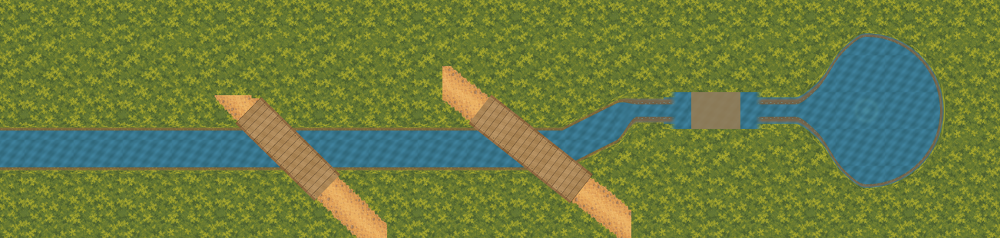
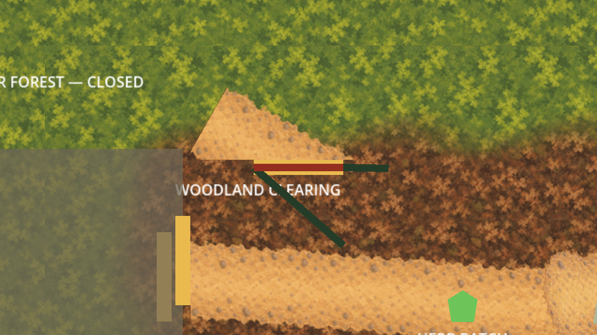

# Approved external channel and closed-forest art scopes

The owner selected both formerly deferred scopes on 2026-10-03 with
“the art scopes are approved”. [scope-authorization.json](scope-authorization.json)
records implementation authority for these external proofs. It records neither visual
acceptance of the new results nor runtime, layout or physical promotion authority.
The clean starting head is `18894f81d836a380a3642ec481b264baaccba6aa`.

## Whole channel



The full [1x composition](channel/review/full-1x.png) covers world `(-64,212)` through
`(2540,832)`. It assembles the accepted outlet, B2, B1, local blue-fringe join, retained
Stream crossing and curved spring. The uncovered western runs use exact absolute-world
water/ground phase and the existing 32-to-16px BOX-filtered banks. The leftmost 64px
are a water-only off-world reference; the physical world boundary stays closed.

Every accepted local source remains byte-identical. The assembled B1 view differs only
where the already accepted join supersedes its last 64×256 pixels. The complete 128×256
accepted join is pasted unchanged at `(1536,384)`. B2, outlet and curved spring joined
views reproduce exactly, including the spring's 384px basin at `(2192,500)` and exact
32px inlet. Source/manifests/masters are preserved, rather than repainted or re-exported.

The retained segment reconstructs the authored water UVs, western/eastern bank regions,
mirrored caps and central `StreamCrossingArea` colour. It is a CPU recipe reconstruction,
not a Godot scene capture or a GPU colour-parity claim. The previously accepted local
fringe correction ends at x=1664; the original retained bank/cap recipe resumes there.
The composition deliberately exposes that remaining appearance for owner assessment.
The bridges' local road tails retain their original proof crop bounds; this is a
channel assembly, not a complete terrain or route-network scene.

Review [B2 at 2x](channel/review/B2-2x.png), [B1/join at 2x](channel/review/B1-2x.png),
[retained crossing at 2x](channel/review/retained-crossing-2x.png) and
[spring at 2x](channel/review/spring-2x.png). [Engineering](channel/review/engineering.png)
locates the assembly interfaces. [The editable master](channel/masters/composition.ora)
retains eight source-composition layers at exact nearest 2x scale, with independent
positions; nearest enlargement adds no painted detail. [Manifest](channel/manifest.json)
binds sources, outputs, draw order and master. [Evidence](channel/evidence.json) records limits.

## Clearing–Closed Deeper Forest Path



The live centreline is `(1000,350)`–`(650,150)`, with a 96px route width. It intersects the
Clearing's north edge at `(737.5,200)`, 6.5px west of the existing gate centre `(744,200)`.
The physical gate spans x=696..792, and its 8px band and two 84px approach sides remain
owned by the existing C# scene/layout. Their files and physical state are unchanged.

The unchanged [raw-strip reference](forest/captures/raw-gate-2.0x-wide.png) samples the
retained straight-path texture through the frozen finite-strip renderer. It visibly
covers the accepted Clearing interior. The separate bounded candidate removes 26,578
visible overlay pixels: all y≥196 pixels and gate-port shoulder pixels at y=192..196
outside x=696..792. Every remaining source texel is unchanged, and transparent RGB is zero.
The original unbounded strip stays as failed feasibility evidence; the owner has not
rejected or accepted either new view.

This candidate addresses the **closed side** of the route. It adds no texture inside the
Clearing or over the gate band. The disposable candidate scenes hide the full greybox
route line, as the earlier path proofs do; the retained approach outlines and visibly
closed collision-backed gate remain. That presentation-only comparison does not change
ordinary startup, near-side navigation, Forester access, saved state or gate semantics.
The clipping is deliberately visible at the gate and still needs owner assessment.

The 54 [captures](forest/captures/) retain three stages (ordinary reference, raw strip,
bounded strip), three targets, three zooms (0.8x/1x/2x), and wide/tall frames (1280×720,
1280×827). [Capture evidence](forest/capture-evidence.json) binds every PNG. The explicit
capture script stamps its input manifest and both overlay digests before output is
bound, rejecting stale captures. It forces a rendering draw to avoid waiting forever
for `frame_post_draw` when macOS obscures the window. It never packs or saves the scene.

[The 2x master](forest/masters/composition.ora) contains the exact bounded source strip,
with export/master parity. [Manifest](forest/manifest.json) and [evidence](forest/evidence.json)
bind provenance, geometry and clipping. These remain external artifacts; production
still has 83 exports and 34 masters.

## Verification and review

```sh
/opt/homebrew/bin/python3 art-direction/approved-external-compositions/tools/channel.py
/opt/homebrew/bin/python3 art-direction/approved-external-compositions/tools/forest.py --check-captures
/opt/homebrew/bin/python3 art-direction/approved-external-compositions/tools/check_rejections.py
/opt/homebrew/bin/python3 art-direction/approved-external-compositions/tools/check_capture_differences.py
/opt/homebrew/bin/python3 -c 'import sys; sys.path.insert(0,"art-direction/approved-external-compositions/tools"); import common; common.predecessors()'
PATH=/opt/homebrew/bin:$PATH ./scripts/quality.sh
```

Rebuild only these external artifacts with `channel.py --build` and `forest.py --build`.
If renderer/overlay inputs change, run the explicit `tools/capture_forest.gd` with Godot
Compatibility, then `forest.py --record-captures`; stale capture context is rejected.
An ordinary validation run never rewrites the proof artifacts.

[baseline.json](baseline.json) protects all 4,068 predecessor files, including every
accepted runtime/proof source and historical record. Only this new folder, the requested
handover edit and `.DS_Store` metadata are excluded. The wrapper verifies the historical
join audit inventory is a preserved subset, then reproduces its outlet, curved spring,
join and fringe artifacts while substituting only the frozen scope audit. Never rewrite
historical inventories to accommodate successors.

Review corrected the disposable greybox-line treatment, replaced a vacuous opaque
centreline check with independent full water/bank/ground texel checks, and added capture
input stamps. Thirteen in-memory mutations reject water/bank gaps, UV drift, changed
bridge/join/crossing/spring pixels, Clearing/gate intrusion, hidden RGB, changed source
texels and an unbounded strip offered as the bounded result. Independent camera
projection confines all 18 raw/bounded capture differences to the clip footprint.
Both new results were visually inspected; owner visual acceptance remains pending.
Full host quality passed: zero-warning build, all 5,033 tests, asset/scenario validators,
all credential-free Godot smokes and Compatibility launch. The sandbox run passed the
build/tests but crashed in Godot log rotation; the identical host retry passed. The
initial sandbox capture launch also crashed; authorized host captures completed.

## Next checkpoint

Assess the whole-channel view first, then the bounded forest view. Any requested
correction should be a separate external successor preserving these references and
accepted local views. No production texture/import, `Main.tscn`, physical owner, layout,
scenario, UI, audio, release or signing promotion follows from scope approval.
