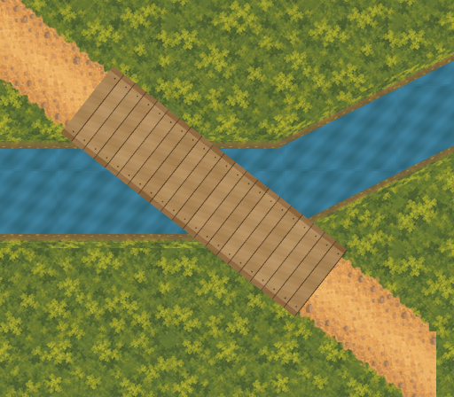

# B1 bridge and joined-bank external proof

One external candidate for Woodland–Village Edge against the visually accepted
[western watercourse proposal](../western-watercourse-proposal/README.md), based on
`d3b04355a3c0308c46d6ae1f588f8c64ff1e10f0`. Visual assessment is pending. No layout,
physical, runtime, scenario, production-manifest or Godot import change is implemented.



This is a local external composition, not a scene capture. The original deterministic
transverse timber-plank deck is rail-free. Flush edge boards and fasteners are painted
inside its full width; they are not obstacles. No posts, railings or side shadows extend
into the retained corridor or nearby wall. This candidate makes no production-art,
human accessibility, pacing, gameplay or traversal acceptance claim.

## Retained geometry and source provenance

The exact centre is `(1318.181818,600)`, deck 96px across by 336px along the retained
`edge-clearing` centreline. The local review canvas is 512×448 at world origin `(1088,384)`.
The water polygon and 16px vertical bank allowance are taken from the accepted external
proposal, including its southwest ramp starting at x=1400. Bank depth along the ramp is
therefore a vertical planning depth, not a constant normal-distance production shoreline.

Source hashes are in [manifest.json](manifest.json) and [evidence.json](evidence.json).
The accepted `woodland-village-edge-path.png` is read at its original `(944,288)` origin.
The quiet-moss ground and repeatable water retain their absolute-world tile phase.
Existing 32px bank art is adapted only in this external composition to the proposed 16px
bank envelope. Banks end at the exact deck polygon, leaving the entire 96px corridor
open; both shores rejoin beyond the deck without gaps. All source files remain byte-identical.

[masters/b1-joined.ora](masters/b1-joined.ora) is a reproducible 1024×896 editable 2x
OpenRaster master with separate ground, unchanged road, proposed water, proposed banks
and deck layers in that back-to-front order. Each layer has its own 1x RGBA export.
`joined.png` composites those exports in the same order. Exports normalize fully transparent
RGB to zero. The repository's existing OpenRaster writer is reused without changing its
production pipeline. The 83 production exports and 34 production masters remain intact;
this proof's six exports and one master are separate, external artifacts.

## Feasibility measurements and limits

| Check | Result |
| --- | ---: |
| Accepted road pixels beneath the water/bank envelope, fully covered by deck | 16,805 |
| Retained 8px navigation-cell centres over proposed water, inside deck | 225 |
| Retained cell centres across proposed water plus banks, inside deck opening | 295 |
| Minimum dry-bank reach across the complete deck end width | 2.051px vertically |
| Deck to accepted conservative Clearing wall envelope at y=454 | 4.463px vertically |
| Horizontal north bank to that wall envelope | 82px vertically |
| Affected fringe cells with corners outside deck | 31 |
| Maximum transverse cell-corner protrusion | 5.245px |

The dry abutment check covers both corners of each deck end, including the eastern
south-bank ramp. Because shore and end edges are piecewise linear, these extrema cover
the full end width in this bounded geometry. The very small 2.051px dry reach and 4.463px
wall separation leave little room for later decorative supports, shadows or enlargement.
The wall measure preserves the parent proposal's conservative 8px planning envelope;
it does not rewrite the runtime's retained Clearing boundary or 96px physical opening.

**Physical feasibility is limited to the existing cell centres and continuous 96px
corridor.** Fringe cell squares extend outside that corridor. A future promotion must
reconcile those edges and actor clearance with water/bank collision exclusions through
separate named physical approval and validation. There is currently no western-water
collision at B1; drawing a bridge would not establish that authority. No existing route,
Clearing opening, collision shape or navigation polygon is changed by this proof.

[The engineering overlay](review/engineering.png) labels the deck envelope and wall
planning edge. [The retained road comparison](review/retained-road.png) omits proposed
water, banks and deck. Unannotated candidates are provided at [0.8x](review/joined-0.8x.png),
[1.0x](review/joined-1.0x.png) and [2.0x](review/joined-2.0x.png); the 2x review uses nearest
scaling to expose 1x raster edges. These are external zoom reviews, not live camera views.

## Reproduction, scope and review

```sh
/opt/homebrew/bin/python3 art-direction/b1-bridge-proof/tools/proof.py --build
/opt/homebrew/bin/python3 art-direction/b1-bridge-proof/tools/proof.py
/opt/homebrew/bin/python3 art-direction/b1-bridge-proof/tools/check_rejections.py
/opt/homebrew/bin/python3 art-direction/production-proof/corrected/tools/validate_stream_laundry_path.py --check-captures --check-promotion-scope
PATH=/opt/homebrew/bin:$PATH ./scripts/quality.sh
```

[baseline.json](baseline.json) freezes all 3,920 pre-existing tracked authored files,
excluding only the explicitly editable `HANDOVER.md` and Finder `.DS_Store` metadata.
The new verifier checks their hashes and inventory, rejects additions outside this proof,
regenerates all raster bytes and the master in a temporary directory, and checks manifest,
measurements, complete bank joins, every accepted road pixel, affected physical-cell
centres, deck mask, abutments, draw order and OpenRaster dimensions/layer stack.

The parent proposal's original verifier passed before this folder was tracked, preserving
all of its 3,912 frozen files. That frozen inventory check intentionally rejects newly
tracked files outside its own proposal folder. After publication, use this proof's broader
3,920-file preservation verifier; do not rewrite the parent's frozen evidence to accommodate
these new artifacts. The accepted Stream–Laundry captures and promotion-scope check pass.

Session code review corrected the declared draw-order list (excluding the finished
composition itself), required full-bank continuity rather than only endpoint checks,
handled the retained source bank's intentional partial alpha, and measured fringe cell
corners instead of treating centre containment as full-cell physical coverage. Four
in-memory mutation checks reject exposed accepted roads, missing banks, bank intrusion
and wrong draw order without modifying any source or runtime file. The 1x candidate and
engineering composition were visually inspected. No further implementation issue was
found; owner visual assessment and future physical acceptance remain separate gates.

Full host quality passed: all asset validators, formatting, zero-warning build, 5,033 tests,
scenario validation, complete credential-free Godot smokes and Compatibility graphical launch.
The sandbox run passed through tests/scenario validation but failed in Godot’s restricted log
directory; the identical host retry passed without product changes.

## Exact next slice

Assess B1's external views: joined shores, full-width rail-free deck, both dry abutments,
Clearing-wall separation and fit to the unchanged accepted road. If the owner requests a
correction, make only that bounded external B1 correction and retain this candidate as
evidence. Do not proceed to B2, source/outlet art or Clearing–Closed Deeper Forest Path
proof until B1 is assessed. Visual acceptance alone does not authorize promotion; obtain
separate named layout/runtime/physical approval and its visual checkpoints before that work.
