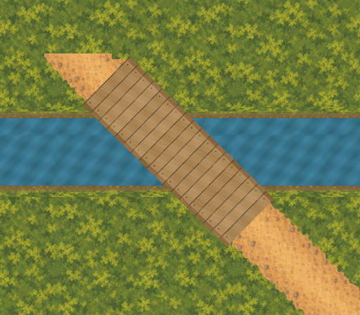

# B2 bridge and joined-bank external proof

One bounded external candidate for Shrine–Southern Road against the accepted
[western-watercourse overview](../western-watercourse-proposal/README.md), based on
`4ddce3e428402769d5954cfbdf14f88ff85d49f7`. B2 visual assessment is pending. No runtime,
layout, physical, production-manifest, scenario or Godot import change is implemented.



The owner said “Perfect!” on 2026-10-03 after B1's external 1x composition was shown.
[b1-visual-acceptance.json](b1-visual-acceptance.json) binds that bounded visual acceptance
to the exact shown PNG digest. It grants no layout/runtime/physical promotion authority.
The original B1 proof, including its historical pending-status records, stays immutable;
this record and the handover carry the subsequent acceptance forward.

## Geometry, sources and artifacts

The exact B2 centre is `(685.454545,600)`, with a 96px-wide, 288px-long deck along the
retained `shrine-road` centreline. The local review canvas is 512×448 at world origin
`(432,384)`. Proposed water occupies y=552..648, with 16px vertical bank allowances.
The accepted `shrine-southern-road-path.png` is read at its original `(432,400)` origin;
its source bytes, Shrine endpoint blend and accepted junction triangle are unchanged.
The local crop shows the retained northern road tip; surrounding Shrine structures are
omitted. The separate accepted endpoint patch is at `(1400,1280)`, outside B2’s crop.

The external deck retains B1's deterministic transverse timber design, flush edge boards
and painted fasteners, adapted to B2's shorter planning length. There are no rails,
posts, side shadows or raised edge obstacles. The full 96px corridor remains open.
Existing quiet-moss ground and repeatable water retain absolute-world tile phase.
Existing 32px bank art is adapted only in this proof to the 16px planning envelope;
both banks end at the full deck footprint and join continuously beyond its opening.

[manifest.json](manifest.json) records source, acceptance-record and artifact hashes.
[masters/b2-joined.ora](masters/b2-joined.ora) is a reproducible 1024×896 editable 2x
OpenRaster master. Ground, unchanged road, water, banks and deck are separate layers,
ordered back to front. Six independent 1x RGBA exports include their joined composition.
Transparent RGB is zeroed. The existing OpenRaster writer is reused; B1's frozen verifier
is preserved, while this proof's independent verifier uses B2's length and origin.
Production remains at 83 exports and 34 masters; these six exports and one master are external.

## Measurements and physical limits

| Check | Result |
| --- | ---: |
| Accepted road pixels under the water/bank envelope, fully covered | 15,377 |
| Retained 8px cell centres over water, inside deck | 204 |
| Retained cell centres over water plus banks, inside deck opening | 273 |
| Minimum dry abutment reach across each complete deck end | 2.656px vertically |
| Deck to Clearing's accepted planning wall envelope at y=454 | 10.853px vertically |
| Horizontal north bank to that envelope | 82px vertically |
| Affected fringe cells with corners outside deck | 32 |
| Maximum transverse cell-corner protrusion | 5.560px |

The full accepted road alpha footprint is checked, not just the centreline. Its measured
maximum half-width is 47.158px, leaving only 0.842px transverse margin inside the 48px
half-deck. Both corners of each deck end reach dry ground beyond the bank envelope;
straight end and shore edges make those the full-width extrema. The 2.656px minimum
reach leaves little room for later supports or enlargements. Clearing's planning wall
edge is shown only within its actual x=600..1248 extent, rather than across the whole crop.

**This proves cell-centre and continuous-corridor feasibility only.** Thirty-two fringe
cell squares extend beyond the deck. A future physical promotion must reconcile those
edges and actor clearance with collision exclusions. The existing western crossing has
no water collision; this external drawing establishes none. The current navigation,
physical routes, Shrine opening, Clearing wall and all source assets are preserved.

This is a local composition, not a scene capture. It grants no gameplay, pacing, human
accessibility, production-art or traversal acceptance. Review candidates are provided at
[0.8x](review/joined-0.8x.png), [1.0x](review/joined-1.0x.png) and [2.0x](review/joined-2.0x.png).
The 2x view uses nearest scaling to expose 1x raster edges. The separate
[engineering overlay](review/engineering.png) labels deck and wall planning envelopes;
[retained-road.png](review/retained-road.png) omits proposed water, banks and deck.

## Reproduction and session review

```sh
/opt/homebrew/bin/python3 art-direction/b2-bridge-proof/tools/proof.py --build
/opt/homebrew/bin/python3 art-direction/b2-bridge-proof/tools/proof.py
/opt/homebrew/bin/python3 art-direction/b2-bridge-proof/tools/check_rejections.py
/opt/homebrew/bin/python3 art-direction/production-proof/corrected/tools/validate_stream_laundry_path.py --check-captures --check-promotion-scope
PATH=/opt/homebrew/bin:$PATH ./scripts/quality.sh
```

[baseline.json](baseline.json) freezes all 3,938 pre-existing tracked authored files,
including B1 and the watercourse proposal. Only this new proof, the requested handover
update and Finder `.DS_Store` metadata are excluded. The verifier checks hashes and
inventory, rejects additions outside its scope, reproduces PNG/master bytes and measures
complete joins, accepted road coverage, route-cell centres and corners, dry abutments,
mask geometry and draw order. It binds the B1 acceptance to unchanged shown-image bytes.

Four in-memory mutation checks reject uncovered accepted roads, a missing bank join,
bank intrusion and incorrect draw order. Session review removed inherited B1 length
constants from B2's mask and abutment checks and clipped the planning-wall overlay to
its real horizontal extent. The review views and source/digest preservation were inspected.

B1's verifier passed before B2 was tracked, retaining its 3,920-file baseline. Its original
frozen inventory now rejects this additional tracked folder, as the parent watercourse
verifier already does for B1. Use B2's broader preservation verifier after publication;
do not rewrite either predecessor's frozen evidence to accommodate new artifacts.
The accepted Stream–Laundry capture and promotion-scope verifier passes.

Full host quality passed: all asset validators, formatting, zero-warning build, 5,033 tests,
scenario validation, the complete credential-free Godot smoke suite and Compatibility launch.
The host run used the already-established workaround for Godot’s sandbox-restricted log
directory; no product code or validation command was changed for that restriction.

## Exact next slice

Assess B2's shown external candidate: joined shores, rail-free width, both dry abutments,
Clearing-wall separation and unchanged accepted-road fit. If the owner requests a
correction, make only that external B2 correction and retain this candidate as evidence.
Defer source/outlet production art and Clearing–Closed Deeper Forest Path proof until
B2 is assessed. Visual acceptance alone grants no named layout/runtime/physical promotion;
obtain separate approval and its visual checkpoints before promotion.
