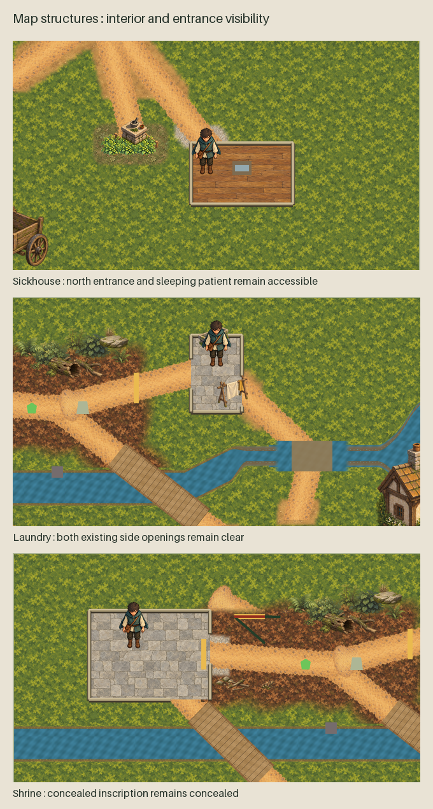

# Buildings fitted to ordinary gameplay

24 October 2026 (Australia/Brisbane). The owner requested: “continue with fitting
exsting artwork into the gameplay - start wit the buildings”. The exact request and
finite implementation boundary are recorded in [authority.json](authority.json).

Ordinary `Main.tscn` now instances `MapStructuresPresentation.tscn`. The complete group
covers the sickhouse, abandoned laundry and its trough/drying rack, old shrine,
abandoned wagon, and a village meeting-house backdrop north of the existing square.
The village building is scenery; it adds no new room or interaction.


## Existing artwork and gameplay fit

Six textures are exact copies of owner-approved structure exports. The north-entry
sickhouse exterior and two floor textures are reused unchanged from the existing
`cfed60a8` building branch. No new image generation or repainting took place here.
Their source images, layered editable 2x masters, original prompts and original
asset manifest are retained in [the recovered provenance package](../map-structures-runtime/manifest.json).
The three earlier derived assets and the new runtime presentation await owner visual
acceptance; source approval is not claimed for them.

The sickhouse, laundry and shrine exteriors cut away when a visible party member approaches their
painted silhouette or enters their existing room/approach bounds. This includes a companion travelling alone;
an absent companion does not reveal a building. Leaving restores each
exterior independently. Current scene-source layouts supply the room bounds rather than
copied coordinates. Painted cutaway floors follow those bounds; low walls follow the
actual collision segments and leave the existing entrances open. The sickhouse bed and
patient show inside the cutaway and do not leak through its closed exterior. Their
existing artwork is retained. Roofs and floors sit below actors and interactables.

Retired greybox fills/route outlines are hidden only by the presentation owner, and
existing site labels are moved below the building paint. No collision shape, navigation
owner, entrance, clue/discovery state, interaction, save schema or gameplay action changes.
The shrine inscription remains concealed until its existing discovery flow reveals it.
Accepted ground, channel, forest, character and audio resources are unchanged.
`WholeChannelPresentation` remains the final child and the examination owner keeps its
immediately preceding position.



## Verification and review

[verification.json](verification.json) records completed checks, source bindings and
limits. The final full root `./quality.sh` passed all **218 stages with no retries**:
**6,181 solution tests** and **369 native smoke checks passed**, with three existing
quarantines. Its compressed summary, console output and current build/test/smoke logs
are retained under `checks/`. The earlier run was intentionally stopped during code
review to add companion cutaways; it is retained as interrupted evidence and is not
claimed as a full pass. The native regression checks nine player approach/interior/revisit positions and three
companion visits, absent-companion handling, independent
roof restoration, patient visibility, concealed evidence and unchanged physical owners.
It runs in the ordinary smoke suite alongside the provenance validator.

Twelve fresh native Main captures cover five exteriors, three cutaways at 1280×720,
the same three at 1280×827, and the whole-map context. The capture tool frames Main,
stops autonomous motion and suppresses UI/labels solely for these art review captures;
it installs no substitute paint. Inputs and image hashes are in
[capture-evidence.json](capture-evidence.json). These controlled views are not an owner
playthrough or a hardware/accessibility qualification. The ordinary UI remains in game.

Owner visual acceptance is pending. The Phase 4 fresh-profile playtest remains deferred
by this request; building integration does not close it or the wider terrain category.

## Reproduce

```sh
artifacts/quality-python/bin/python scripts/validate-building-gameplay.py
ALLRPCS_CHARACTER_MODEL_COMPOSITION_DISABLED=1 \
ALLRPCS_ORDINARY_PARTICIPATION_SMOKE_MODEL=1 \
godot --headless --path game --script "$PWD/scripts/check-building-gameplay.gd"
ALLRPCS_CHARACTER_MODEL_COMPOSITION_DISABLED=1 \
ALLRPCS_ORDINARY_PARTICIPATION_SMOKE_MODEL=1 \
godot --rendering-method gl_compatibility --path game \
  --script "$PWD/scripts/capture-building-gameplay.gd"
artifacts/quality-python/bin/python art-direction/buildings-gameplay-integration/build_review.py
./quality.sh
```

Full root quality is required for these product changes. Captures are current candidate
views; the capture tool refuses to overwrite an owner-accepted package. No executable
package, merge or release is included.
