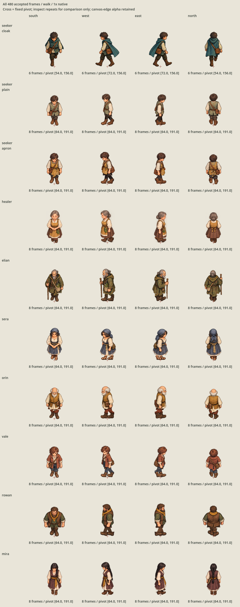
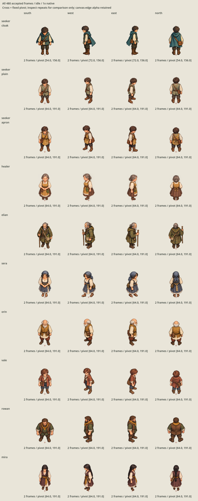
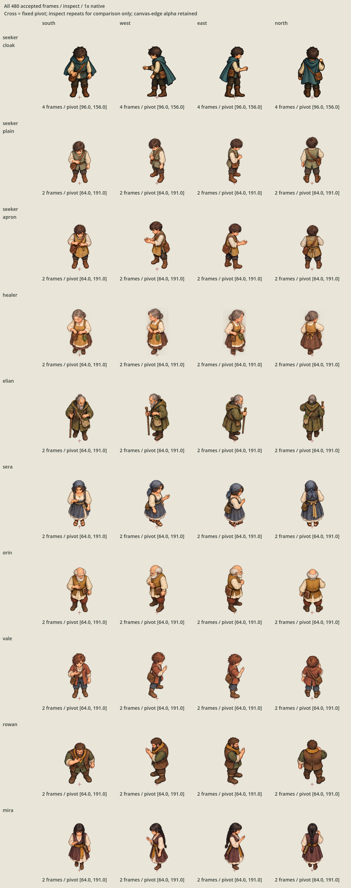

# Complete character animation import proof

The approved directional set is imported and registered in one isolated Godot proof:
**432 new accepted frames across nine families, plus 48 unchanged Seeker cloak frames**.
Ten independent SpriteFrames resources contain 120 animations. Source PNG bytes,
editable master hashes and decoded imported RGBA are unchanged. Artwork authority is
carried forward from [the original acceptance](../characters-batch/owner-acceptance.json).
No additional artwork approval is required for this proof.

## Complete comparison

Every preview contains all ten families and all four directions in the same order.
These are lossless animations of actual Godot Compatibility captures. The 36 retained
PNG samples cover every source frame; each decoded WebP frame equals its PNG capture.
Labels and crosses are proof overlays. The full-resolution 2× previews retain the
actual doubled native paint without shrinking the comparison to a game camera.

| Action | Native | 2× |
| --- | --- | --- |
| Idle | [Complete native loop](review/idle-1x.webp) | [Complete 2× loop](review/idle-2x.webp) |
| Inspect | [Complete native gestures](review/inspect-1x.webp) | [Complete 2× gestures](review/inspect-2x.webp) |
| Walk | [Complete native loops](review/walk-1x.webp) | [Complete 2× loops](review/walk-2x.webp) |





Run `godot --path game res://CharacterAnimationImportProof.tscn` for the interactive
proof. Choose idle, inspect or walk; select native/2× scale; pause and step complete
frame sequences. The walk cadence button compares the proposed 720 ms cycle against
the approved artwork preview's 800 ms cycle. Both use the same eight approved frames.
The inherited cloak remains at its existing 720 ms cadence. Scroll to see every role.

## Registration and cadence

[registration.json](registration.json) records exact provenance, measurements and
frame order. New frames retain the original 128×192 canvas and its proposed pivot
`(64,191)` throughout every direction/action; no individual frame is trimmed,
repainted, mirrored, scaled to match the cloak, or recentered to cancel authored bob.
The inherited cloak keeps the manifest pivot `(width/2,156)` with its original
108/144/192×168 canvases. Native sizes remain deliberately visible for comparison.

Alpha greater than 96 measures substantial paint, matching the original rig's
measurement threshold. The last 24 canvas rows measure lower support, which may
include clothing/accessories and is not a collision silhouette or anatomical sole.
The table gives the lowest substantial painted row relative to the fixed pivot.
Horizontal distance from the pivot to this measured support is at most three pixels.

| Family | Frames | Canvas sizes | Painted bottom relative to pivot |
| --- | --- | --- | --- |
| seeker-cloak | 48 | 108×168 / 144×168 / 192×168 | -2…-1 px |
| seeker-plain | 48 | 128×192 | -2…0 px |
| seeker-apron | 48 | 128×192 | -2…0 px |
| healer | 48 | 128×192 | -3…0 px |
| elian | 48 | 128×192 | -2…0 px |
| sera | 48 | 128×192 | -2…0 px |
| orin | 48 | 128×192 | -3…0 px |
| vale | 48 | 128×192 | -3…0 px |
| rowan | 48 | 128×192 | -3…0 px |
| mira | 48 | 128×192 | -2…0 px |

422 of 480 frames have nonzero alpha on their bottom canvas edge; none touches the
top or either side. This is retained approved source content, not introduced import
clipping. Source crop limits, restrained arm motion, rigid accessories and cutout
articulation remain the original artwork's limitations. The three-pixel contact
measurement is a presentation registration check, not physical or traversal approval.

- Idle: two frames × 600 ms, retaining the existing Seeker cadence (1,200 ms cycle).
- Walk: eight new phases × 90 ms, matching the existing six × 120 ms cloak cycle
  (720 ms). The optional 100 ms/frame comparison retains the 800 ms artwork preview.
  This proposal does not claim matching movement distance, footstep timing or speed.
- Inspect: two new frames × 160 ms, versus the inherited four × 160 ms reach.
  Resources remain non-looping. The proof repeats them for comparison only, without
  adding interaction, sleeping, waking or recovery behavior.

## Exact import recipe and verification

`build.py` copies approved PNGs without decoding/re-encoding them and references
retained editable ORAs by exact path/hash. It creates independent canonical path-owned
Godot UIDs, explicit lossless sidecars and complete ordered SpriteFrames resources.
Mipmaps, alpha-border RGB rewriting, premultiplication, channel changes and size
limits are disabled so imported RGBA remains exact. Linear filtering matches the
existing Seeker presentation. Verified proof outputs refuse accidental rebuilds;
reproduce them in a disposable destination:

```sh
/opt/homebrew/bin/python3 art-direction/character-animation-import-proof/build.py --output-root /tmp/character-proof-replay
/opt/homebrew/bin/python3 scripts/validate-character-animation-import-proof.py --replay
/opt/homebrew/bin/python3 art-direction/character-animation-import-proof/verify.py --attempt a-new-check --evidence-root /tmp/character-proof-checks
```

Use `--capture` on the last command for a desktop-rendered check. New attempts refuse
existing evidence paths; use an evidence root outside the frozen package for rechecks.
`game/CharacterAnimationImportProofCheck.gd` checks decoded texture pixels, canonical
independent UIDs, exact frame order/duration/loop semantics and actual playback of
all 120 animations. Every animation completes at least two cycles or gestures,
visits every frame in order and keeps the same pivot. Cold imports use the published
project configuration in a disposable copy, changing only its startup scene.

[Final evidence](evidence/final/run.json) records 480 byte-stable sidecars and all
actual imported-texture/playback checks. [The original artwork check](evidence/approved-source/run.json)
passes unchanged in a disposable copy excluding only local `.DS_Store` and Python
cache files; the live package is untouched. The initial sandbox editor-settings
failure and pre-final trailing-newline mismatch remain in `evidence/`.
[Review notes](session-review.json) and [verification bindings](verification.json)
record the consolidated review and all retained inputs/previews.

All existing ordinary product/CI files, including the unrelated local
`game/project.godot` editor rewrite, match [the boundary snapshot](boundary-inputs.json).
The preceding [5,033-test product evidence](../woodland-clearing-dressing-runtime-promotion/verification.json)
is retained; this pure GDScript proof adds no C# or ordinary runtime/CI integration.
Fresh checks cover the new imports, scene, playback, captures and recipe. No claim
is made that the full product suite was rerun for this isolated proof.

## Completion and remaining authority

The isolated import/registration deliverable is complete. Main integration requires
an explicit owner request naming characters/appearances, placements, scale and
cadence, followed by confirmation of the actual proposed runtime views. That future
scope would also need its own controller/physical-semantic validation. This proof
adds no Main, gameplay, collision/navigation, scenario, provider, functional UI,
audio or release behavior. Character designs, portraits and sleeping/recovery poses
remain at their existing scope. Git publication has not been authorized in this chat.

The persistent ledger closes this proof; the next missing roadmap deliverable is
Phase 9.3's audio direction and dynamic-range policy. Neither this proof nor that
queue choice declares all Phase 9.2 art validation or runtime integration complete.
