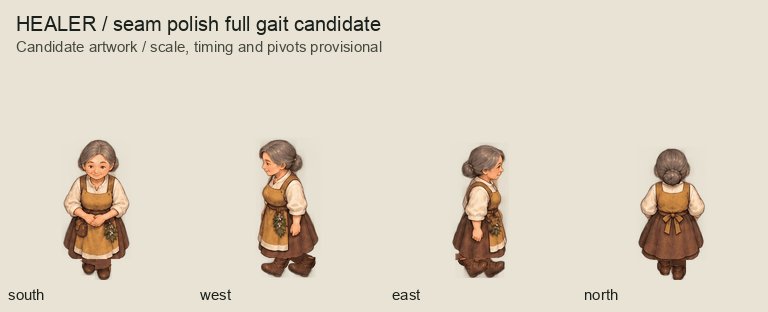
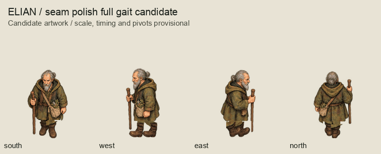
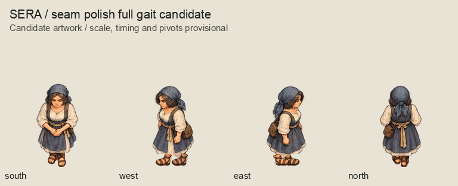
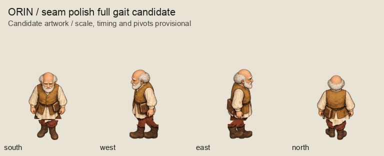
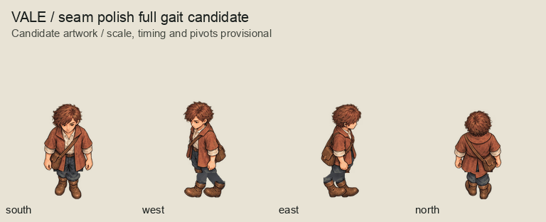
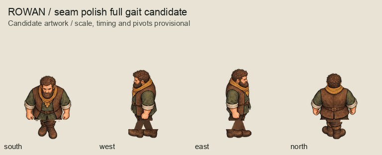
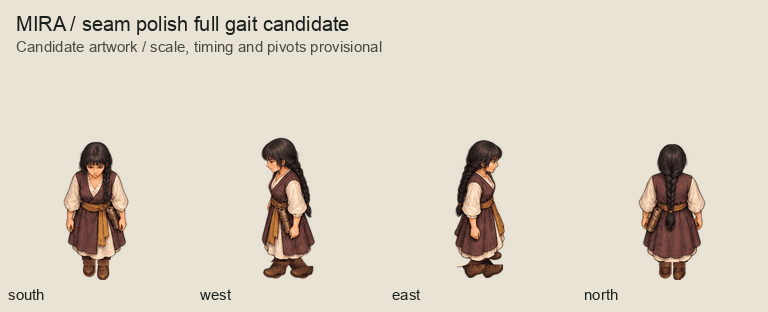
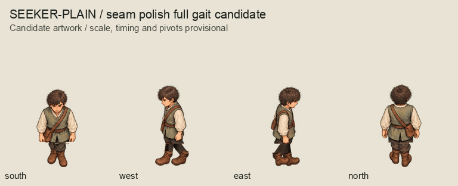
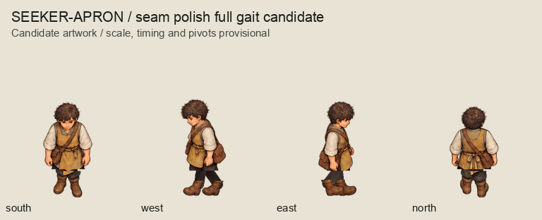
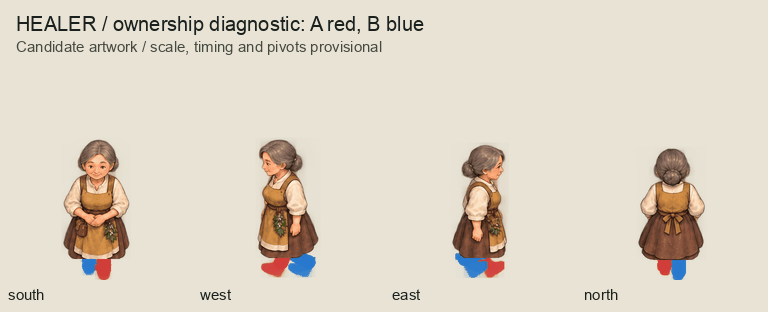

# Walk seam-polish candidates

This separate 2026-10-04 candidate pass preserves the first mechanical series in
[`../walk-rig/`](../walk-rig/README.md). Owner artwork acceptance remains pending.
There are 288 transparent frames, 288 editable exact 2x OpenRaster masters,
nine family contact boards, nine eight-phase full-loop GIFs and one leg diagnostic.
This replaces the same 144 incomplete initial walking studies as the first rig;
the active new character count remains 456, not the sum of both rig snapshots.

Side-view review found that toe-centered boot crops put connectors away from the
actual boot shafts, producing abrupt cuts and ankle gaps. The new connectors
meet the upper shaft and overlap the concealed hip, using two rounded segments
and a small swing-knee bend. Boot outlines remain rigid and keep their facing.
Elian's west foot crop also contained a staff strip touching the toe; a measured
alpha mask removes the exposed strip above the retained toe contour. The staff retained in the torso stays
attached to the hand. A repeating connector-texture trial was rejected during
authoring; the final pass stretches one local paint patch without tiling it.

The series still uses restrained torso bob, neutral arms and rigid accessories.
It is a simple cutout gait, not a complete articulated character rig. Occluded
side limbs reuse visible-side paint. Clothing seams, apparent sliding, proportions,
arm motion, staff usage and directional accessory continuity remain owner review
concerns. Timing remains 100 ms per frame (800 ms per loop); camera and pivots are
provisional. No runtime assets, scenes or physical/gameplay authority change.

## Complete collective review

Each animation shows south, west, east and north simultaneously. Each family also
has a labelled `<role>.png` board containing all 32 poses.

Red is anatomical left (A), blue anatomical right (B); the diagnostic is not
production paint. Contact/swing alternates while each limb retains its ownership.

## Reproduction and checks

Run `python3 art-direction/characters-batch/polish_walk.py`, then
`python3 art-direction/characters-batch/inspect_walk_polish.py`.
The second command checks package coverage, RGBA/hashes, master/export parity,
unique decoded poses, alternating anatomical ownership and full GIF sequences.
It also re-renders all 36 loops, checks their endpoint closure, compares all 288
stored masters to the actual rendered pixels and verifies predecessor hashes.
These are authoring checks; consolidated artwork approval remains pending.

`inventory.json` binds source paint and phase metadata. `review-manifest.json`
binds this package and its authoring scripts; it does not record owner acceptance.
`predecessor-review-manifest.json` preserves the preceding parent review snapshot
before its script/document entries were refreshed. Both predecessors' artwork,
masters, reviews and sources remain byte-identical. Do not rebuild approved art.
The first rig's recorded parent script hashes remain historical; this candidate
binds the current shared scripts. A disposable replay reproduced all 596 original
generated files byte-for-byte after the writer refactor.
The OpenRaster masters contain merged paint and a blank correction layer, rather
than separately editable limbs. The script remains the reproducible rig source.

After owner feedback, revise as needed and freeze exact artwork acceptance plus
consolidated scoped validation. Only then continue to the complete herbs/remedies/
tools/scrolls/inscriptions/containers/clue-object artwork series. Runtime scope
approval and runtime visual confirmation remain separate checkpoints.
