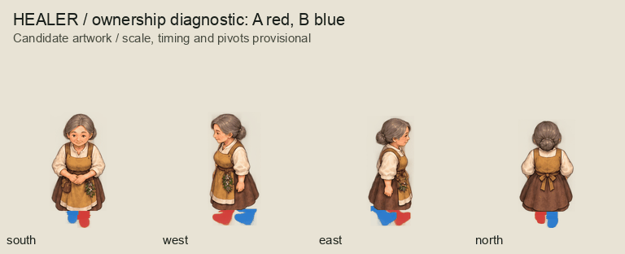

# Mechanical walk candidates

The owner explicitly authorized code-based cutout rigging on 2026-10-04:
“Yes, rig and render the walk cycles mechanically.” These candidates replace the
initial same-leading-foot stride studies for visual review. They have not received
owner artwork acceptance and do not change runtime assets.

There are **288 transparent frames and exact 2x OpenRaster masters**: nine
character/outfit families, four directions and eight phases per loop. Each leg
keeps its anatomical identity through contact, stance, passing and swing; opposite
contacts reverse the leading foot. The computed 360-degree endpoint is pixel-identical
to frame zero, without duplicating that endpoint in the eight-frame GIF.

This is a simple lower-limb cutout rig. Boots retain their authored shape and toe
direction. Painted connectors join them to concealed upper sockets, and the torso
has a modest bob. Arms retain the neutral pose; additional knee/arm articulation,
hem seams, foot proportions, apparent sliding and the overall cutout style need
visual review. The hidden side limb reuses the visible-side paint with a darker
value. Original generated sheets and initial masters remain unchanged.

## Full series for collective review

Each family also has a labelled `<role>.png` contact board with all 32 poses.

## Ownership diagnostic

Red is anatomical left (A); blue is anatomical right (B). Colors remain on the same
limb throughout the loop and across directions; this diagnostic is not production paint.

## Reproduction and evidence

Run `python3 art-direction/characters-batch/rig_walk.py`, then
`python3 art-direction/characters-batch/inspect_walk_rig.py`. The authoring checks
verify the 288-pair package, RGBA and exact master/export parity, source-paint hashes,
36 directional loops, eight distinct images per loop, alternating planted/swinging
limbs and complete GIF sequences. The renderer checks the actual pixel endpoint.

`inventory.json` records source master hashes, measured hems and each limb's phase,
travel, lift, draw order and paint bounds. Rig parameters remain in the reproducible
script; OpenRaster outputs contain merged raster paint and a blank correction layer.
`review-manifest.json` freezes this candidate snapshot, not owner acceptance.

Playback uses 100 ms per frame (an 800 ms loop); timing and final pivots remain
provisional. The diagnostic uses 180 ms to make ownership easier to inspect.
Named runtime scope approval and visual confirmation are still required before use.
