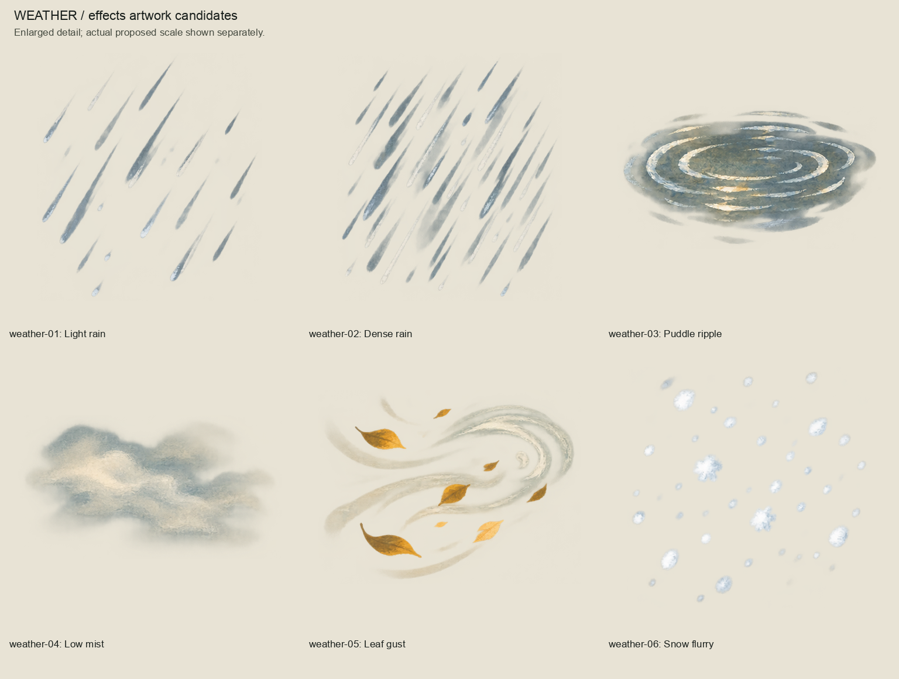
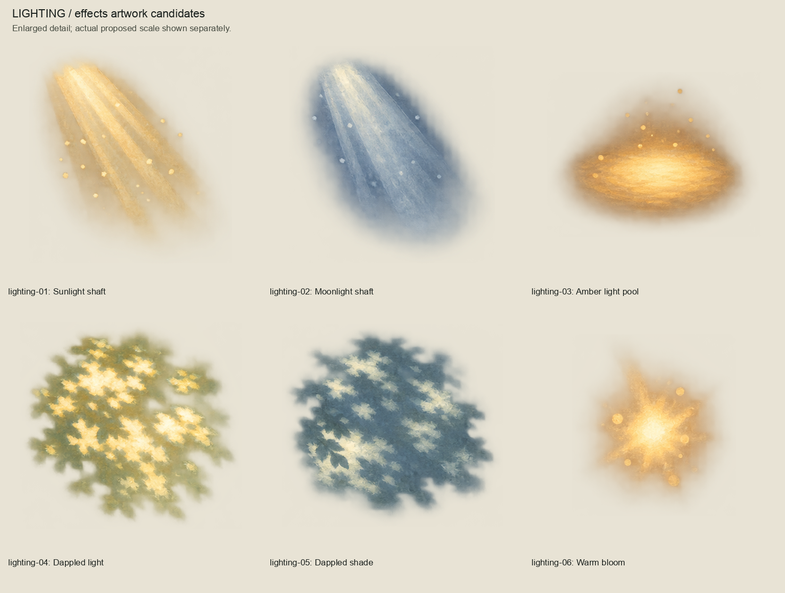
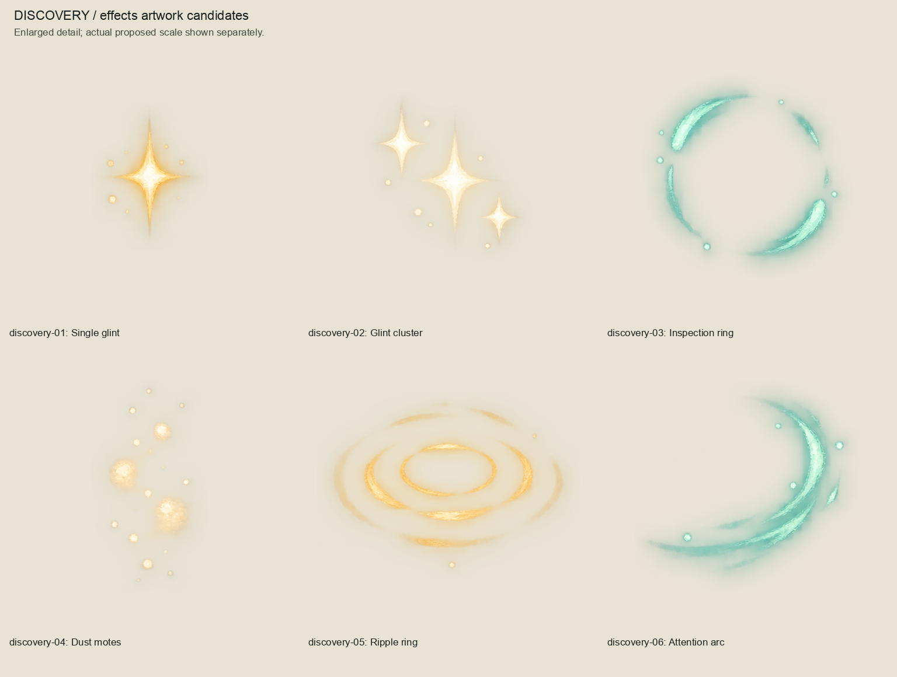
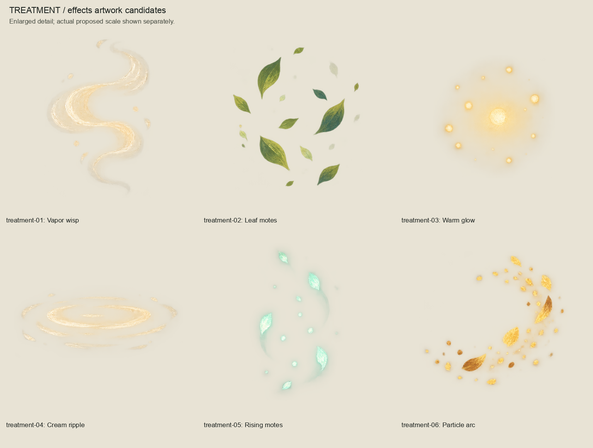
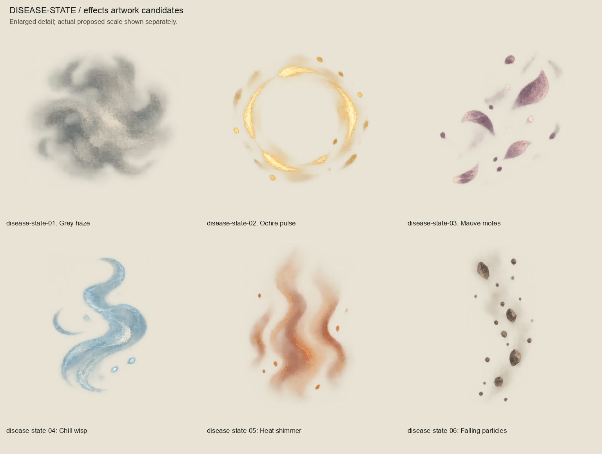
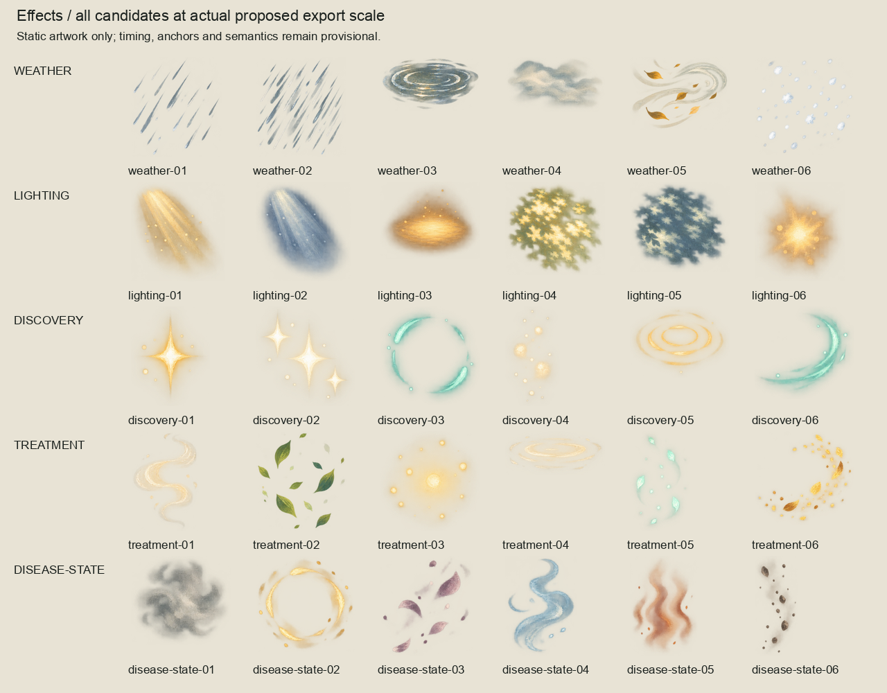
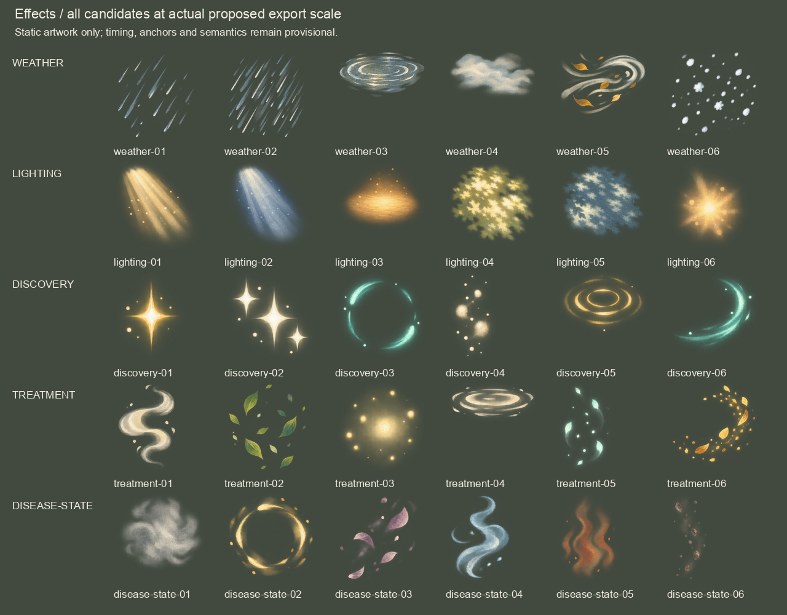
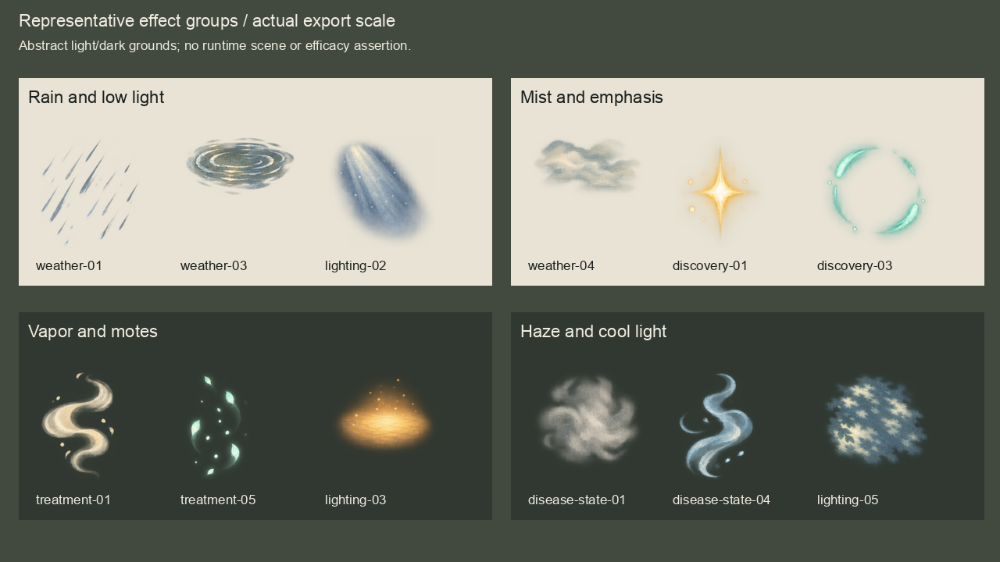

# Effects artwork batch 01

Complete external weather, lighting, discovery, treatment and disease-state series,
authored 2026-10-04 (Australia/Brisbane) with built-in image_gen.
**Owner approved the five displayed source sheets 2026-10-04.**
30 static painted candidates, editable 2x OpenRaster masters, five labelled family
boards, two full-series export-scale boards and a representative grouped composition.
No runtime integration or animation behavior.

## Families

## Proposed scale and groups

Both full-series boards show all 30 exports once at their actual exported dimensions.
Groups show selected effects side by side against abstract grounds; they are not
runtime captures, approved arrangements or demonstrations of treatment efficacy.
The proposed 144-pixel painted bounds and top-left anchors are provisional.
Opacity, colour-vision accessibility, timing, animation registration, blending,
tileability, gameplay mappings and runtime placement remain unverified.
Disease-state names identify generic paint shapes, not diagnoses, severity or symptoms.
Discovery effects establish no knowledge or clue content. Treatment effects establish
no dosage, administration, recovery or medicinal efficacy.

## Sources and reproduction

- `sources/`: five unchanged transparent generated sheets and tool provenance.
- `prompts.json`: exact prompts, transparency flag and approved style reference hash.
- `masters/`: 30 OpenRaster files at exactly twice their export dimensions. Each
  contains source paint and an empty Corrections layer; these editable raster masters
  do not reconstruct semantic layers or add source detail.
- `exports/`: padded transparent PNGs, downsampled from the masters.
- `inventory.json`: measured cells, exact crops, faint-pixel accounting and asset hashes.
- `review-manifest.json`: exact source, authoring, derivative and review-input hashes.
- `owner-acceptance.json`: approval of the exact five source sheets displayed in chat.
  Derivative exports, masters and boards were packaged afterwards; their technical
  reproduction checks do not claim that the owner separately reviewed those boards.
- `session-review.json` and `validation.json`: review fixes and scoped technical evidence.

The first equal-grid weather extraction crossed a mist edge at alpha 19. Its source
snapshot is retained in `evidence/weather-gutter-rejected.png`; the artwork itself
was preserved unchanged. Measured gutters correct the crop boundaries without repainting.
All pixels with alpha >= 8 are retained, with an eight-source-pixel crop margin.
Only distant pixels below alpha 8 can be excluded; counts and maximum alpha are
recorded per component. Retained pixels are never thresholded or repainted.

Rebuild using `/opt/homebrew/bin/python3 art-direction/effects-batch/build_review.py`;
inspect using `/opt/homebrew/bin/python3 art-direction/effects-batch/inspect_package.py`.
Approved packages are frozen; author a separate revision for changes.
Product/runtime/CI inputs are unchanged; preceding full-suite evidence remains in
`art-direction/woodland-environment-batch/validation.json`.
