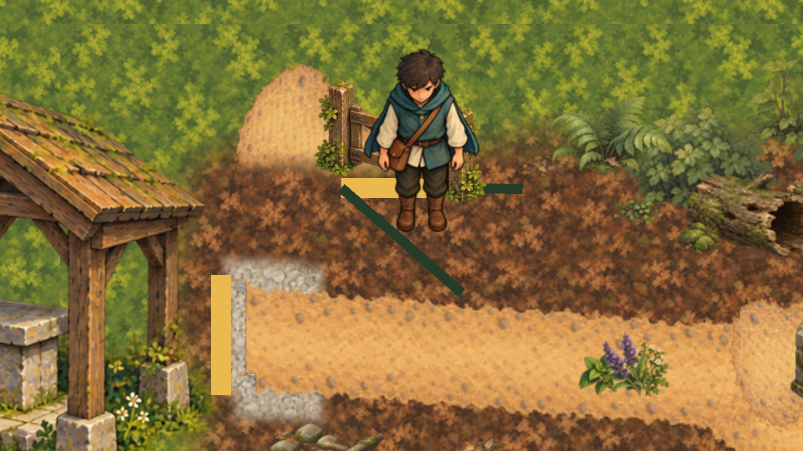
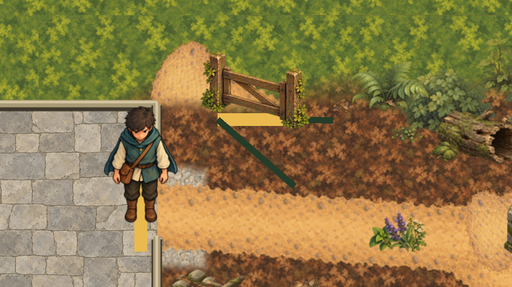

# Closed forest gate

7 November 2026 (Australia/Sydney). After merging PR #492, the owner closed the Healer reference-gait
slice ([acceptance](../../docs/superpowers/evidence/2026-11-07-healer-reference-gait-480-owner-acceptance.json)),
chose the next greybox marker and chose the closed deeper-forest gate. The owner's replies are in
[authority.json](authority.json).

## Runtime

The closed gate in `game/Main.tscn` was a red 8 px `Line2D` over its collision segment (696, 200)–(792, 200).
It now shows `game/art/runtime/structures/woodland-04.png`, a byte copy of the approved
[structures-batch](../structures-batch/README.md) "Forest gate" (bound by hash in its `owner-acceptance.json`).
No new artwork was made.

- The sprite `GateArt` is a child of `OpeningRegionClosedForestPathSceneSource/ClosedGate/Line2D`. The line keeps
  its points, width and visibility (older checks pin them) but draws nothing itself: its `self_modulate` alpha is 0.
  When the Forester's access opens the path, `TryInstallAccess` hides the line as before, and the gate art goes
  with it. No C# changed.
- The sprite is uncentred, scaled 3/7 so the 224 px between the post foot centres (export pixels (54, 180) and
  (278, 230)) becomes the 96 px opening. Its `offset` (-166, -205) puts the midpoint of the two post feet on the
  gate centre (744, 200). The art is painted at the batch's high-oblique angle, so the right post's foot is about
  21 px lower than the left's.
- Collision, approach boundaries, the gate marker and label, navigation, saves and the accepted forest-path
  terrain are unchanged. The gate blocks the Seeker south of it, and the Seeker's depth z is at least 1, so the
  Seeker always draws in front of the gate. The gate needs no place in `CharacterDepthOrderPresentation`.

Seen in the captures and left unchanged (outside this slice): the dark-green approach-boundary lines and yellow
opening polygons are still greybox. The accepted terrain's dirt path leaves the clearing a little west of the
gate's collision opening; the art makes that older offset visible. Tracked in #494.

## Checks

- `scripts/validate-forest-gate-art.py` checks the structures-batch acceptance binding, that the runtime PNG is
  byte-identical to its approved export and that its import is lossless, plus the captures, the capture script and
  the gate PNG against [capture-evidence.json](capture-evidence.json). It does not check the `Main.tscn` hash
  recorded there, because Main keeps changing after this slice; [verification.json](verification.json) pins it
  instead. It checks only those bytes (#471).
- `scripts/check-forest-gate-art.gd` checks the unchanged collision segment, the texture, that the line draws
  nothing while visible, that the post feet stand on the gate ends, no own draw order, that the Seeker at the
  gate draws in front, and that hiding the line by hand hides the art. The real opening path (Forester access
  through `TryInstallAccess`) is driven by `SeekerBackgroundRouteVariationSceneSmokeCheck`, which asserts the line
  is hidden afterwards; since the art is the line's child, that covers the art too.
- `scripts/capture-forest-gate-art.gd` writes the two `captures/` and [capture-evidence.json](capture-evidence.json)
  (needs a renderer; run without `--headless`). It hides every Control, so world labels are not shown.

Results are in [verification.json](verification.json).
