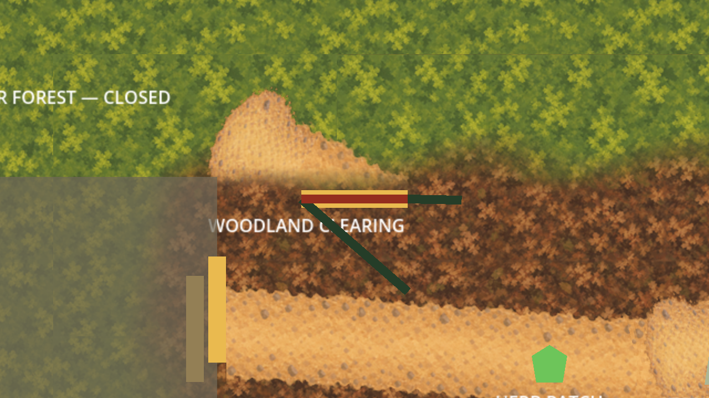

# Rounded closed-forest path runtime promotion

The owner approved the [named scope](../forest-path-ending-correction/runtime-promotion-scope.md)
on 2026-10-03 after accepting the [external views](../forest-path-ending-correction/owner-acceptance.json).
The owner confirmed the completed runtime views on 2026-10-03 ("confirmed");
[owner-runtime-acceptance.json](owner-runtime-acceptance.json) binds the two displayed views
and the 18-view capture evidence. The reviewed promotion is authorized for direct-main publication. The whole-channel composition remains an accepted external proof only.

One exact `terrain.clearing_closed_forest_path` export (552×384) and editable 1104×768
OpenRaster master raise production totals to 84 exports and 35 masters. The production,
isolated-proof and runtime PNGs share SHA-256
`3984916a864042f54b5ccbf0d745c150f7807d064a44f9022f96f83b7d081451`.
Its retained rounded-end/alpha-easing recipe reproduces exact accepted RGBA bytes.
Imports are lossless, mipmap-free and independently identified, with alpha-border
processing and premultiplication disabled.

The final `GreyboxNavigation/RoutePresentation/ClosedForestPath` sprite uses centre
`(796,224)`, identity transform and z=-75. It replaces only the 96px visual line from
`(1000,350)` to `(650,150)`. Existing sprite order, all other pixels and physical owners
remain unchanged. The texture is **closed-side only**: y≥196 is transparent, and the
near side inside the Clearing remains untextured. Gate `(744,200)`, collision, outlines,
marker and existing Forester-access behavior remain owned by the original scene source.
Capture-only framing and HUD/Seeker hiding never enter ordinary startup.

## Runtime views

All 18 captures match the accepted external correction in every decoded RGBA byte.
The gate, midpoint and closed end use 0.8x/1x/2x cameras in 1280×720 wide and 1280×827
tall frames. [Capture context](capture-context.json) binds the live scene, presentation
owner, capture script, runtime texture and sidecar; [evidence](capture-evidence.json)
binds all output PNGs. Automated parity is not owner runtime visual acceptance.



| Target | 0.8x wide / tall | 1x wide / tall | 2x wide / tall |
| --- | --- | --- | --- |
| gate | [wide](captures/runtime-gate-0.8x-wide.png) / [tall](captures/runtime-gate-0.8x-tall.png) | [wide](captures/runtime-gate-1.0x-wide.png) / [tall](captures/runtime-gate-1.0x-tall.png) | [wide](captures/runtime-gate-2.0x-wide.png) / [tall](captures/runtime-gate-2.0x-tall.png) |
| midpoint | [wide](captures/runtime-midpoint-0.8x-wide.png) / [tall](captures/runtime-midpoint-0.8x-tall.png) | [wide](captures/runtime-midpoint-1.0x-wide.png) / [tall](captures/runtime-midpoint-1.0x-tall.png) | [wide](captures/runtime-midpoint-2.0x-wide.png) / [tall](captures/runtime-midpoint-2.0x-tall.png) |
| closed-end | [wide](captures/runtime-closed-end-0.8x-wide.png) / [tall](captures/runtime-closed-end-0.8x-tall.png) | [wide](captures/runtime-closed-end-1.0x-wide.png) / [tall](captures/runtime-closed-end-1.0x-tall.png) | [wide](captures/runtime-closed-end-2.0x-wide.png) / [tall](captures/runtime-closed-end-2.0x-tall.png) |

## Preservation and verification

[baseline.json](baseline.json) freezes the complete 4,190-file tree at `0944b8b` before
implementation. The new validator binds those inventory bytes and permits only named
presentation, production and supporting validation/documentation changes. Every protected
file is checked live, and the old correction inventory is a preserved subset. Main's
normalized scene and the previous manifest remain exact; navigation construction and
all retained presentation helpers remain byte-identical.

The terrain accessibility report remains unchanged. Its validator removes only this new
forest entry/provenance when checking the frozen report's full prior manifest binding.
No earlier review images, reports, manifests or preservation inventories were rewritten.

```sh
/opt/homebrew/bin/python3 art-direction/forest-path-runtime-promotion/tools/validate.py --check-captures --check-archived
PATH=/opt/homebrew/bin:$PATH ./scripts/quality.sh
```

The archived mode extracts the pinned Git tree to a disposable directory and reproduces
the historical correction, all predecessor proofs and archived captures there. Historical
live-source commands intentionally reject promotion changes; do not modify their hashes.
Run the separate `scripts/capture-closed-forest-path-runtime.gd` with Godot Compatibility
only after render-input changes, then validate with `--record-captures` to bind outputs.
Ordinary verification never rewrites proof or runtime capture artifacts.

Focused asset/master/import/scope checks, pinned historical reproduction, all 18 runtime
pixel comparisons and the actual runtime-tree smoke passed. Three disposable mutations
rejected stale capture inputs, altered runtime pixels and a rewritten preservation inventory.
Host quality completed with a zero-warning build, 5,033 passing tests, asset/scenario
validation, the remaining Godot smokes and Compatibility launch. Review corrected the
isolated proof resource ordering and uncentred origin after its initial parse failure;
the explicit focused engine rerun passed. Host execution used the established workaround
for sandbox-restricted Godot log rotation. There are no unresolved review findings.

## Next checkpoint

The runtime visual checkpoint is complete. Prepare the next named whole-channel promotion
scope before implementation.
Preserve closed-side-only coverage, all accepted external sources, physical owners,
scenario, UI, audio, providers, saves, release and signing boundaries. Runtime acceptance
establishes no gameplay, pacing, usability or accessibility acceptance. Whole-channel
promotion requires its own named scope.
