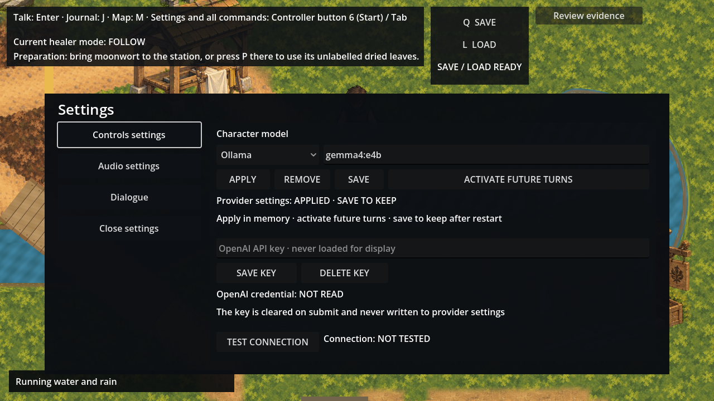
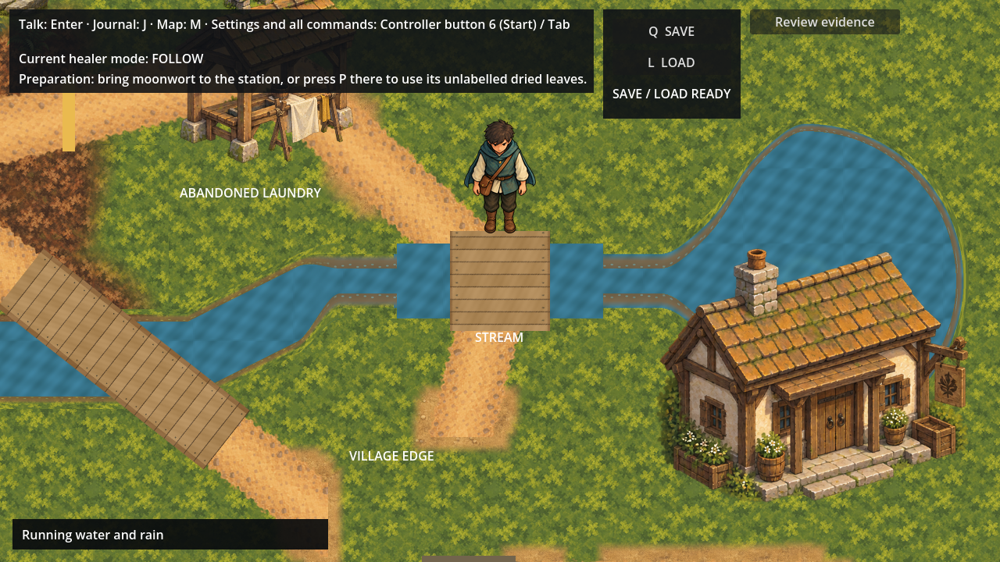

# Gameplay screenshot repairs

24 October 2026 (Australia/Brisbane). The owner selected both defects from the shared
screenshot: settings overflow/overlap and retained Stream crossing placeholders.
[authority.json](authority.json) records the question, reply, screenshot URL and finite scope.

## Settings fit



The existing controls now share one bounded settings card: Controls, Audio, Dialogue
and Close remain in their original focus cycle and paths, beside the existing provider
and credential fields. Model controls are laid out in rows with space for statuses and
wrapping hints. The card fits the viewport and follows viewport changes. The evidence
review entry sits beside Save/Load, or beneath the HUD on a narrower viewport, instead
of overlapping it. Provider selection, in-memory Apply, Save, activation, credential
operations, dialogue and input ownership retain their existing controllers.

## Retained crossing paint



The retained Stream crossing now draws fully opaque timber from the **unchanged approved
channel-decks atlas**. Its source patch lies inside the accepted B1 deck; UVs reuse that
paint without generating or editing an image. The destination follows the current
StreamBounds (x=1736–1864, y=452–548), with a 16-pixel painted bank apron at each end
(y=436–564). Its draw order stays below actors. No rail, collision, route or new bridge
location is introduced.

The flat crossing fill and four retained cap sprites keep their geometry, resources,
colour, order and ownership; only their old paint is retired through self opacity.
The five accepted channel atlases, original overlap mask, existing B1/B2 placements,
water geometry/UVs, physical banks and navigation remain unchanged. Other terrain,
object and actor placeholders are outside these two screenshot repairs.

## Verification and historical boundary

[verification.json](verification.json) records checks and limits. The final full root gate passed
all 218 stages with 0 retries: 6,181 solution tests and 370 smoke checks
(3 existing quarantines). Its compressed summary, console and current-product logs
are retained in `checks/`. The new current fixture
checks settings containment/non-overlap, the original focus/close cycle, real in-memory
Apply, HUD entry separation, existing deck binding and unchanged physical snapshots at
1280×720, 1280×827, 1920×1080 and 960×720. Eight captures retain the normal UI; no layer,
label, status or overlay is hidden for artwork review. Apply uses a temporary process-local
fixture configuration; these captures do not perform a provider request, activation,
credential operation or save, and do not establish a human or accessibility qualification.
Capture source/image bindings are in [capture-results.json](capture-results.json).

The building package and its validator remain unchanged at the verified `c3ca1b24`
checkpoint. Its exact-append Main test belongs to that predecessor. The current smoke
suite runs a separate successor validator: it verifies the predecessor's complete quality
receipt and unchanged building/art inputs, then checks that current Main differs only by
the two authorised presentation owners. Accepted evidence and validators are not weakened.
The original building native check continues to run against current Main.

The broad Phase 4 owner playtest and building visual acceptance remain separately pending.
No physical controller, microphone, screen-reader or executable-release result is inferred.

```sh
artifacts/quality-python/bin/python scripts/validate-gameplay-view-repairs.py
ALLRPCS_CHARACTER_MODEL_COMPOSITION_DISABLED=1 \
ALLRPCS_ORDINARY_PARTICIPATION_SMOKE_MODEL=1 \
ALLRPCS_CHARACTER_MODEL_SETTINGS_TEST_STORAGE=1 \
godot --headless --path game --script "$PWD/scripts/check-gameplay-view-repairs.gd"
# Add ALLRPCS_GAMEPLAY_VIEW_CAPTURE=1 and use --rendering-method gl_compatibility
# instead of --headless to regenerate the UI-visible capture group.
./quality.sh
```
