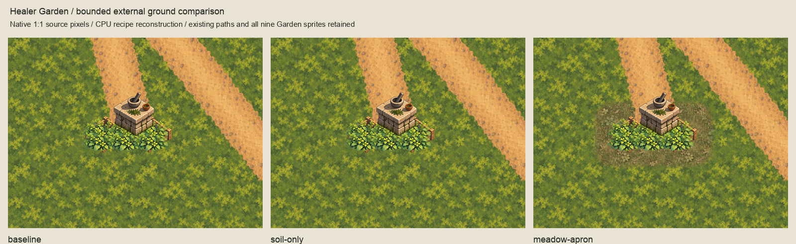
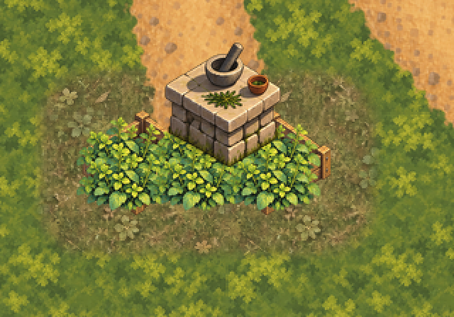
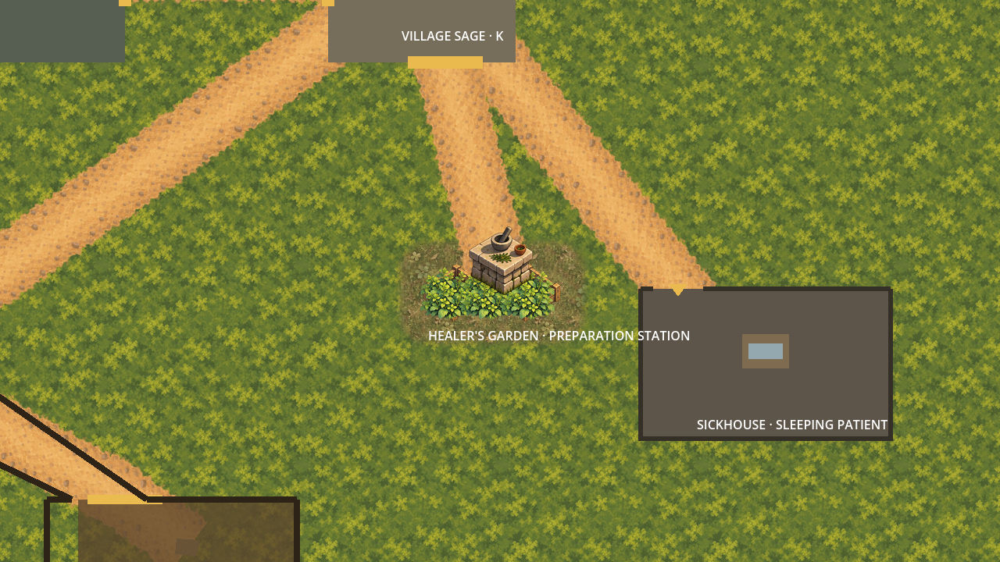
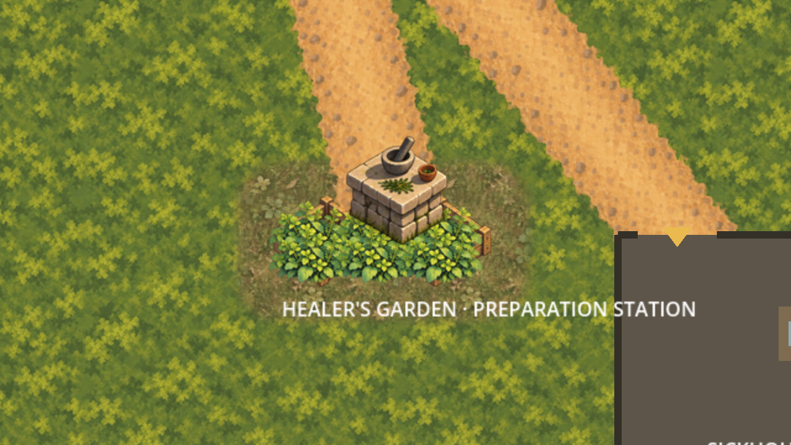

# Healer's Garden ground feasibility

External proof of the owner-selected first placement: soil confined to the retained
raised-bed presentation, followed by an optional meadow apron. The owner preferred
the displayed apron variant: **"definitely better with the meadiw apron"**.
[Selection](owner-selection.json) binds the exact displayed CPU composition and
its editable master/coverage inputs. It records a variant preference, not named
runtime promotion or acceptance of the subsequent Godot preview captures.




## Placement and preserved paint

The live Garden anchor is `(2300,1300)`. Read the two bed, six foliage and preparation
table placements directly from `game/Main.tscn`, preserving native source sizes,
offsets and sibling order. The retained Square–Garden/Sickhouse paths and Village
Square junction retain their source bytes, placement and depth. CPU views reconstruct
those twelve source layers on quiet moss; labels and actors are omitted from the CPU
recipe, while the disposable Godot views show the existing world labels.

The bed source-frame envelope is `(2196,1275)`–`(2384,1355)`, **188x80 pixels**.
It bounds the proof, not a new gameplay cultivation polygon. The final soil coverage
is the exact source-over union of the two original bed alpha channels. New soil sits
beneath those sprites; their already-painted interior soil and wood remain untouched.
It changes only 886 visible native pixels, mostly translucent edge/shadow details;
about 88% of the soil coverage remains visually occluded.

The apron extends that envelope by **32 pixels**, to `(2164,1243)`–`(2416,1387)`.
Its provisional rounded mask uses a 44px corner radius and a 16px inward feather.
Meadow is beneath the tight soil underlay, paths and original Garden sprites.
The apron variant changes 22,750 visible pixels in the CPU view. Absolute-world paint
phase is `(0,0)`: quiet moss repeats every 256px and the new fields every 128px.
No field is rotated, resized, repainted or regenerated.

The masks are separately recorded composition geometry. They are **not approved
transition modules**. The accepted 128px meadow/soil straight/corner modules have
midpoint ports; they cannot simply be dropped around this 188x80 silhouette without
changing coverage or placement. This proof instead blends the same accepted field
paint through the recorded masks. It demonstrates this bounded composition, not a
reusable connector family or terrain-category completion.

## Retained diagnostics

The initial source-frame soil rectangles produced a conspicuous dark mat, including
transparent corners outside the painted beds. Rounding/feathering the frame did not
remove that problem. Both sharp and rounded attempts are retained in `evidence/`.
The corrected silhouette mask avoids assigning ground from sprite crop-frame padding.
The optional apron provides the useful visual change; the tight soil underlay adds
little at ordinary viewing scale. Keep baseline and soil-only comparisons as evidence.

## Disposable Godot preview




Six captures show baseline, soil-only and meadow-apron at 1x/2x in a 1280x720 viewport.
`capture.gd` instantiates the ordinary scene in a SubViewport, creates two temporary
ImageTexture sprites at `(2048,1120)`, z=-90/-89, then toggles their visibility.
It hides CanvasLayer UI and actor sprites and reframes the camera only in that
disposable instance. It does not save/pack the scene or create Godot imports.
The existing Garden world label and nearby Sickhouse remain visible; their text/layout
is inherited evidence, not changed or approved by this proof.

`capture-evidence.json` binds the source scene, inventory, script, two paint layers
and all six captures. The host used Godot 4.6.3 .NET Compatibility on Apple M3 Max.
The initial sandboxed Godot launch exited 134 before capture; the identical host
retry succeeded. No product workaround was introduced. The final standard-viewport
capture run succeeded. GPU differences stay inside the declared envelopes with a
two-screen-pixel linear-filter allowance. These are external previews, not production
runtime placement or owner runtime acceptance.

## Editing and checks

Two 1024x768 OpenRaster masters retain ground, masked fields, each original route,
each of the nine Garden sprites and an empty Corrections layer. They are exact
nearest 2x composition masters: enlargement adds no source paint or detail.
`inventory.json` binds 169 inputs, including all 102 accepted ground artwork files,
35 retained terrain exports and the live presentation sources. Builders write only
this package and refuse changes to the selected paint/coverage files.

```sh
/opt/homebrew/bin/python3 art-direction/garden-ground-feasibility/build.py --check
/opt/homebrew/bin/python3 art-direction/garden-ground-feasibility/inspect_package.py
godot --path game --script "$PWD/art-direction/garden-ground-feasibility/capture.gd"
```

The inspector independently samples absolute-world fields and applies integer
source-over, verifies unchanged opaque route/object pixels, reassembles all 31 master
layers, reproduces 17 generated files byte-for-byte, and checks the six captured views.
`validation.json` and `session-review.json` record results, rejection probes and review.
Product/runtime/CI inputs are unchanged; retain the existing full-suite evidence in
`../woodland-environment-batch/validation.json` instead of replaying product tests.

## Next bounded slice

Prepare a **named Garden presentation-only runtime scope proposal** for the selected
exact two underlays, using one independent owner beneath the retained paths/objects.
Bind proposed runtime paths, imports, master/source hashes, world phase, depth and
unchanged Garden/physical ownership. Address the tight soil layer's limited benefit
explicitly; do not silently remove it from the selected composite. Do not modify the
ordinary scene, manifest or imports before the owner approves that exact scope.
Full product validation and owner runtime visual confirmation remain later gates.
