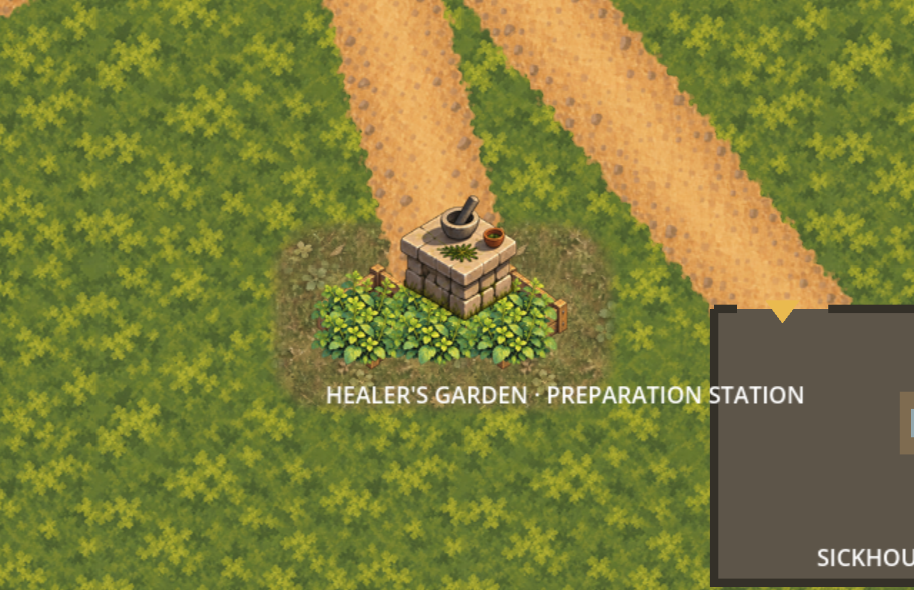

# Garden ground ordinary-scene checkpoint

The owner approved the exact [Garden scope](../garden-ground-runtime-scope/README.md)
("Scope approved"). [Authorization](authorization.json) binds the unchanged proposal
and specification plus the complete [7,054-file predecessor](baseline.json) at `0032223`.
The owner subsequently confirmed all six displayed ordinary-scene views ("approved").
[Runtime acceptance](owner-runtime-acceptance.json) binds the unchanged review request,
verification and twelve capture hashes. The reviewed runtime change is cleared for
the existing direct-main publication authorization.
The proposal's historical pending fields remain immutable and are superseded only by
this authorization for implementation, not by a runtime acceptance claim.

The exact selected meadow and soil PNG bytes are independently owned production,
proof and runtime copies. Two isolated 1024x768 OpenRaster masters retain exact nearest
2x masked paint, a separate hidden coverage reference and empty Corrections layer.
Their merges exactly match enlarged native layers; the selected composite master and
all accepted source paint/masks remain untouched. Production now has 91 assets and
42 masters, preserving all prior entries and bytes.

One script-free `GardenGroundPresentation` root owner is at `(2048,1120)` with only
`Meadow` z=-90 and `Soil` z=-89. Both are 512x384, uncentred, native scale, linear,
non-repeating sprites. They keep world phase `(0,0)` beneath unchanged paths and the
Garden's existing two beds, six foliage sprites, table and label. Soil remains part
of the selected composite despite its small visible contribution. The Garden station,
binding, inputs, physical layout and navigation keep their original owners/bytes.

## Six ordinary-scene views for confirmation

The captures instantiate ordinary `Main.tscn` and use its actual imported textures.
No external proof sprite is injected. HUD/actors are hidden and camera framing adjusted
only in the disposable capture instance; matched baselines hide only the new ground
owner. [Capture evidence](capture-evidence.json) binds all source files, twelve PNGs,
zoom, viewport, actual camera centres and canvas transforms. All six changed-pixel
regions stay within the selected apron with a two-screen-pixel filtering allowance.
The 1x/2x wide runtime and baseline views exactly match the retained external GPU
previews in every RGBA pixel. Tall 0.8x keeps the existing camera clamp, giving an
actual centre `(2300,1283.125)` instead of the target `(2300,1300)`; paired views
have identical transforms. No camera default or limit is changed.

| Zoom | Wide 1280x720 | Tall 1280x827 |
| --- | --- | --- |
| 0.8x | [Runtime](captures/runtime-0.8x-wide.png) · [Baseline](captures/baseline-0.8x-wide.png) | [Runtime](captures/runtime-0.8x-tall.png) · [Baseline](captures/baseline-0.8x-tall.png) |
| 1x | [Runtime](captures/runtime-1.0x-wide.png) · [Baseline](captures/baseline-1.0x-wide.png) | [Runtime](captures/runtime-1.0x-tall.png) · [Baseline](captures/baseline-1.0x-tall.png) |
| 2x | [Runtime](captures/runtime-2.0x-wide.png) · [Baseline](captures/baseline-2.0x-wide.png) | [Runtime](captures/runtime-2.0x-tall.png) · [Baseline](captures/baseline-2.0x-tall.png) |




## Checks and retained limits

`scripts/validate-garden-ground-runtime.py` verifies approved source/authorization
digests, the complete preserved predecessor tree, exact old scene bytes after named
additions, manifest/export/master/import parity, independent UIDs and capture scope.
Eight disposable mutations reject changed paint/masks, phase/depth, dropped soil,
duplicate ownership, import processing and physical scope. The builder supports a
read-only `--check`; validation does not regenerate captures or rewrite old evidence.

The quality pipeline reproduces all 35 frozen Python artwork/runtime validators on
the pinned last unchanged product tree `2fcc849`, with a disposable Git index. The
successor additionally proves that their retained live inputs are unchanged except
for the explicitly normalized scene/manifest additions. Live 91-texture imports,
new Garden checks, the existing .NET tests, scenarios and Godot smokes remain required.
See [verification](verification.json) and [review request](runtime-review-request.json)
for final results and exact hashes. Fresh empty-cache Godot import evidence also
proves runtime RGBA equality with independently regenerated proof UIDs.

```sh
PATH="/opt/homebrew/bin:$PATH" ./scripts/quality.sh
/opt/homebrew/bin/python3 scripts/validate-garden-ground-runtime.py --check-captures --check-rejections
godot --path game --script "$PWD/scripts/capture-garden-ground-runtime.gd"
```

No collision, navigation, layout, scenario, gameplay, dialogue, clue, discovery,
treatment, save, provider, functional UI, audio, release or signing change. Existing
labels, cropped landmark text and greybox buildings are inherited presentation;
these views establish no human accessibility, pacing or terrain-completeness result.
Other accepted terrain/channel/Stream/forest ownership and limits remain frozen.

## Acceptance and next boundary

The original review request, verification and session review retain their historical
pending fields; runtime acceptance supersedes that checkpoint without rewriting evidence.
The six exact views are now approved for reviewed direct-main publication. A different
underlay, phase, depth or placement requires a new scope; the next new-field use needs
a named selection/interface or an explicit placement-proposal request.
