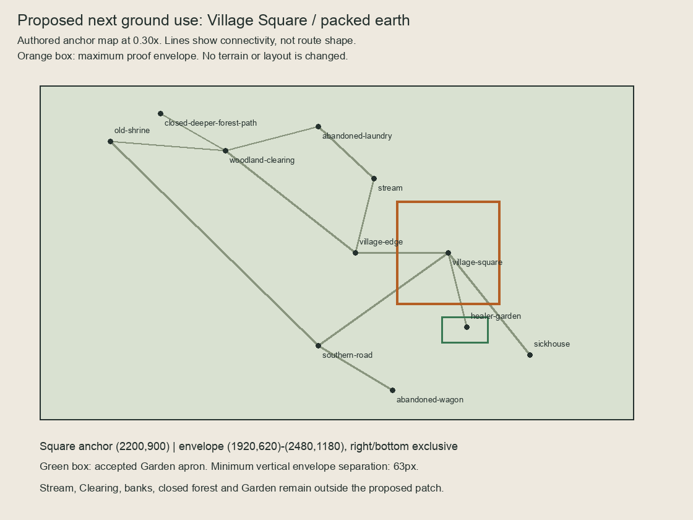
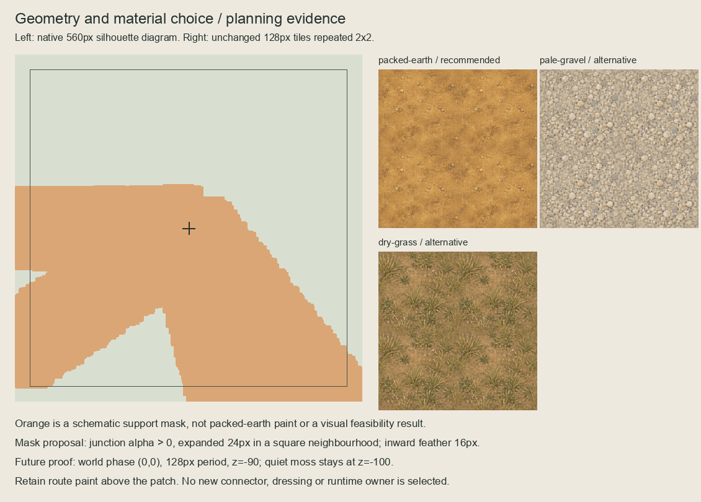

# Village Square ground placement proposal

Prepared on 2026-10-05 (Australia/Sydney) against live `main` at `7942e7d`, after
the owner requested a placement proposal. **Proposal only; selection pending.**
[Source bindings and board hashes](proposal.json) identify the exact packet.

## Recommended next use

Use the approved **packed-earth** field for a narrow worn apron around the existing
Village Square junction at `(2200,900)`. This gives the cask/gathering point a local
ground treatment while testing one actual route-alpha/quiet-moss interface. The
proposal follows the accepted junction silhouette rather than creating a new
rectangular plaza or changing the physical square. Packed earth's restrained
surface is the recommendation; pale gravel is a brighter alternative and dry grass
would retain a more rural green/brown character. These are design judgments from
the unchanged samples, not use-specific visual acceptance.




The location board is an anchor/connectivity diagram, **not a rendered scene**;
its straight lines do not describe the bent routes or bank geometry. The second
board shows a native-scale support diagram and separate unchanged 2x2 tile repeats.
Orange represents proposed support, not composited earth paint. No new artwork,
editable master, connector, import, production asset or runtime file is produced.

## Proposed external proof recipe

| Property | Proposed value |
| --- | --- |
| Material | `residual-ground-tiling-proof/exports/packed-earth.png`, unchanged 128x128 RGBA |
| Source alpha | Accepted live 512x512 Village Square junction, centred at `(2200,900)` |
| Coverage | Binary junction alpha `>0`, expanded 24px in a square neighbourhood |
| Feather | Inward-only 16px smoothstep from the expanded support's boundary |
| Maximum window | `(1920,620)` to `(2480,1180)`, exclusive right/bottom; 560x560 |
| World phase | `(0,0)`, period 128; no rotation or resampling |
| Proposed depth | -90, above quiet moss (-100), below routes (-71/-70) |
| Dressing | None in the first proof |

The binary diagnostic support begins at y=829, despite the larger rectangular
window. The final feather must stay within this support, using zero-padded distance
calculation at the window edges; it must not extend paint through clamped mask
edges. This is a provisional composition technique, not an accepted reusable
quiet-moss/earth connector. Preserve source RGB beneath the separate coverage
plane and keep the original tile/master unchanged.

Bind and compose the live junction, Village Edge–Square connector, Square–Garden,
Square–Sickhouse and Square–Southern Road presentation at their actual transforms
and draw order. Include the retained cask and visible square presentation when
creating disposable Godot previews. Do not substitute the topology diagram for
that work. Preserve route edge RGB/alpha, the existing root/sibling ordering,
station ownership, discovery state and every physical/navigation input.

The five channel atlas alpha planes have **zero overlap** with the proposed support
plus a two-native-pixel guard at their actual world origin `(-64,212)`; the bound
owner defines that placement. The maximum square window ends 63px before the
accepted Garden apron's y=1243 bound. Keep both Garden underlays and all
channel/Stream/forest/Clearing paint and owners unchanged. The plan does not select
mud along banks, gravel at the Sickhouse, or dry grass near the Wagon.

## Next bounded slice and acceptance

The next slice is pending **owner selection of this Village Square / packed-earth
use and the proposed mask/interface recipe**, or a named revision. The requested
placement proposal authorizes preparing this packet; it does not select its
recommendation automatically.

After selection, make one separate external source-matched feasibility package:

1. Reject changed proposal/source hashes; bind the live routes and complete
   preserved product inputs at the actual starting head.
2. Derive the proposed coverage and feather with explicit zero padding; preserve
   editable field/coverage layers at exact 2x and native exports in the external
   package. Keep baseline, hard-support diagnostic and feathered candidate views.
3. Show the complete composition and native/2x crops at the junction alpha edges,
   quiet-moss perimeter and route ports. Include matching wide/tall disposable
   GPU previews at 0.8x/1x/2x with all actual route owners. Record any clipping,
   repetition, colour/alpha fringe or port failure; retain failed candidates.
4. Present the whole proof series together for review before consolidated scoped
   validation. Verify world phase, source RGB, coverage bounds, editable master
   parity, channel/Garden separation and unchanged runtime/product inputs.
5. Record any concrete connector need. A named runtime scope and separate runtime
   visual confirmation would follow only after external composition selection.

No physical/layout/scenario/gameplay/dialogue/clue/discovery/treatment/save/provider/
functional-UI/audio/release/signing change. Terrain completeness, human
accessibility and runtime suitability remain open.

## Reproduce and check

```sh
/opt/homebrew/bin/python3 art-direction/ground-placement-proposal/build.py --check
```

The builder binds approved swatches, production/runtime junction parity, live
scene/layout/route/channel owners, Garden acceptance and the font. It reproduces
both PNG boards and JSON in memory. Existing bindings reject source drift, even
without `--check`; checks do not write. [Session review](session-review.json)
records fresh proposal checks and retained product-validation evidence.
