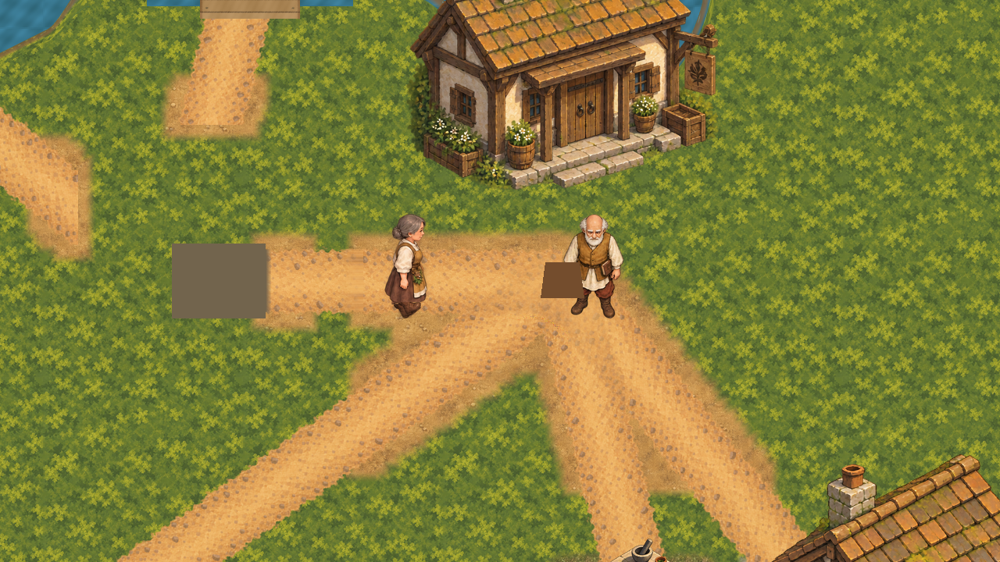

# Healer and Village Sage runtime art

On 28 October 2026 (Australia/Sydney), after closing the sickhouse bed/patient slice, the owner
asked for the Healer and Village Sage (Orin) characters next ([authority.json](authority.json)).
Implemented 29 October 2026.
This slice installs their owner-approved characters-batch artwork in ordinary Main. No new art
was generated.

## Which frames

The 96 runtime PNGs under `game/art/runtime/characters/{healer,orin}/<direction>/` are byte
copies of the exports that [the characters-batch acceptance](../characters-batch/owner-acceptance.json)
lists in `active_assets`. For each role and each of south/west/east/north there are:

- `idle-01..02` and `inspect-01..02` from `characters-batch/exports/` (approved 2026-10-04);
- `walk-01..08` from `characters-batch/walk-rig-polish/exports/`, the approved 8-phase polished
  walk. The 4-frame `*-walk-*` studies in `characters-batch/exports/` are **not** used: the
  [characters-batch README](../characters-batch/README.md) records they keep the same foot
  leading and must not be promoted.

## Wiring

Each role has an `animations.tres` SpriteFrames with the twelve animations the Seeker uses:
`idle_*` (600 ms per frame, looping), `interact_*` (the inspect frames, 160 ms, not looping)
and `walk_*` (90 ms, looping). The walks' 8 × 90 ms gives the
[reference gait model](../reference-gait-model.md)'s 720 ms cycle (the same cycle as the
Seeker's runtime walk). That re-times the walk from the 100 ms per frame (800 ms loop) at which
the [polished walk](../characters-batch/walk-rig-polish/README.md) was reviewed. The batch
acceptance excludes runtime timing, so the authority for the change is
[authority.json](authority.json). The frames themselves stay the approved 8-phase cutout gait. This slice
did not re-author them to the reference model's 16 side poses, because that would be new art the
owner did not request. That deviation from the gait model awaits owner sign-off
([#480](https://github.com/hherb/allrpcs/issues/480)).

- `Healer/WalkAnimation` replaces the `Body` and `Satchel` polygons. It reuses
  `SeekerWalkAnimationPresenter`. `Healer.cs` passes it the chosen `Velocity` before
  `MoveAndSlide`, as `Seeker.cs` does, so the Healer's own movement picks the facing and the
  walk/idle loop.
- `SageHearingPosition/Figure` replaces the Sage `Body` polygon. The Sage never moves, so it
  autoplays `idle_south`. Its label is unchanged.
- Both sprites use offset (0, −96), which puts the feet (the bottom row of the 128×192 frames)
  on the node origin, as the Seeker's are. Positions, collision, navigation, interaction ranges,
  dialogue, commands and saves are unchanged. The Healer still starts the game hidden, away on
  its authored task.

The inspect gesture is wired as `interact_*` animations but never triggered for the Healer.
The natural trigger, the herb examination's `HerbExaminationActionController.Examined`, would be
new behaviour outside this slice, so it is tracked as [#481](https://github.com/hherb/allrpcs/issues/481).

## Checks

- `scripts/validate-healer-sage-runtime.py` checks each runtime frame against the hash in the
  characters acceptance record, checks their lossless import settings, and fails on any extra
  frame under the two runtime folders. It checks only these files (#471).
- `scripts/check-healer-sage-runtime.gd` checks that the placeholders are gone and both nodes
  are unmoved, that neither sprite is hidden, every animation's frames, timing and looping, and
  that the Sage's breathing loop advances. It holds the Healer in Wait and checks it rests
  facing south, then lets it follow the Seeker moved away so it walks east, then back so it
  idles east. It fails on the pre-slice Main, when the `Healer.cs` presenter call is removed,
  when either sprite is hidden, and when the Sage loop is frozen.
- `OpeningRegionSageConsultationInputSmokeCheck` now checks that `Figure` is visible instead of
  the removed `Body` polygon.
- `scripts/capture-healer-sage-runtime.gd` writes the two `captures/` and
  [capture-evidence.json](capture-evidence.json). Run it without `--headless`.

Results are in [verification.json](verification.json).

## Known limits

The greybox water-cask marker at (2200, 900) draws over the Sage's legs, because the new art is
much taller than the old polygon. Replacing that marker is outside this slice; it is tracked as
[#477](https://github.com/hherb/allrpcs/issues/477).

Main draws its characters in tree order, not by depth, so the Seeker draws over the taller
Healer or Sage when it stands behind them. Depth sorting would reorder everything Main draws, so
it is tracked separately as [#479](https://github.com/hherb/allrpcs/issues/479).
