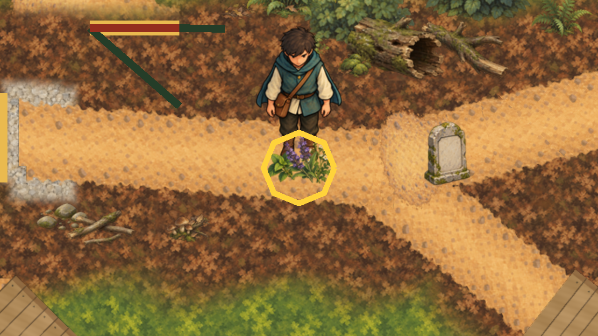
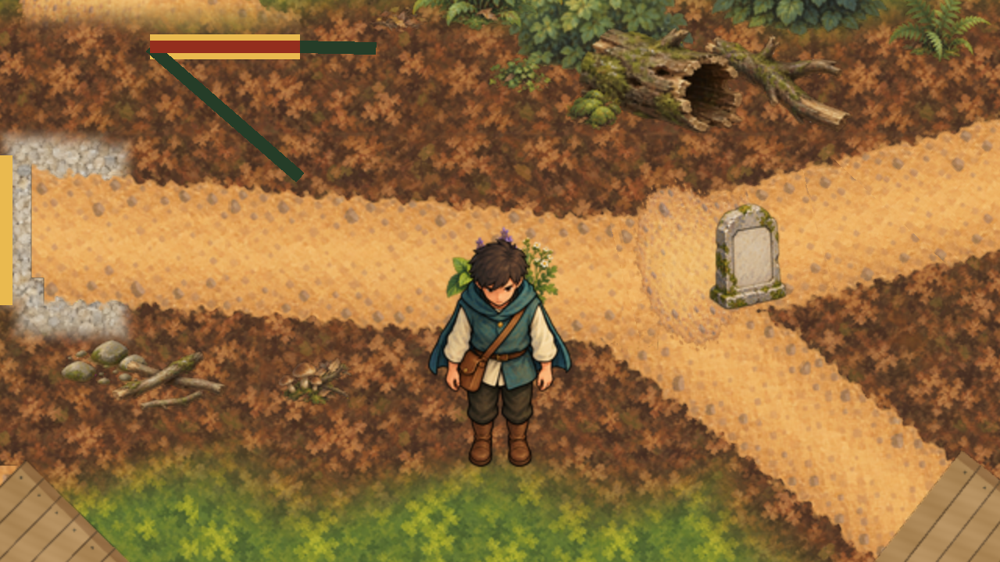

# Herb patch sprigs

30 October 2026 (Australia/Sydney). After merging PR #483, the owner closed the stone marker slice
([acceptance](../stone-marker-art/owner-acceptance.json)) and chose the herb patch as the next
greybox marker to replace. The owner's reply is in [authority.json](authority.json).

## Runtime

In `game/Main.tscn`, the `Marker` Polygon2D under `InteractionCandidates/HerbPatch` is now a Node2D
holding three Sprite2D nodes. Each shows a byte copy, in `game/art/runtime/objects/`, of one approved
[objects-batch](../objects-batch/README.md) growing sprig (bound by hash in its
`owner-acceptance.json`): herbs-01 "Broad-leaf sprig" on the left, herbs-03 "White flowering sprig"
on the right, and herbs-02 "Purple flowering sprig" drawn in front of both in the middle. The batch's
other herbs (a drying bundle, a root bundle and a tray) are harvested goods, not a patch. No new
artwork was made.

Each sprite is uncentred, with its `offset` set to minus the export's proposed foot pivot, so its
`position` is its foot: (−18, 16), (18, 16) and (0, 16). All three feet stand on the old polygon's
base line (y +16), just above the unchanged `HERB PATCH` label. The node position (920, 350), which
the interaction ranges, perception and herb collection measure from, is unchanged.

`CharacterDepthOrderPresentation` now places a list of fixed props between the four ranked figures,
instead of only the stone marker. Each prop gets z `1 + DepthDrawOrder.CountNorthOf(...)` from its
foot (herb patch +16, stone marker +18 below its node). The Sage, water cask, Healer and Seeker keep
their accepted ranks z 1..4, and the stone marker behaves as before. The cask, Healer and Seeker
come after the herb patch in `Main.tscn`, so at equal z they draw in front of it. Because all three
sprigs share one foot line, one depth foot is exact for the whole patch.

The Healer's herb trip ends a few pixels north of that line, so there the sprigs draw over its
legs, as the depth rule requires; the old polygon at z 0 never covered it. No capture shows this.

## Checks

- `scripts/validate-herb-patch-art.py` checks the objects-batch acceptance binding, that each runtime
  PNG is byte-identical to its approved export and that its import is lossless. It also checks the
  captures and their art and script inputs against [capture-evidence.json](capture-evidence.json).
  It checks only those bytes, never the whole tree (#471).
- `scripts/check-herb-patch-art.gd` checks the three textures, their order, each foot, and the
  unchanged interaction point. It checks that the cask, Healer and Seeker come after the patch in
  the tree. It also checks that a Seeker level with the sprigs' feet draws in front of them and one
  1 px north draws behind, which ties the presentation's foot offset to the sprites' feet.
- `scripts/capture-herb-patch-art.gd` writes the two `captures/` and
  [capture-evidence.json](capture-evidence.json).

Results are in [verification.json](verification.json).
