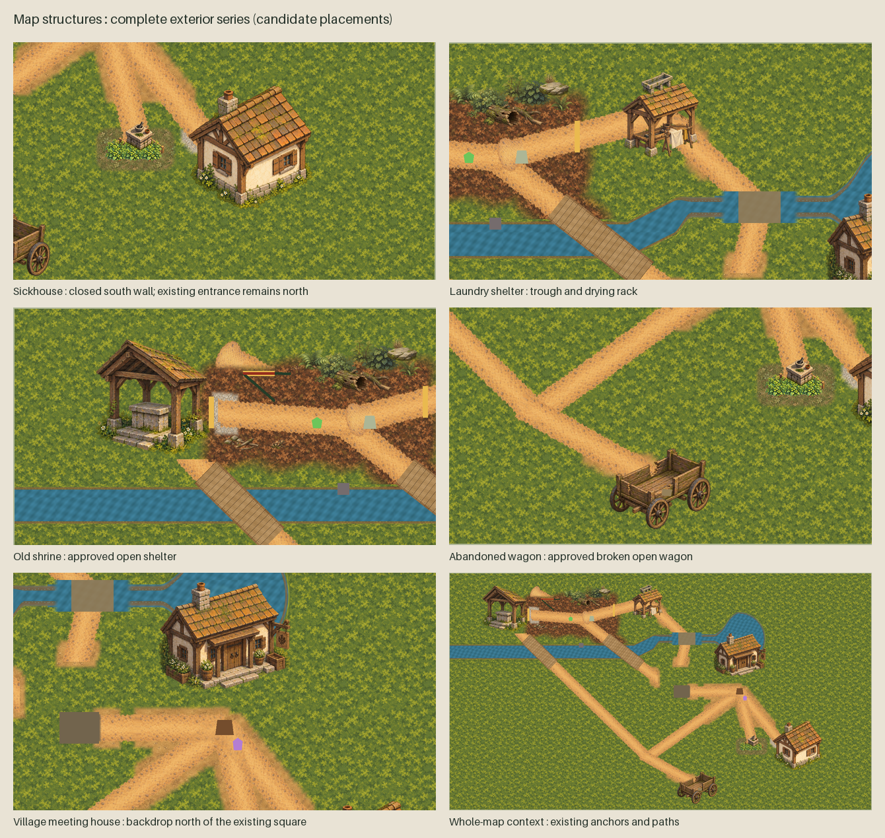

# Opening-region structure presentation

18 October 2026. Requested by the owner: “work on finalizing the artwork that is still
missing in the game's map - for example the buildings”. Implementation is on the isolated
`codex/map-building-artwork` branch; the original checkout's Phase 2 work stays separate.

The complete candidate group covers the sickhouse, laundry shelter, old shrine, abandoned
wagon and village meeting-house backdrop. Six runtime textures are byte-identical approved
structure exports. A generated sickhouse variant removes the illustration's south
door because the actual room's retained entrance is north. Its original approved reference
is unchanged. Two new timber/stone floor textures finish the cutaway rooms. All three
generated assets have separate sources and layered OpenRaster masters at exact 2x export size; the correction layer is intentionally blank, not semantic wall/roof layers.



The building cutaways remove opaque exterior paint when the Seeker approaches the
painted silhouette or enters the retained room. Painted timber/stone floors and low walls
keep the interior readable; the floor bounds and low walls follow the existing room bounds
and actual collision segments. A small canvas shader changes alpha only; approved source
pixels stay intact. The sleeping patient remains visible inside; the
concealed inscription stays concealed. The wagon and meeting-house remain open/backdrop
art. Retired greybox fills and boundary lines are presentation only. No anchor, route,
collision shape, discovery state, interaction owner, accepted terrain or accepted character
art was changed. The meeting house is a backdrop, not a newly enterable location.


## Review and verification

The 12 actual Main captures comprise five exterior views, three cutaways at 1280x720,
the same three cutaways at 1280x827, and one whole-map overview. A disposable scripted
camera frames the existing scene; it does not inject textures or save a substitute scene.
UI/labels are suppressed only for artwork captures, distant-exterior captures hide the
Seeker, and cutaway captures retain the visible Seeker. These are artwork review views,
not a physical playthrough or accessibility qualification. The ordinary UI is retained.
`capture-evidence.json` hashes the renderer, textures/import settings and images.

Scoped checks passed: game build with zero warnings/errors, C# formatting, new native
cutaway/physical/discovery preservation check, existing first-patient and sickhouse
navigation checks, village transitions, laundry, both shrine modes, road/wagon navigation,
terrain presentation, five shipping-policy tests, shipping scene repack/load and autoload
restoration, frozen-evidence guard, continuation checker and its 15 regression probes.
The editor repack exited zero with its required marker but logged RID/ObjectDB shutdown
warnings; some native checks also logged ObjectDB warnings. No leak-clean claim is made.
An initial temporary relative-script invocation failed to load; the corrected absolute
invocation passed. The committed smoke registration uses an absolute script path.
Full root quality and visual acceptance are not claimed for this candidate.

The owner-requested workflow in ROADMAP.md requires grouped review/revisions before the
consolidated full gate. Keep the slice open for the owner's new visual result; do not
repeat accepted source-art review. Other map work (remaining object/actor placeholders,
terrain gaps and wider production detail) is not claimed complete by these five sites.

## Files and reproduction

- `authority.json`: direct request and finite presentation scope.
- `manifest.json`: all nine runtime assets, exact provenance and editable master.
- `prompts.json`: exact prompts; **built-in image_gen** produced the variant and both floor textures.
- `sources/sickhouse-north-entry-exterior.png`: unchanged generated source.
- `masters/`: three editable 2x masters, including the two painted floor textures.
- `build_generated_assets.py`: deterministic native-source/master/export packaging.
- `verification.json`: scoped evidence and limits.
- `captures/`, `building-review.png`, `cutaway-review.png`: complete review set.

```sh
python3 scripts/validate-map-structures.py
python3 scripts/check-continuation.py
ALLRPCS_CHARACTER_MODEL_COMPOSITION_DISABLED=1 \
ALLRPCS_ORDINARY_PARTICIPATION_SMOKE_MODEL=1 \
godot --headless --path game --script "$PWD/scripts/check-map-structures-runtime.gd"
ALLRPCS_CHARACTER_MODEL_COMPOSITION_DISABLED=1 \
ALLRPCS_ORDINARY_PARTICIPATION_SMOKE_MODEL=1 \
godot --rendering-method gl_compatibility --path game \
  --script "$PWD/scripts/capture-map-structures.gd"
python3 art-direction/map-structures-runtime/build_review.py
```

Use the repository's pinned quality Python for Pillow-based validation/review assembly.
Review images may be regenerated while candidates; the capture script refuses to overwrite
an eventual `owner-acceptance.json` package. Do not record acceptance without an owner result.
