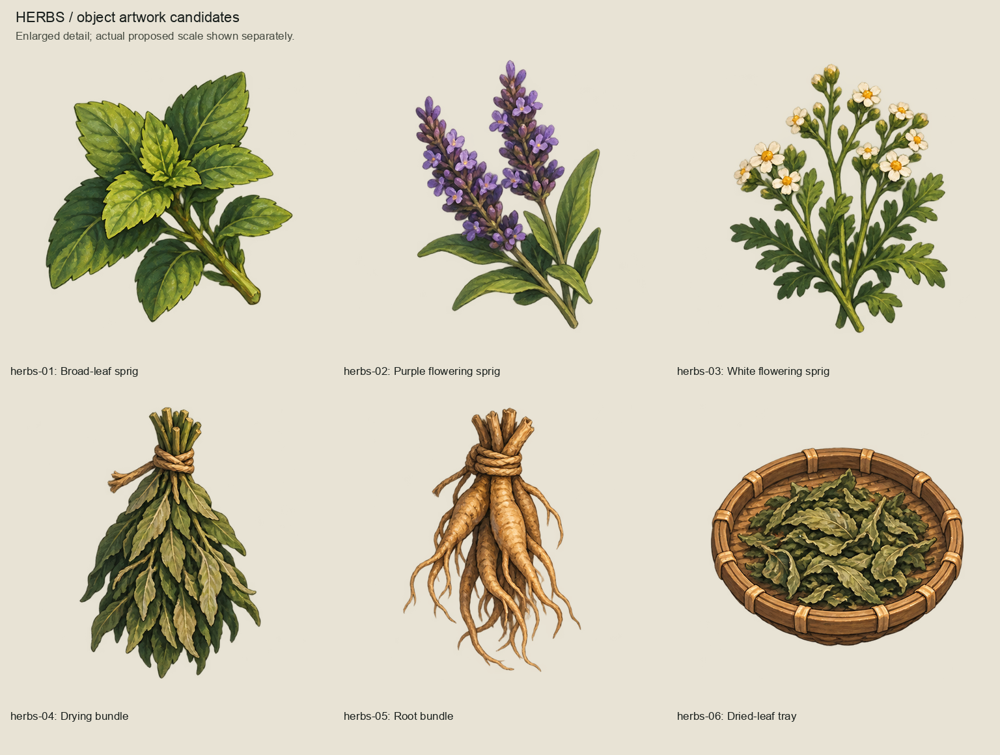
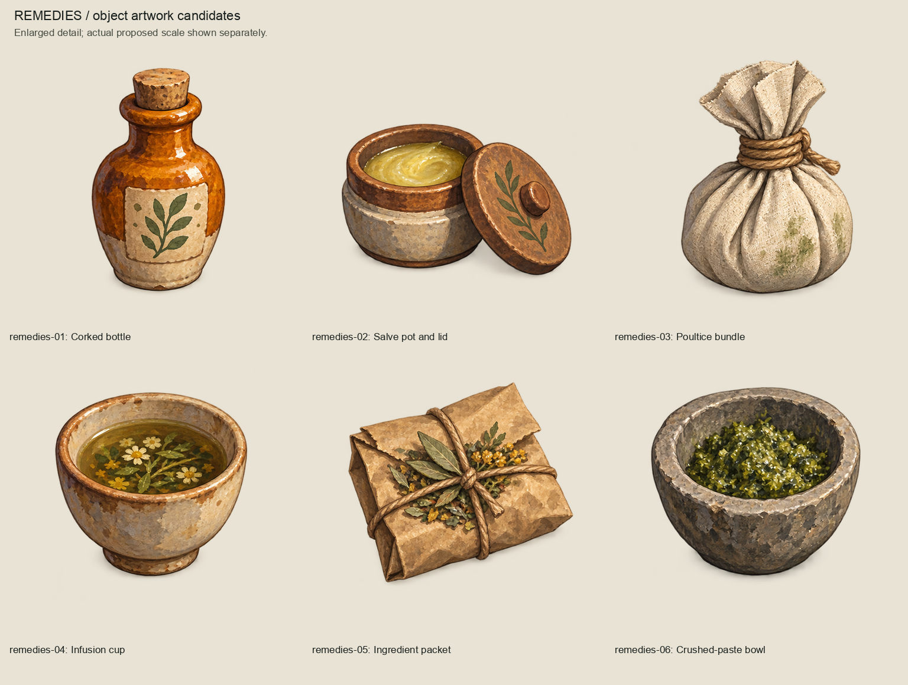
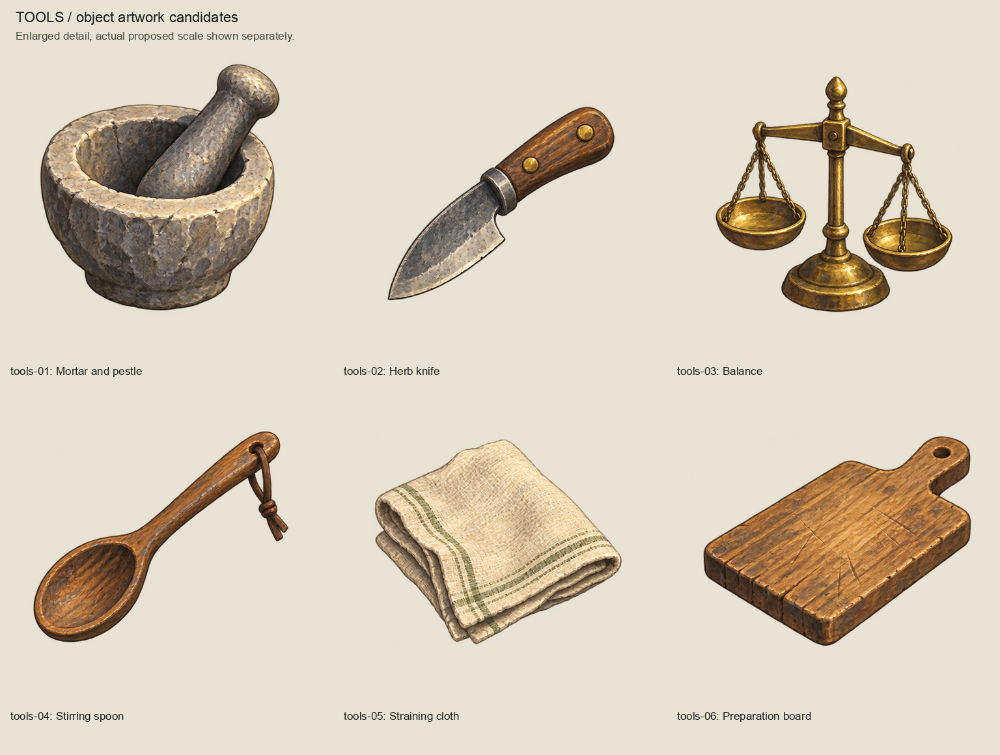
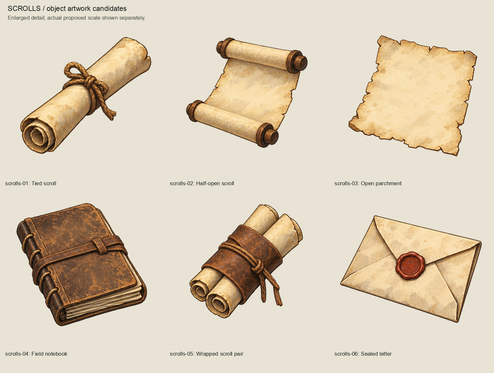
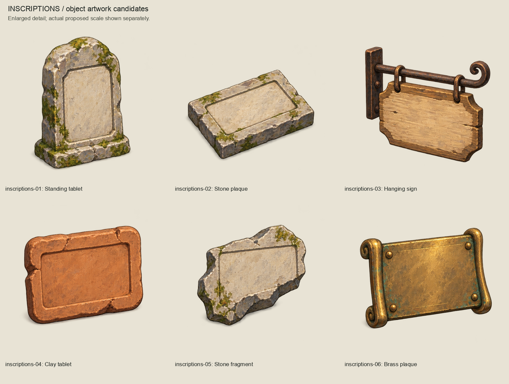
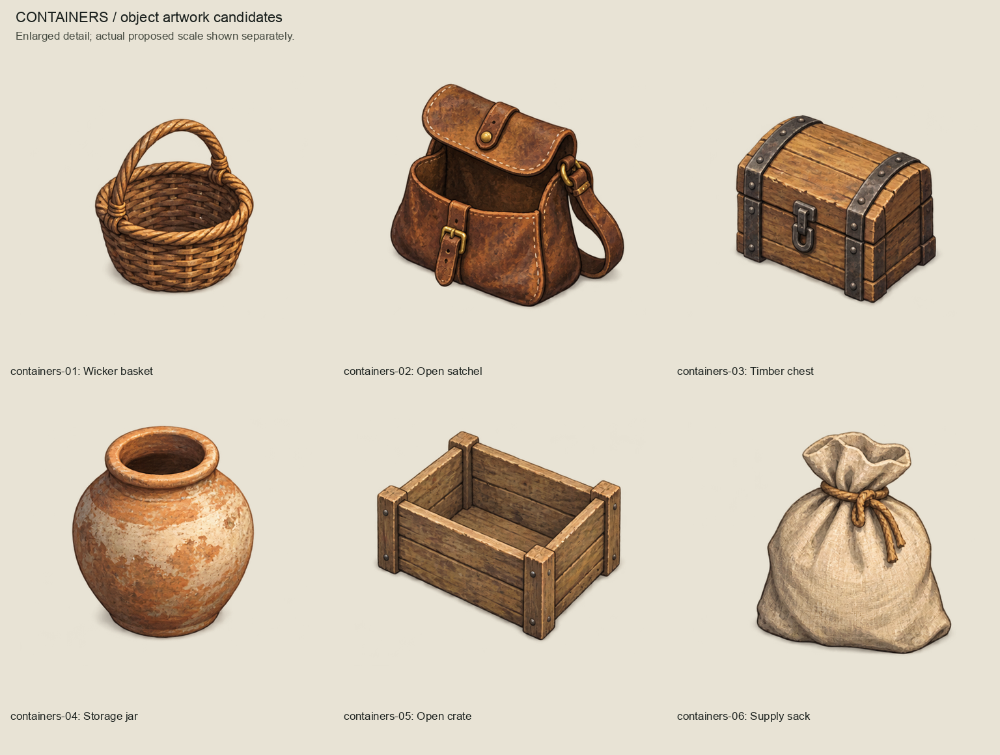
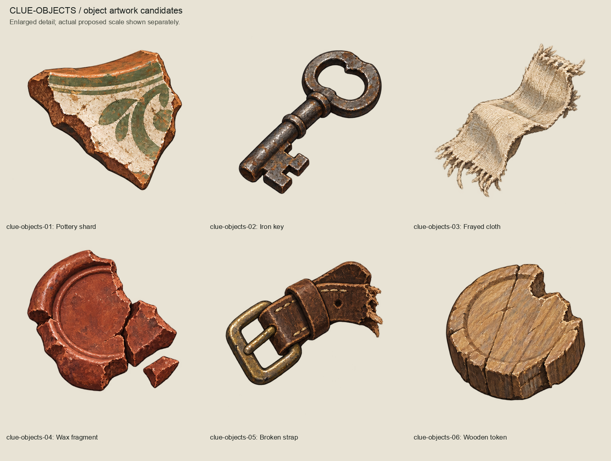
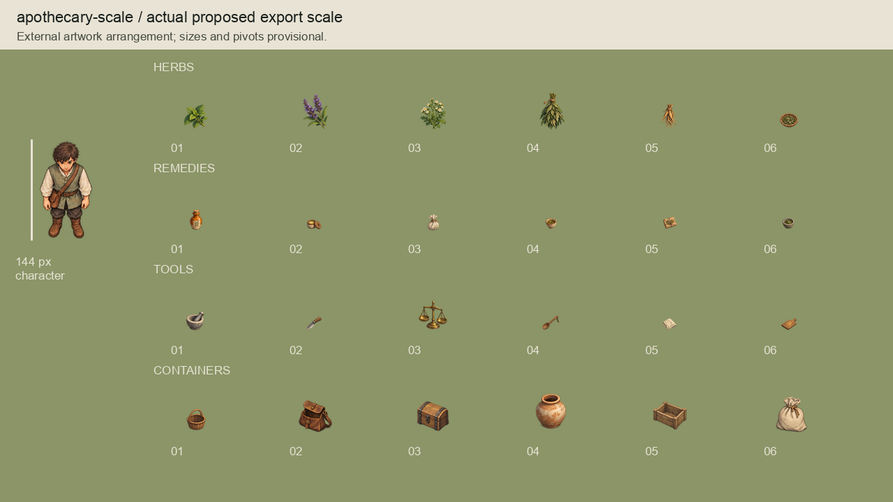
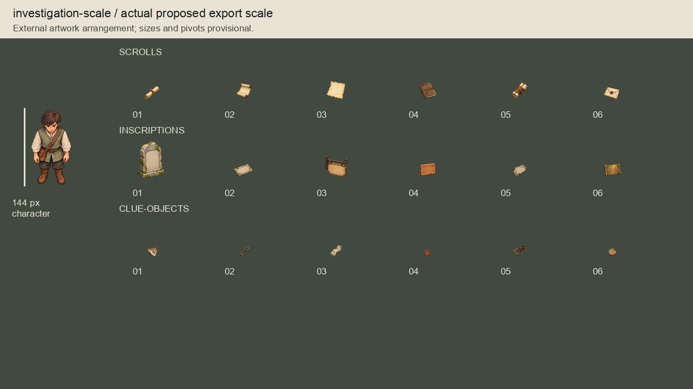

# Objects artwork batch 01

Complete initial external Phase 9.2 object series, produced on 2026-10-04
(Australia/Brisbane) with the built-in image_gen tool. **Awaiting collective owner
artwork review.** No runtime promotion or scenario-content approval is implied.

42 candidates: six each for herbs, remedies, tools, scrolls, inscriptions,
containers and clue objects. The approved Direction A representative scene supplied
the gouache brushwork, rural materials and oblique camera reference.

## Complete family series

## Scale review

All 42 actual transparent exports appear in the following 1280x720 external
arrangements, beside approved Seeker artwork with its visible painted height set to
144 pixels. Family boards enlarge original source paint for detail inspection;
these compositions show the proposed export scale on light and dark grounds.
They are review arrangements, not runtime screenshots or opening-region layouts.

## Package and reproduction

- `sources/`: seven unchanged generated RGBA sheets, including source provenance.
- `prompts.json`: exact built-in prompts, transparency setting and reference hash.
- `masters/`: 42 OpenRaster files at exactly twice export canvas dimensions,
  with source paint and a separate blank correction layer. These are editable raster
  masters, not reconstructed semantic layers. Original higher-resolution paint stays
  in the source sheets; the proposed small game-scale masters are downsampled.
- `exports/`: 42 transparent candidate PNGs with padded canvases.
- `inventory.json`: identities, source crop bounds, dimensions, provisional pivots,
  scale reference and export/master hashes.
- `review-manifest.json`: exact source/master/export/board and authoring-input hashes
  for this review candidate. It records no owner acceptance.

Reproduce with `/opt/homebrew/bin/python3 art-direction/objects-batch/build_review.py`.
Run lightweight checks with
`/opt/homebrew/bin/python3 art-direction/objects-batch/inspect_package.py`.
Crop cells preserve every alpha component, including detached parts and faint edge
paint. Measured gutter overrides prevent slicing herb bundles or intruding on scrolls; no source pixels
are repainted or removed by component filtering. ZIP timestamps are fixed for byte
reproduction. Do not regenerate this candidate after approval without preserving its
accepted evidence and deliberately creating a revision.

Inscription and writing fields are blank for later separately authorized content.
Plant designs are visual motifs, without species, efficacy or treatment claims.
Clue objects are ordinary ambiguous props; they establish no discovery, evidence,
ownership or narrative facts. The bottle uses an amber finish rather than establishing
a material requirement. Paint, proportions, tiny-object readability, contact shadows,
pivots, occlusion and actual runtime scale/imports remain subject to review.

Only lightweight authoring checks and session code review are appropriate before
owner feedback. Product code, runtime assets, imports, scenes, CI, collision,
navigation, dialogue, clues, saves and gameplay remain unchanged. Retain the prior
full-suite evidence referenced by `HANDOVER.md`; consolidate scoped approval checks
after artwork feedback, without replaying unchanged product suites.
