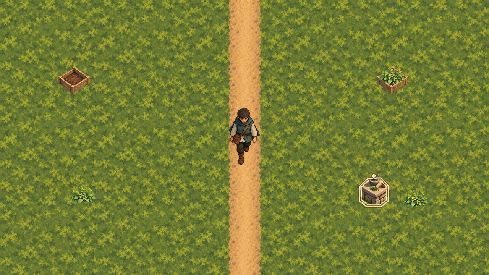

# Direction A corrected production-pipeline proof

Status: bounded scale-rebaselined proof, 2026-09-30. This directory remains outside `game/`; exact
copies use separate isolated-proof and runtime-owned paths, so no proof-directory path is runtime
authoritative.

This proof corrects the sheet-dependent failures recorded by the first Phase 9.2 proof. Eighteen
individual painterly inputs remain under `sources/imagegen`; deterministic Python tooling turns them
and the earlier high-resolution Seeker source sheet into individual exports, exact geometry,
editable OpenRaster masters, and review evidence. The scale rebaseline reused those retained sources;
it did not enlarge the previous 48–56-pixel exports or generate a new character design.

## Result

- `asset-manifest.json` schema 2 contains all 68 asset IDs, the 1280x720 base and 1280x827 expanded
  fullscreen reference viewports, the 144-pixel minimum visible character height, exact 2x master
  dimensions, contact baselines, pivots, hashes, animation order/timing, review placements, and the
  96-pixel navigation-clearance corridor. Every entry is included in the isolated import proof.
- `exports` contains one file per module: quiet moss, opaque woodland leaf litter, one deterministic
  moss-to-leaf straight transition, two outer-corner transitions, two inset-corner transitions,
  straight path, one 90-degree path bend, one T-junction, one cross-junction, one end-cap, and the
  exact live-angle Stream–Laundry–Woodland junction, one 1024x512 world-aligned full-clearing
  feather overlay, plus empty herb bed, broadleaf foliage,
  one 96x96 ordinary preparation table, three matching 96x96 cue overlays, and 24 normalized
  south-, west-, east-, and north-facing Seeker walk frames, eight two-frame idle/breathe frames,
  and 16 four-frame generic reach-and-inspect frames.
- `masters` contains nineteen editable layered OpenRaster files for terrain/path, the leaf-litter
  ground and five transitions, the path bend, the path T-junction, the path cross-junction, the path
  end-cap, the live-angle opening junction, planted herb bed, preparation-table states, walk,
  idle/breathe, interaction strips, and the composed review scene.
- `review/module-review-scene.png` is a 1280x720 composition made only from corrected exports. Its
  grayscale companion preserves the path, character, props, and identified-state cue hierarchy.
- `review/state-cues-grayscale.png` shows ordinary, noticeable, identified, and dangerous table
  treatments without relying on hue.
- `review/path-bend-review.png` joins the bend to vertical and horizontal copies of the straight
  module over quiet moss without adding another terrain asset.
- `review/path-t-junction-review.png` joins the junction to vertical and two horizontal copies of
  the straight module over quiet moss without adding another terrain asset.
- `review/path-cross-junction-review.png` joins the cross-junction to two vertical and two
  horizontal copies of the straight module over quiet moss without adding another terrain asset.
- `review/path-end-cap-review.png` joins the end-cap below one exact vertical copy of the straight
  module over quiet moss without adding another terrain asset.
- `review/opening-junction-review.png` places the exact live-angle junction between clipped external
  straight-path continuations and pairs that composition with its tangent-continuous 96-pixel
  route-band containment mask.
- `review/path-module-topology-review.png` connects rotated T-junction and bend modules with the
  straight, cross-junction, and end-cap exports as one deterministic network over quiet moss.
- `review/woodland-leaf-litter-review.png` shows the opaque leaf-litter tile in an exact 2x2 seam
  proof beside quiet moss and the packed-earth modules.
- `review/woodland-leaf-litter-transition-review.png` repeats the exact quiet-moss, deterministic
  edge transition, and leaf-litter sequence in two connected rows.
- The four corner-transition review files connect each outer or inset corner to exact source-ground
  and rotated straight-transition neighbours in a 3x3 composition.
- `review/woodland-village-edge-transition-review.png` pairs the full-clearing leaf overlay over
  quiet moss with its exact alpha mask, including the irregular 64-pixel perimeter and Village-route
  feather.
- `review/terrain-accessibility` contains exact original, grayscale, protanopia, deuteranopia, and
  tritanopia views for quiet moss, leaf litter, packed earth, and all five ground transitions. Its
  report binds every view to the current manifest hashes and records descriptive luminance and
  neighbouring-pixel texture measurements without making an accessibility acceptance claim.



## Mechanical validation

Run from the repository root:

```sh
python3 art-direction/production-proof/corrected/tools/build.py
python3 art-direction/production-proof/corrected/tools/validate.py
python3 art-direction/production-proof/corrected/tools/check_opening_junction_feasibility.py
python3 art-direction/production-proof/corrected/tools/terrain_accessibility_review.py
python3 art-direction/production-proof/corrected/tools/validate_terrain_accessibility_review.py
```

The scripts require Python 3 and Pillow. The current run passed all of these gates:

- all 68 exports are RGBA, have visible and fully opaque pixels, and retain no RGB data beneath
  fully transparent pixels;
- non-terrain cutouts have transparent export borders;
- ground left/right and top/bottom edges match exactly, and the straight path's top/bottom edges
  match exactly;
- the leaf-litter tile is fully opaque, has exact opposing-edge parity, useful tonal variation,
  measurable moss/path contrast, and no 96-pixel full-span path-like corridor;
- the deterministic ground transition retains exact 32-pixel quiet-moss and leaf-litter connector
  strips, full opacity, and an exact repeatable top/bottom seam;
- both outer and both inset corners retain exact straight-transition edge connectors,
  exact unused source-ground edges, full opacity, and connected 3x3 review seams;
- the 1024x512 Village Edge overlay retains exact world origin, clearing bounds, opening anchor,
  96-pixel route width, 180-pixel route continuation, transparent outer corners, and at least 128
  distinct partial-alpha levels across its 64-pixel feather;
- the 256x256 path bend has transparent unused edges and outer corners, plus exact 96-pixel
  straight-path parity at its centered top entry and compatible centered right exit;
- the 256x256 path T-junction has transparent lower outer regions and bottom edge, plus exact
  96-pixel straight-path parity at its centered top, left, and right ports;
- the 256x256 path cross-junction has transparent outer corners and exact 96-pixel straight-path
  parity at its centered top, bottom, left, and right ports;
- the 256x256 path end-cap has exact 96-pixel straight-path parity at its centered top port, a
  rounded terminus before the lower half, transparent side and bottom edges, and a transparent
  lower 64-pixel band;
- the 512x512 opening junction retains exact incoming and transformed outgoing 96-pixel port
  pixels for the live 57.599282-degree turn, records its 335x458 visible footprint, blends its path
  texture through an 80-pixel tangent-continuous curve, rejects hard texture overlaps and dark
  resampling fringes, and keeps every visible pixel inside that curved physical-route band;
- one 1024x768 topology composition connects every path shape using only exact exports and
  deterministic rotations, without introducing another terrain asset;
- all six frames in each of the four directional walks are unique, remain at least 144 visible
  logical pixels high, share a 156-pixel contact baseline on a 168-pixel export canvas, and use one
  documented 120 ms loop timing;
- both idle/breathe frames in each direction are distinct, preserve the direction-specific fixed
  origin, remain at least 144 visible logical pixels high, preserve the 156-pixel baseline, and use
  one documented 600 ms loop timing;
- all four reach-and-inspect frames in each direction are distinct, all 16 are unique, preserve the
  direction-specific fixed origin and 156-pixel baseline, and use 160 ms non-looping timing;
- the four 96x96 table states share exact 192x192 editable-master geometry and remain measurably
  distinct in grayscale;
- the external terrain accessibility review exactly reproduces 40 simulation views from the current
  manifest exports, preserves fixed sheet order, and reproduces every recorded descriptive metric;
- no fixed review-scene obstacle overlaps the 96x720 path corridor; and
- all nineteen `.ora` files expose a valid OpenRaster mimetype, layer stack, merged image, and
  editable PNG layers.

## Review conclusion and boundaries

The corrected proof passes the art bible's alpha, seam, pivot, editable-master, grayscale-cue,
four-direction walk, idle/breathe, interaction, and 144-pixel character-scale gates. The unchanged
96-pixel path and 72–96-pixel props remain readable and proportionate in the 1280x720 composition.
The preparation table and its cue canvases were later regenerated from their retained source at
96x96 logical pixels after product-owner scale feedback; their 192x192 master, `(48, 92)` pivot,
and grayscale hierarchy remain deterministic. The terrain-only colour-vision review is
reproducible external evidence, not human accessibility acceptance. Direction A remains feasible,
so the Direction D contingency does not activate.

The product owner accepted the corrected opening-junction curve and texture continuity after two
bounded review corrections removed the hard leg overlap and the preview-only triangle at the elbow.
That acceptance applies only to the isolated proof; it does not authorize a runtime copy or an
ordinary-scene presentation change.

After separate runtime authorization, the product owner rejected hard straight moss/leaf edges in
the initial Village Edge presentation. The replacement uses one tailored full-clearing overlay; a
second correction extended its feather across the north and northeast edge. The owner accepted the
final unobstructed and ordinary-scene views. This is visual acceptance of that blend only, not human
accessibility, pacing, or usability acceptance.

After separate preparation-table authorization, the product owner rejected the proposed 80x80
runtime scale as too small. The retained source and cue geometry were deterministically regenerated
at 96x96 with exact 192x192 masters. One separate runtime-owned ordinary table replaced only the
garden's greybox bench and mortar at the same station footprint. The owner accepted its scale and
placement in 0.8x, 1.0x, and 2.0x wide and tall Compatibility views. The cue overlays remain
proof-only, and that acceptance grants no preparation, interaction, collision, navigation, or
other gameplay authority.

After separate herb-bed authorization, one exact runtime-owned copy of
`plants.herb_bed_empty` supplies two unscaled 96x80 raised beds beneath the accepted garden foliage
and table. Their `(48, 77)` planted-foot pivots replace only the remaining greybox plot and bed-line
visuals. Static and engine checks retain exact manifest parity and presentation-only ownership. Six
wide and tall Compatibility views at 0.8x, 1.0x, and 2.0x are prepared for product-owner review;
the first review found the north-left and north-right foliage crowns outside the bed rails. Moving
the complete north row 27 pixels south corrected only that presentation. The product owner accepted
the corrected wide and tall views without granting physical, gameplay, pacing, usability, or human
accessibility authority.

This is still a deliberately small pipeline proof. It does not prove gameplay-triggered interaction,
a complete terrain transition set, production estimates for the whole opening region, ordinary
runtime animation selection, collision or navigation behavior, UI, or final production quality.
All 68 exports have a separate isolated Godot import proof, and `Main.tscn` references no path in
this proof directory. This does not authorize bulk-producing the opening region, changing gameplay/UI behavior,
starting audio, or performing release or signing work.

## Provenance

- The eighteen image-generation inputs were created with Codex's built-in image tool using only
  repository-owned proof images as references. Exact prompts are in [PROMPTS.md](PROMPTS.md).
- The 24 walk frames are derived from the earlier repository-owned source sheet; the eight idle
  frames and 16 interaction frames come from the eight retained character image-tool sources.
- Cue overlays, cleanup, geometry, manifests, composites, hashes, and `.ora` files are produced by
  [tools/build.py](tools/build.py); no third-party content is used.
- The image tool did not expose a model/version identifier, so none is claimed.
