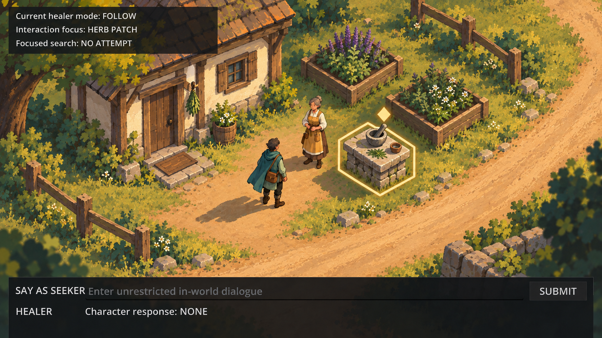

# Allrpcs art bible — selected Direction A

Status: approved Phase 9.1 direction and bounded art bible 0.1, 2026-09-28.

Direction A, painterly storybook gouache, is selected. The user preferred A if feasible and D
otherwise. A is feasible with the constraints below: it uses the existing 2D renderer, 960x540
logical viewport, and `Camera2D`; it requires no renderer, navigation, gameplay, or UI-behaviour
change. Direction D remains a contingency only if the representative production proof fails the
explicit feasibility gates near the end of this document.

This image is a visual target, not a runtime screenshot or source of final building, costume,
foliage, UI, or interaction assets.

Human review approved the refined scene on 2026-09-28. Phase 9.1 is complete; later changes must
preserve this direction or pass the documented Direction D contingency gate.

## Camera, projection, and resolution

- Preserve the current 960x540 logical viewport and continuous `Camera2D` framing.
- Use an orthographic-like high-oblique three-quarter projection with no horizon and negligible
  perspective convergence. World objects retain comparable scale across the screen.
- Judge all assets and UI at 960x540 before approving higher-resolution captures.
- Author raster masters at 2x their intended logical dimensions and retain those editable masters.
  Exported runtime dimensions follow the object's required on-screen footprint; do not assemble one
  monolithic painting of the opening region.
- Use smooth filtering for painterly raster assets. Pixel-perfect integer scaling is not a Direction
  A requirement.

## Modular production language

- Separate ground, paths, structures, plants, props, characters, occluders, effects, focus cues, and
  UI into independent layers.
- Build ground from broad low-frequency painterly patches with blendable edges. Reuse plant clusters,
  fence sections, rocks, wall sections, roof sections, doors, and windows with restrained variation.
- Reserve unique brush detail for landmarks and investigation focal points. Ordinary traversal space
  stays quieter than interactive or narrative space.
- Keep authored collision and navigation geometry independent of painted silhouettes. Art may clarify
  those boundaries but must not become their authority.
- Avoid one-off baked shadows crossing multiple movable or reusable assets. Each module owns only the
  contact shadow needed to ground itself; broad time-of-day light remains a separate treatment.

## Palette

The palette is a role-based starting set, not a ban on intermediate painted colours.

| Role | Starting colour | Use |
| --- | --- | --- |
| Charcoal | `#1A201D` | UI panels and deepest local values; avoid pure black |
| Moss | `#536F3C` | quiet ground and mid-value foliage |
| Leaf | `#7F9B4E` | lit foliage accents |
| Ochre | `#D2A84D` | warm cloth, late light, and restrained emphasis |
| Cream | `#E8D8B8` | plaster, type, and high-value material surfaces |
| Weathered brown | `#6E4B2F` | timber, soil accents, and warm selective outlines |
| Seeker teal | `#1F6E6B` | player silhouette accent, never the sole identity cue |
| Focus ivory | `#F7E3A1` | focus contours and markers with geometric redundancy |
| Danger brick | `#A84432` | danger accent only, always paired with a hazard shape/pattern |

- Keep walkable ground, blocking edges, characters, and interactables separable by luminance as well
  as hue.
- UI body text targets at least 4.5:1 contrast. World-state markers target at least 3:1 against their
  immediate surroundings and always carry a second non-colour cue.
- Verify representative scenes in grayscale and common colour-vision simulations before production
  approval.

## Light and atmosphere

- Default exterior language is warm late-afternoon side light with soft, readable cast shadows.
- Lighting establishes time and mood but cannot hide a required route, body, doorway, or state cue.
- Use restrained leaf/dust motes only at scene edges or quiet negative space. Never layer particles,
  fog, bloom, or foreground foliage over interaction markers or navigation-critical ground.
- Interiors may be warmer and more enclosed, but value hierarchy and state cues remain consistent.
- Weather and story-state variants alter light, surface response, and atmosphere without replacing
  canonical object silhouettes.

## Texture and outline policy

- Use matte gouache-like brush grain and simplified hand-painted forms. Texture frequency decreases
  with gameplay importance: quiet ground is broad; focal props may carry finer accents.
- Use selective warm-dark outlines, normally one to two logical pixels at 960x540. Strengthen the
  lower/contact edge and separation between overlapping gameplay silhouettes; omit unnecessary
  interior contouring.
- Do not outline every grass blade or stone. Dense detail, universal black outlines, photorealistic
  surface noise, and excessive bloom are outside the selected language.

## Character proportions and animation requirements

- Gameplay characters target 48–56 logical pixels in height at 960x540 and roughly 4.5–5 heads tall.
- Preserve a distinct head/hair shape, torso mass, cloak/apron shape, feet, and facing cue in each
  silhouette. Clothing colour supports identity but does not define it alone.
- Initial production proof requires four directional facings, a two-frame idle/breathe treatment,
  and a six-frame walk cycle per required facing. A four-frame interaction gesture is the next
  bounded addition only after the walk proof succeeds.
- East/west mirroring is allowed only when costume, carried objects, handedness, and story details
  remain correct; otherwise author both sides.
- Animation must preserve the collision-foot position and avoid shifting the perceived interaction
  origin between frames.

## Object-state legibility

State cues layer on top of stable authored silhouettes and never change game authority.

| State | Visual rule |
| --- | --- |
| Ordinary | Material, silhouette, and contact shadow only; no persistent marker or sparkle |
| Noticeable | Add a deliberate silhouette break or short ground tick plus a local value edge; do not identify the object for the player |
| Hidden | Render no discoverable object or marker until authoritative state permits it; never encode hidden content as faint pixel hunting |
| Identified/focused | Add a warm-ivory double contour and a separate solid diamond marker; selected/focused motion may pulse scale or position, not hue or opacity alone |
| Dangerous | Add a stable triangular/chevron hazard silhouette and diagonal hatch treatment; brick colour is supplementary only |

- Markers remain outside the object's core silhouette and do not obscure text, characters, routes,
  or evidence details.
- At 960x540, the diamond or hazard marker targets 12–16 logical pixels and must remain recognizable
  in grayscale.
- Do not use hidden-object sparkle, hue-only rarity, tiny cursor changes, or ambient VFX as the sole
  carrier of gameplay state.

## UI language

- UI remains engine-rendered, not baked into world art.
- Use flat translucent charcoal panels, restrained cream sans-serif text, generous padding, and one
  clear focus treatment. The dialogue panel occupies at most the bottom quarter of 960x540.
- Preserve keyboard focus, scaling, and existing content behaviour. This art direction does not
  authorize a layout or interaction redesign.

## Feasibility gates and Direction D contingency

Direction A remains selected if one representative production proof can satisfy all of these:

1. At 960x540, both characters, the doorway, walkable ground, and the preparation table read without
   zooming or relying on hue.
2. A small modular kit can recompose the cottage edge, path, two herb beds, fences, and foliage
   without visible seams or a monolithic background painting.
3. One four-direction character walk proof keeps silhouettes and foot placement stable at 48–56
   logical pixels.
4. Editable 2x masters can be revised and exported without destructive flattening or untracked
   third-party content.
5. The measured production estimate for the opening region is accepted before bulk asset creation.

Direction D becomes the fallback only if a reviewed Direction A production proof fails these gates
after one bounded correction pass. Preference alone, stylistic drift, or convenience is not enough
to switch. Any switch must retain the same camera, accessibility rules, provenance tracking, and
runtime/gameplay boundaries.

## Explicit exclusions

This draft does not import or replace runtime assets; change Godot project settings, camera,
navigation, collision, gameplay, or UI behaviour; create the production asset set; define final
portraits; begin audio; use third-party assets; or authorize release or signing work.
