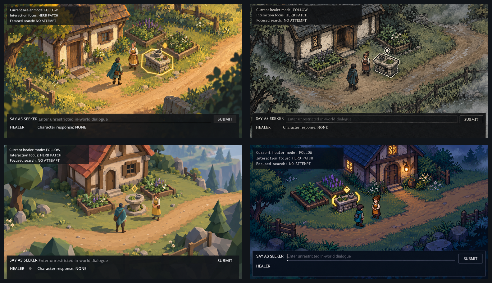

# Representative-scene visual directions

These preview-only images begin Phase 9.1 without changing the Godot project or selecting a final
direction. Every direction uses the same comparison brief: one village-edge clearing, one healer's
cottage, two characters, herb plants, one stone preparation table, and the existing dialogue/status
UI hierarchy at gameplay scale.

The comparison sheet is ordered A/B on the first row and C/D on the second. Review the full-size
sources before judging fine texture or pixel treatment:

- [Direction A — storybook gouache](previews/direction-a-storybook-gouache.png)
- [Direction B — ink and wash](previews/direction-b-ink-wash.png)
- [Direction C — low-poly diorama](previews/direction-c-low-poly-diorama.png)
- [Direction D — pixel art](previews/direction-d-pixel-art.png)

## Selected direction

Direction A is approved after human review, subject to explicit production-feasibility gates;
Direction D is the fallback only if an A production proof fails those gates after one bounded
correction pass. The first refinement reduces bespoke detail, preserves navigation clearance, and
strengthens the non-colour interaction cue:

- [Selected Direction A refinement](previews/selected-direction-a-refinement.png)
- [Bounded approved art bible](ART_BIBLE.md)

## Locked comparison content

- 16:9 gameplay view with approximately the existing greybox camera scale.
- Exactly one building, two full-body characters, planted herbs, and one interactable preparation
  table.
- A status panel at upper left and practical dialogue UI across the bottom quarter.
- The interactable uses both a shape cue and contrast; colour alone is never the cue.
- The path and open ground remain readable for navigation.

The previews intentionally simplify the much larger opening region. They are not runtime screenshots,
asset sheets, final layouts, or commitments to the generated building, costume, foliage, or UI
details.

## Concise comparison

| Direction | Perspective and resolution question | Palette, light, texture, outline, atmosphere | Characters and object legibility | Main tradeoff to review |
| --- | --- | --- | --- | --- |
| A — storybook gouache | High oblique three-quarter; inspect the 1672x941 preview at the current 960x540 viewport before selecting a base | Warm moss/ochre/cream/teal; late-afternoon side light; visible brush grain; gentle uneven outlines; leaf and dust motes | Naturalistic, about five heads tall; golden polygonal ring plus diamond makes the table readable by shape and value | Warm and approachable, but hand-painted asset volume and lighting consistency may be expensive |
| B — ink and wash | Near-top-down oblique; inspect the 1672x941 preview at the current 960x540 viewport before selecting a base | Charcoal/parchment/sage/iron-blue/rust; diffuse overcast light; paper grain and hatching; strongest dark contours; low ground mist | Compact, slightly exaggerated heads and hands; heavy double contour plus white diamond is the strongest non-colour cue | Excellent silhouette discipline, but dense hatching may become noisy in motion or at smaller scales |
| C — low-poly diorama | Clean isometric three-quarter; inspect the 1672x941 preview at the current 960x540 viewport before selecting a base | Pine/clay/limestone/ochre/teal; cool morning plus low warm sun; faceted materials; no drawn outlines; distant valley haze | Four-head-tall faceted figures; octagonal plinth, cast silhouette, and outlined diamond separate the table | Clearest spatial depth and reusable geometry, but isometric staging may constrain the existing authored camera and navigation presentation |
| D — pixel art | High three-quarter top-down; preview is 1672x941, with a proposed 320x180 authored base and integer scaling | Limited navy/blue-green/violet/amber/cream; blue-hour dusk; clustered pixels and selective outlines; edge fog | Sprites about 28 proposed-base pixels tall; paired brackets plus diamond remain readable without hue | Strongest explicit resolution discipline and atmosphere, but animation and environment coverage require substantial authored pixel work |

The original four-way comparison remains evidence for the selection rather than a source of runtime
assets. Direction A prioritizes painterly warmth while the art bible constrains its higher production
cost through reusable modules, a fixed logical viewport, quiet traversal surfaces, and explicit
readability gates.

## Provenance

- Created on 2026-09-28 with Codex's built-in image-generation tool. The tool did not expose a
  model/version identifier, so none is asserted here.
- The only image input was
  [`reference/greybox-camera-reference.png`](reference/greybox-camera-reference.png), a 960x540 crop
  of the project's own Phase 8 ordinary graphical checkpoint. It was used only for camera scale and
  UI layering.
- The reference crop was made from `/private/tmp/allrpcs-manual-large.png` with ImageMagick:
  `magick INPUT -crop 2800x1575+240+260 +repage -resize 960x540 OUTPUT`.
- Each direction was generated independently from that same reference and its recorded prompt. No
  third-party image, asset, logo, trademark, or style-reference image was used.
- The selected refinement was generated from Direction A as its edit target and the same greybox as
  a scale/framing reference. Its prompt and invariants are also recorded.
- The comparison sheet is a deterministic 2x2 montage of the four unedited generated PNG files.
- Generated pixels have not been imported into Godot or treated as shippable assets.

Exact generation prompts are preserved in [PROMPTS.md](PROMPTS.md).

## File integrity

| File | Pixels | SHA-256 |
| --- | ---: | --- |
| `reference/greybox-camera-reference.png` | 960x540 | `e2ddef84ea224e00d34e56ae81935161abb3257152610ab365b8c0a75a3da7f7` |
| `previews/direction-a-storybook-gouache.png` | 1672x941 | `56de22a56ab9ce00024e3ed05e8f1ac81dc6a276885acadb0741ffb2ac193654` |
| `previews/direction-b-ink-wash.png` | 1672x941 | `9f3b22fef8bf37e12ee6d86ffc46baca6cd7b8d099fe9f8f565629f9a6820bbb` |
| `previews/direction-c-low-poly-diorama.png` | 1672x941 | `e11caed8c1bac08cd4a0d07ca4cfe85f13051f98bd5ad37f057c0b301ec5e3d2` |
| `previews/direction-d-pixel-art.png` | 1672x941 | `b3d639980b8c9c30a8f809f9492505be3c787621ec388da7728a85a64e64c7c9` |
| `previews/selected-direction-a-refinement.png` | 1672x941 | `21077033ac87fc2606f8e3407413501b38198246f4861f899d8b6ab73fb6d296` |
| `comparison-sheet.png` | 1584x912 | `25f55defa50b815385256c9faee4c85ba6d3b20e5e0bc6ac197e57666a0a8d3a` |
