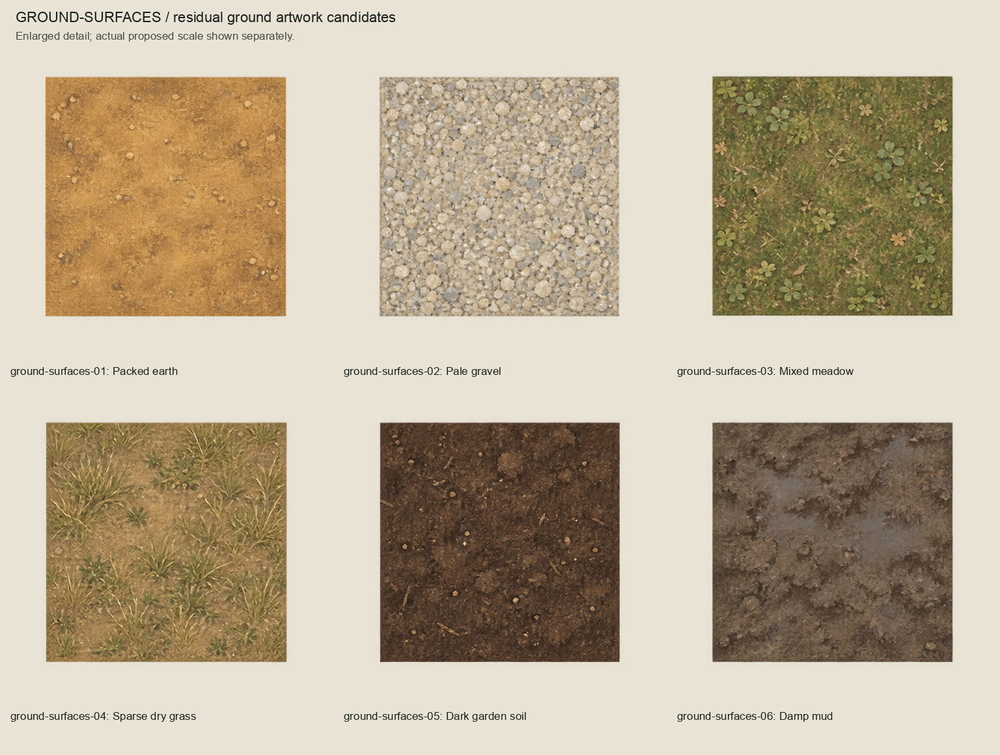
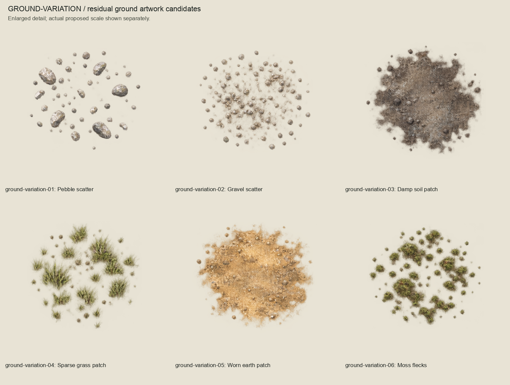
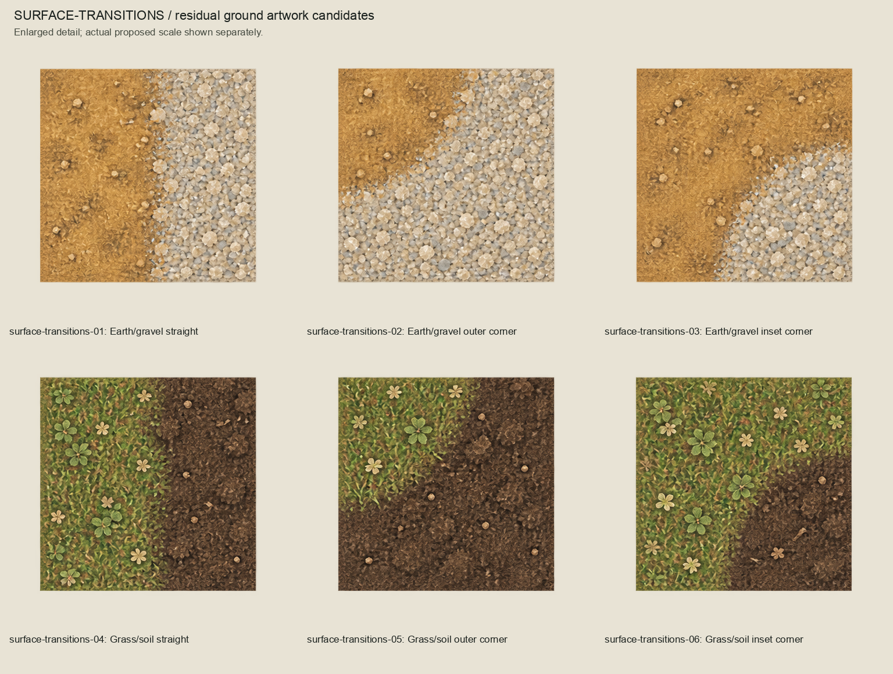
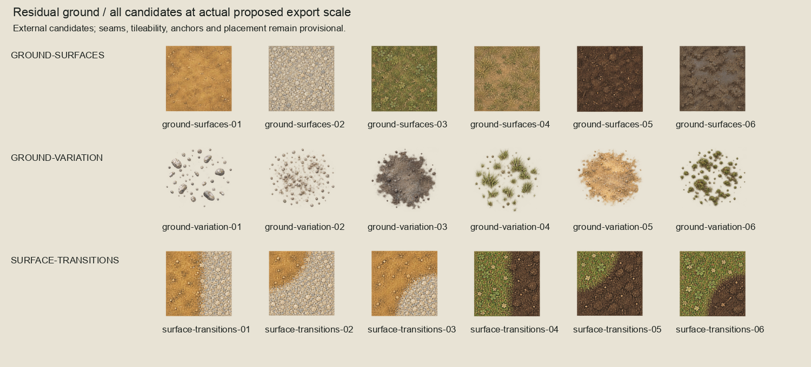
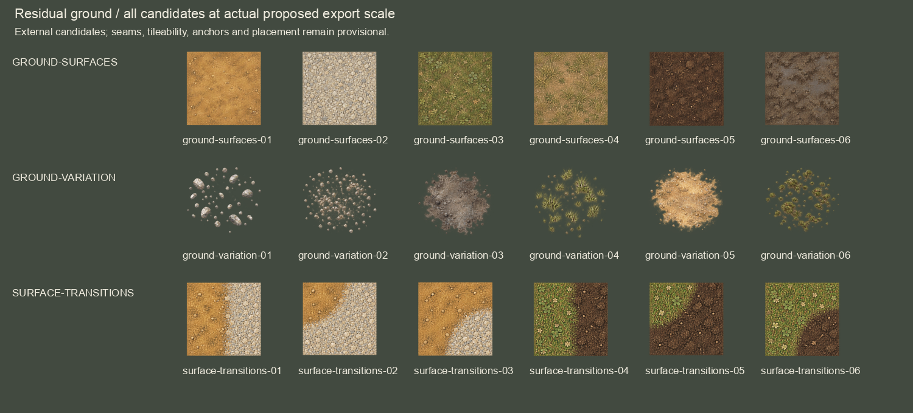
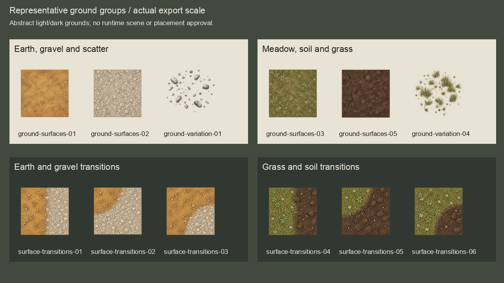

# Residual ground artwork candidates

Complete proposed 18-candidate external ground series, authored 2026-10-04
(Australia/Brisbane) with built-in image_gen. **The owner approved the complete
displayed artwork series: "This looks once again perfect! I approve".**
Six generic ground surfaces, six transparent variation overlays and six material
transition candidates. No predecessor artwork or runtime inputs changed.

## Complete family boards

## Proposed scale and groups

Both scale boards show every export once at 1:1. Groups show related materials
side by side, not a seamless mosaic or runtime scene. Each painted crop fits within
128x128 proposed bounds, with four export pixels of transparent padding. Masters
are exactly twice the export dimensions, with Source paint and empty Corrections
layers. They retain raster editability, not reconstructed semantic layers.

Surface sources have slightly translucent edges. Transition paint was generated
using the new surface sheet as a material reference; it is a reinterpretation,
not shared source pixels or verified connector geometry. These are material studies,
not import-ready repeatable tiles. Tileability, seams, corner connectivity, scale,
anchors, alpha blending, colour-vision accessibility and runtime placement are
provisional. No routes, terrain topology, navigation, collision or scenario facts
are established. Overall terrain completeness remains open.

## Sources and reproduction

`sources/` preserves all three unchanged generated sheets and provenance.
`prompts.json` records exact prompts, transparency flags and references.
`inventory.json` records source cells, crops, excluded faint pixels, provisional
dimensions and hashes. Crops retain all alpha >= 8 plus an eight-source-pixel margin;
only recorded distant pixels below alpha 8 are excluded, and retained paint is
never thresholded. `review-manifest.json` binds all technical review inputs.
`owner-acceptance.json` binds all 45 artwork files and the technical review manifest.
The inventory retains its historical candidate status; acceptance supersedes that
status. `session-review.json` records code/visual review and byte reproduction;
`validation.json` records consolidated scoped acceptance checks.

Build with `/opt/homebrew/bin/python3 art-direction/residual-ground-batch/build_review.py`.
Inspect with `/opt/homebrew/bin/python3 art-direction/residual-ground-batch/inspect_package.py`.
The builder refuses to overwrite a package with an owner acceptance record.
The complete artwork is accepted; production suitability checks and runtime promotion
remain separate. Product/runtime/CI inputs are unchanged, so product CI is not replayed.
Retain the unchanged full-suite evidence in
`art-direction/woodland-environment-batch/validation.json`.
