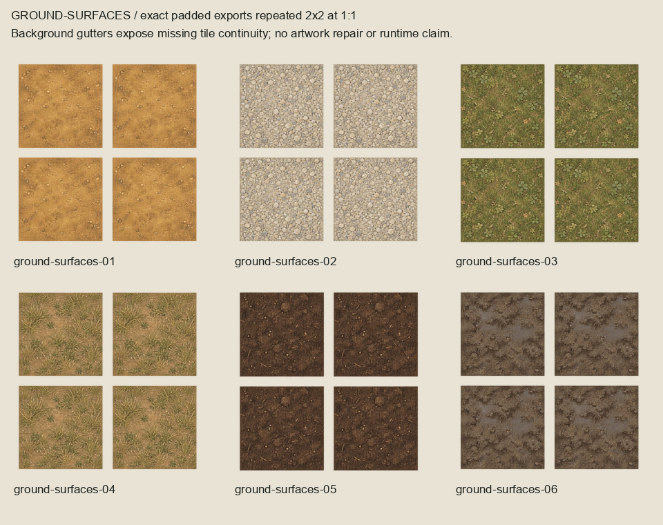
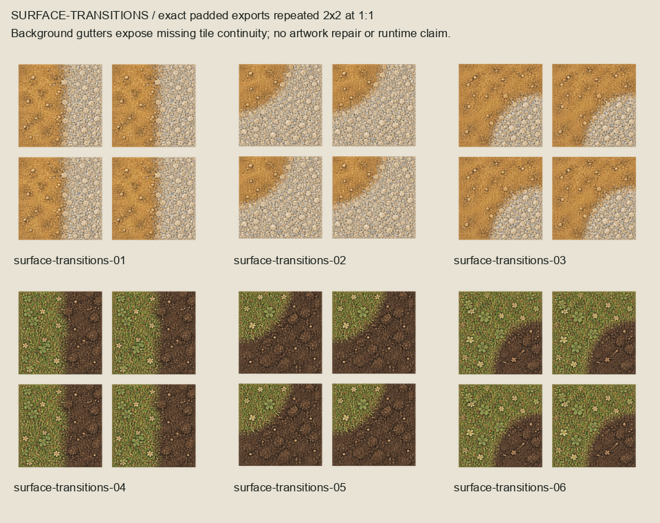

# Residual ground production-readiness audit

Read-only external audit after owner acceptance of the complete 18-candidate ground
artwork series. All approved source/master/export/board bytes remain unchanged.

The boards repeat exact padded exports 2x2 at 1:1. All twelve modules have fully
transparent outer edge rows/columns; repeating them leaves visible background gutters.
Equal transparent borders do not establish seamless material paint. Generated corner
boundaries also lack verified shared endpoints and fixed connector geometry. The six
variation overlays are intentionally isolated alpha artwork and remain accepted.

`readiness.json` binds the accepted package, each export and both diagnostic boards.
Reproduce with `/opt/homebrew/bin/python3 art-direction/residual-ground-readiness/inspect_readiness.py`.
These boards are diagnostics, not proposed artwork revisions or runtime arrangements.

The next bounded slice is a separate entire 12-module external production-feasibility
series: six repeatable 128x128 ground surfaces, plus straight/outer/inset transitions
for earth/gravel and meadow/soil. Use the accepted new source sheets as material
references; preserve the approved studies and all existing terrain. New full-surface
exports need filled perimeter pixels, repeatable paint edges, source-matched transitions
and verified connector endpoints. Keep editable 2x masters, labelled family boards,
1:1 repeat/connected compositions and retained failed evidence. Present the complete
series for collective owner review. No runtime imports, geography, navigation,
collision or terrain-category completion is authorized by this audit.
