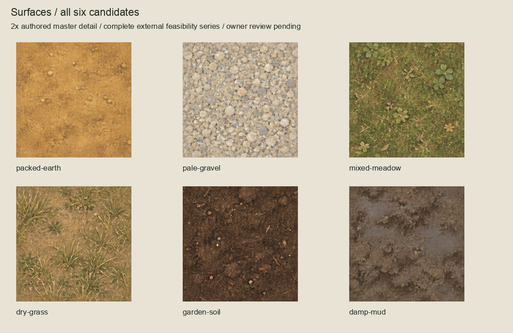
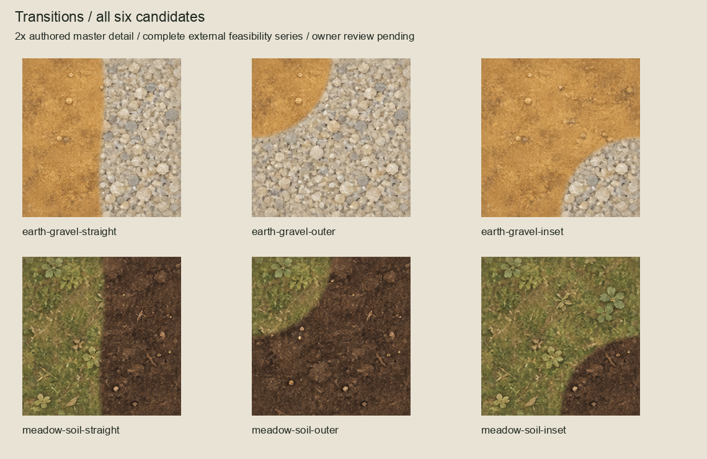
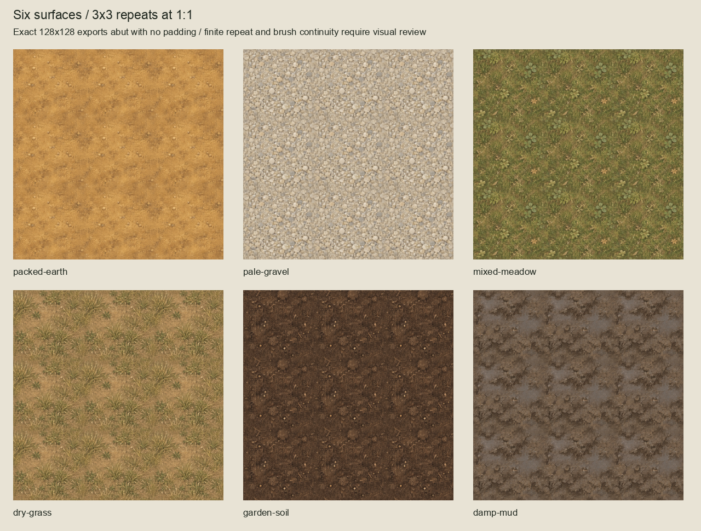
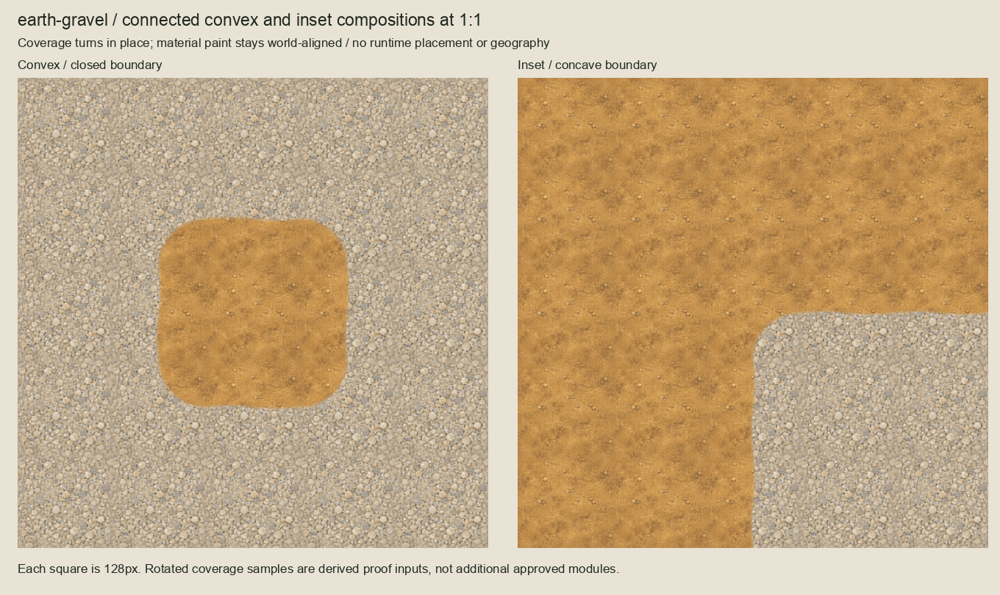
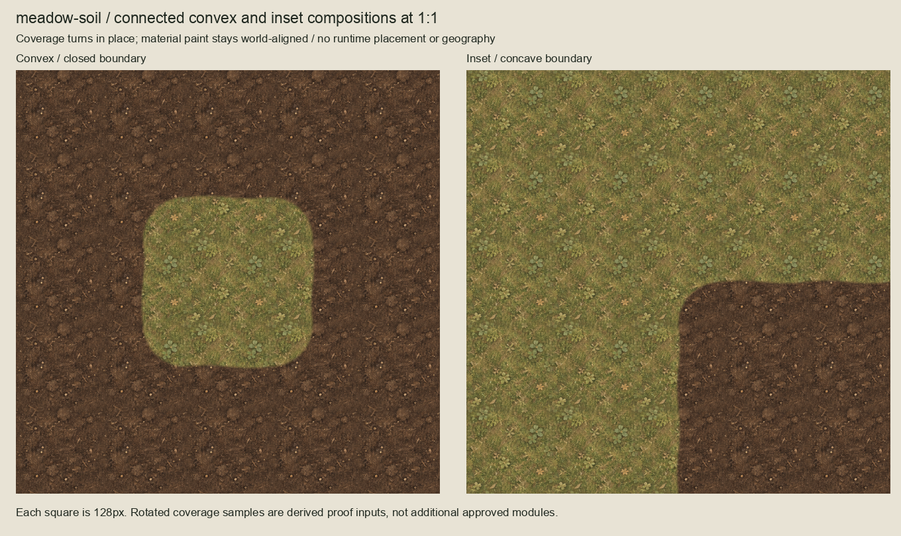

# Residual ground tiling feasibility candidates

Complete separate twelve-module external series, authored 2026-10-04 from the
approved [ground material paint](../residual-ground-batch/README.md). **The owner
approved the complete series: "Looks good - all approved".** Six fully filled 128x128 repeatable surface candidates
and two three-module straight/outer/inset transition families. Existing approved
studies, variation overlays, the 35 manifest terrain exports and runtime are preserved.

The native OpenRaster workflow reuses approved image_gen source paint; no new
image generation or material reinterpretation is involved. Source interior crops
exclude the study perimeters. Their nearly opaque paint is composited over a
material-specific median-colour underpaint, then wrapped using 64-master-pixel
overlapping painted margins. Two-master-pixel connector bands are reconciled.
No source artwork is overwritten. The naive unwrapped crops fail opposite-edge
equality and remain in `evidence/unwrapped-repeat-1x.png`.
The earlier [transparent-gutter diagnostics](../residual-ground-readiness/README.md)
also remain unchanged.

All masters are 256x256, authored at exact 2x, with editable raster layers and an
empty Corrections layer. Surface masters retain the source interior beneath the
periodic paint. Transition masters separate the background material and masked
foreground paint; reusable coverage masks are in `sources/`. Exports are derived
once with BOX downsampling, whose two-pixel support preserves shared connectors.
The masks have a six-export-pixel smooth painted boundary, restrained straight
waviness and fixed midpoint endpoints. Outer corners put foreground at upper-left;
inset corners put background at lower-right. They have distinct curved coverage.

Connected boards use the exact exports at 1:1 plus explicitly recorded orientation
samples. **Only the coverage masks turn; material paint stays world-aligned.**
Rotating the entire painted export would not preserve the source phase. These
supplemental orientations are proof inputs, not extra approved modules or a
runtime tile-selection implementation. Every connected neighbour has an exact
filled material/transition edge; visual continuity and brush character still
received collective owner artwork approval. Finite repeated motifs remain visible. New
variation overlays, terrain-category completion, import settings, accessibility,
geography and runtime promotion are outside this slice.

Build with `/opt/homebrew/bin/python3 art-direction/residual-ground-tiling-proof/build.py`.
Run lightweight authoring checks with
`/opt/homebrew/bin/python3 art-direction/residual-ground-tiling-proof/authoring_check.py`.
Dependencies are Pillow and NumPy. The builder refuses to overwrite owner-accepted
artwork. `inventory.json` binds original sources, predecessor hashes, master/export
dimensions and all board placements; `review-manifest.json` binds the review packet.
`session-review.json` records this session's code/visual review and reproduction.
The inventory/board candidate labels preserve their historical authoring status;
`owner-acceptance.json` supersedes that status and binds all 57 artwork files plus
the technical review manifest. Consolidated scoped checks are in `validation.json`.
Recheck with `/opt/homebrew/bin/python3 art-direction/residual-ground-tiling-proof/inspect_package.py`.
The read-only [remaining terrain-readiness audit](production-readiness.md) identifies
the exact next bounded external slice; overall terrain readiness remains open.
Retain unchanged product-suite evidence from
`../woodland-environment-batch/validation.json`; no product/runtime/CI inputs changed.
