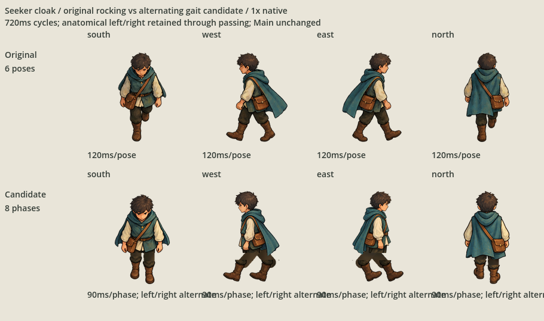
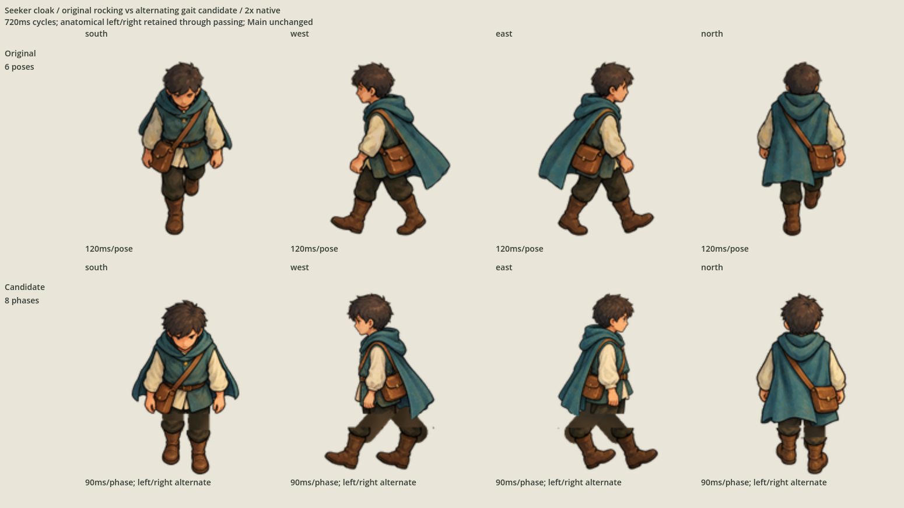
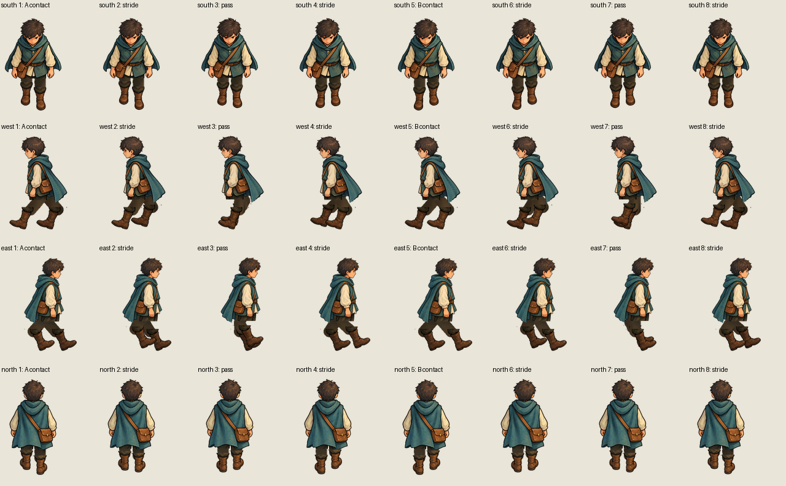
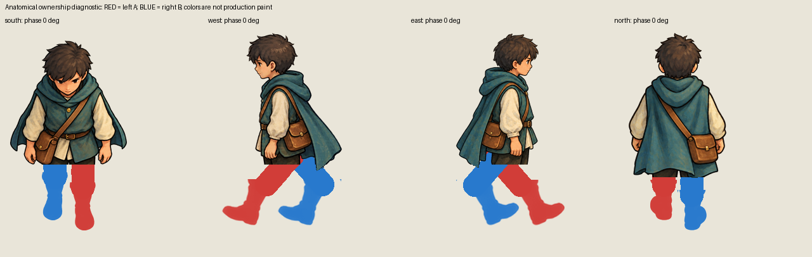
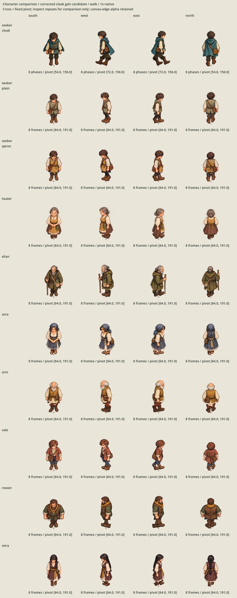

# Seeker cloak gait correction

The owner identified the missing gait on 2026-10-06: the first row rocks while
retaining one leading leg. Inspection of the original six poses confirms this
in all four directions. The earlier import proof correctly retained and played
those frames; its pixel/frame-order checks did not establish a real walking gait.
That distinction was missed in the previous review.

This separate candidate uses the original editable cloak paint with the existing
mechanical cutout-rig workflow: **32 new walking poses, four directions, eight
phases each**, with semantic torso/cloak, anatomical-left, anatomical-right and
blank correction layers in every native 2× OpenRaster master. The original
six-pose exports/masters, accepted import proof and other nine families remain
unchanged. Main still uses its existing presentation.

## Complete comparison

The top row is the original inherited sequence; the bottom is the correction.
All four directions are shown together. Both cycles take 720 ms: original six
poses × 120 ms; candidate eight phases × 90 ms. Lossless WebP previews preserve
every actual Godot capture pixel and its exact sample timing.






The diagnostic colors anatomical left A red and anatomical right B blue; these
colors are not production paint. Ownership never changes as the boots pass.



Run `godot --path game res://SeekerCloakGaitCorrectionProof.tscn` to compare both
sequences interactively at native/2× scale, pause and step through the poses.
The additive `game/CharacterAnimationImportProofCorrectedCloak.tscn` also shows
the corrected first row with all nine unchanged families, preserving every
other family, idle and inspect resource. The frozen original proof stays intact.



## Actual gait checks

`check_gait.py` replays all four directions and compares the actual rendered
pixels with all exports and every composed OpenRaster layer stack. It checks
the defect itself, beyond successful import or a nonempty loop:

- Side-view boot shafts exchange which one leads between phases 0° and 180°.
- Both passes, at 90° and 270°, bring the shafts within four native pixels.
- The swing foot changes from anatomical right B to left A on opposite passes.
- Front/rear contacts alternate their painted sole depths and swing foot.
- Anatomical identity and hip attachment remain fixed across all eight poses.
- Every direction has eight distinct decoded poses and an exact loop endpoint.

The corrected texture sizes retain the original 108×168 front/rear and 144×168
side canvases, with fixed `(width/2,156)` pivots. All four directions have canvas
padding. `rig.json` records source-master hashes, sampled layers, boot/hip/shaft
coordinates, frame order, stride and swing metadata. Source files are untouched.

The Godot capture checker checks all 32 decoded imported RGBA images, ordered
playback of every old/new direction through at least two complete loops and
unchanged pivots. The 24 retained Compatibility captures cover every old and
new walking pose at both scales. Import sidecars use independent canonical UIDs
and the frozen proof's lossless RGBA-preserving recipe without changing that recipe.

This is a simple cutout gait. The far side boot reuses visible-side paint with
a restrained value difference; arms, torso and accessories remain largely rigid.
Source-paint cutouts and local textured hip/knee/ankle connectors correct the
leg motion, without claiming a fully articulated body, terrain foot placement,
movement-speed matching, footsteps or physical authority.

## Evidence and state

- `owner-request.json`: exact correction request; ledger reopening is limited to this defect.
- `authoring-check.json`: actual contact/pass/anatomy and native master/export replay.
- `candidate.json`: hash-bound complete candidate, comparisons, imports and tools.
- `captures/`: actual old/new imported-texture comparison frames.
- `rejected/`: first doubled-side-boot extraction and pre-final torso-mask fringe evidence.

Authoring checks:

```sh
/opt/homebrew/bin/python3 art-direction/seeker-cloak-gait-correction/check_gait.py
/opt/homebrew/bin/python3 scripts/validate-character-animation-import-proof.py
python3 scripts/check-continuation.py --self-test
```

The complete corrected candidate is ready for the owner's visual selection.
No selection, ordinary runtime replacement or publication approval is inferred.
The audio-policy slice is deferred in the persistent ledger while this correction
is active. Full product tests/CI have not been repeated for this external candidate.
