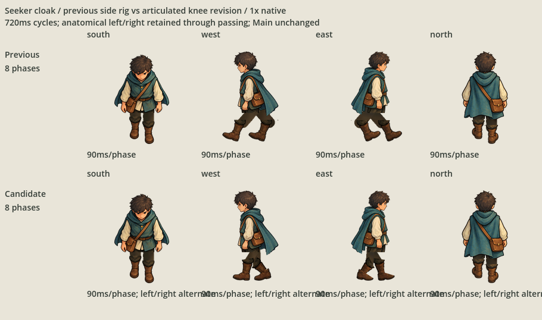
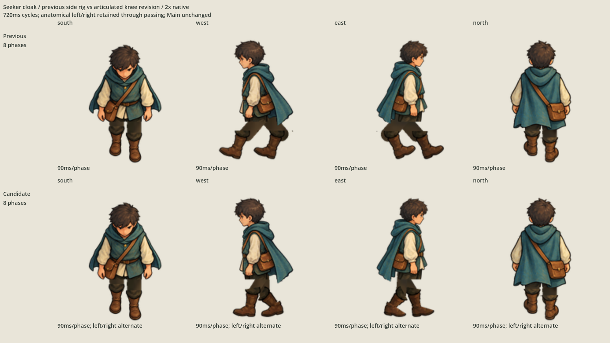
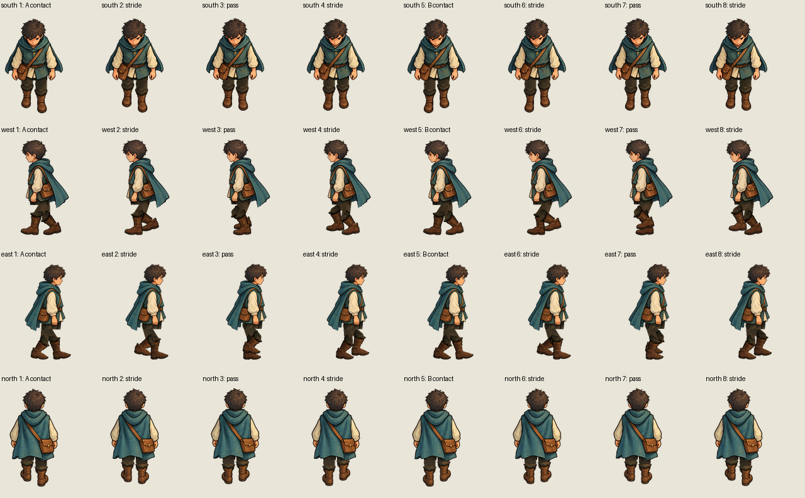
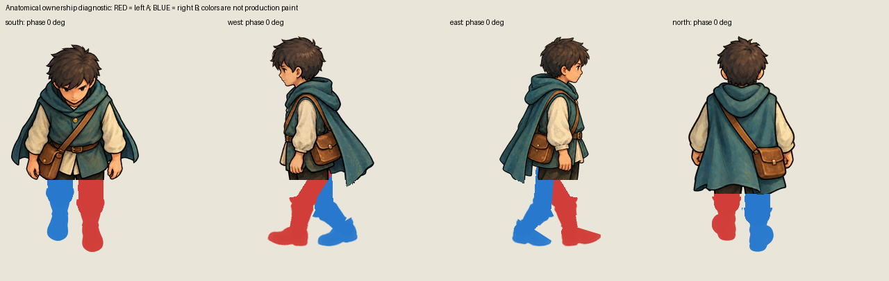

# Seeker cloak side gait revision

The owner accepted the front and back views on 2026-10-07 and rejected the sides:
the translated straight boots retained a backward shaft angle. The exact
[request](owner-request.json) permits a straight central-pelvis scissor gait or
knee flexion/extension. This candidate uses articulated knees and ankles.

Both legs attach to one hidden central pelvis. Fixed-length thigh and shin bones
drive each knee, and the original boot calf rotates with the shin. Separate foot
paint permits heel strike and toe-off without forcing the boot's inherited angle
onto every pose. The swing knee flexes at passing, then extends toward the next
contact. The anatomical left/right identities remain fixed throughout the cycle.

The sixteen accepted south/front and north/back exports and native OpenRaster
masters are copied **byte for byte** from the previous candidate. Their selection
is retained in `accepted-views.json`; only the sixteen west/east poses are revised.
The previous candidate, original approved character paint, frozen import proof,
Main and all other character families are preserved.

## Complete comparison

Top: previous candidate. Bottom: side revision with accepted front/back unchanged.
Both use eight phases at 90 ms each, for a 720 ms cycle. These lossless previews
retain the actual imported Godot capture pixels at native and 2× scale.






Open the isolated comparison with:

```sh
godot --path game res://SeekerCloakGaitSideRevisionProof.tscn
```

It supports native/2× display, pause/play and frame stepping. The separate
`game/CharacterAnimationImportProofRevisedCloak.tscn` carries this walking set
into the full proof while retaining all other families and actions.

## Evidence and boundary

`check_gait.py` checks the actual defect: central pelvic attachment, constant bone
lengths, exchanged contact leads, both passing poses, planted stance soles,
knee-angle excursion and rotating shin paint. It also checks exact editable-layer
composition and decoded export replay for all 32 poses, accepted front/back file
identity, original source-master hashes and every predecessor candidate binding.

```sh
/opt/homebrew/bin/python3 art-direction/seeker-cloak-gait-side-revision/check_gait.py
python3 scripts/check-continuation.py --self-test
git diff --check
```

`rig.json` retains measured source cuff/ankle anchors, solved hip/knee/ankle
coordinates, rotations, phase order and file hashes. `candidate.json` binds the
complete revision and comparisons. `evidence/` records scoped import/playback
and capture results. Import and rendering use a disposable game copy with published
project bytes, preserving the unrelated local editor rewrite.

This remains cutout animation with largely rigid arms and torso. It does not
implement terrain contact, speed matching or footsteps. Front/back approval is
settled; visual selection of the revised sides remains open. Main integration,
ordinary runtime changes and Git publication are outside this correction.
