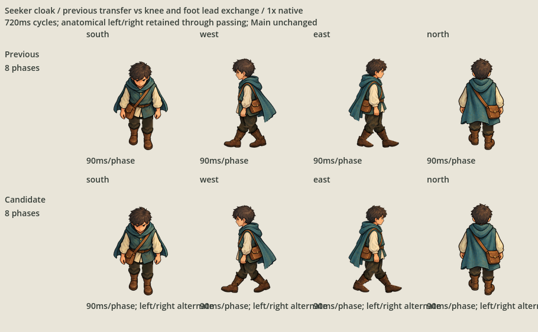
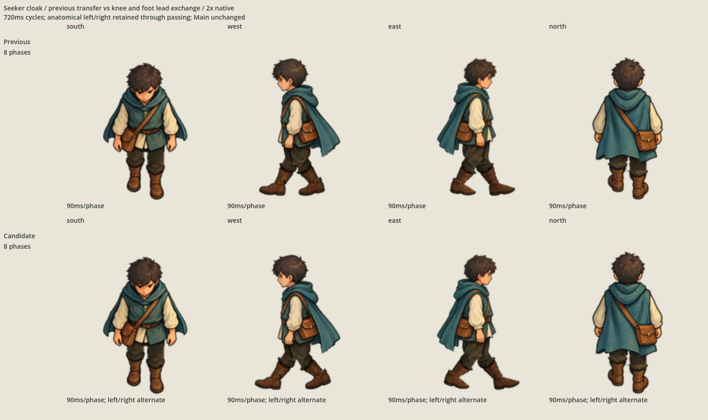
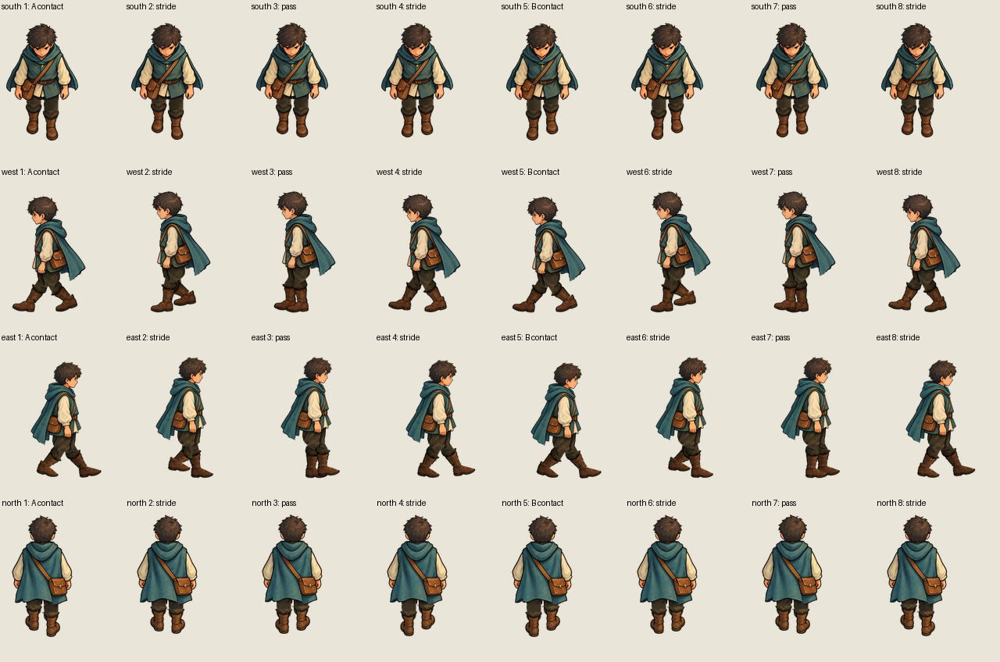
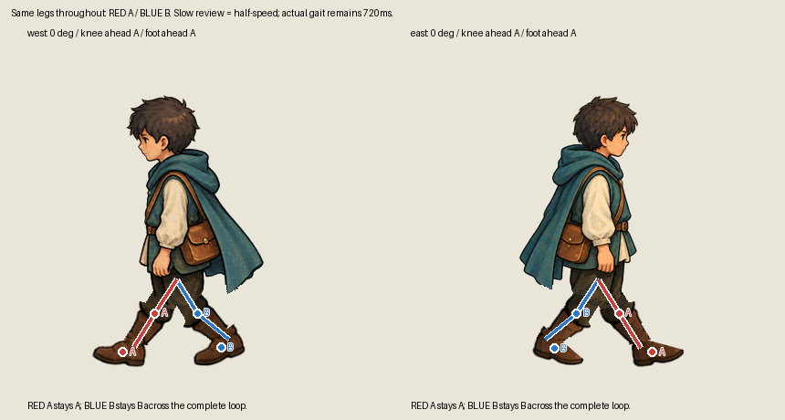

# Seeker cloak knee and foot lead exchange

The owner's [latest correction](owner-request.json) requires the former hind knee
and foot to move well ahead of the former front pair, while the old leader becomes
the hind leg. This separate successor changes side transfer timing and excursion;
the painted pelvis, filled front contour and backward-only knee hinges are retained.

The preceding contact poses exchange ankle positions, but the mid-transfer swing
foot remains behind after its knee has passed. The successor advances the swing
thigh farther and extends the knee earlier. By the middle transfer pose, the new
knee and rendered foot both lead clearly. The leading pair continues to contact;
the opposite pair moves behind and then repeats the same transfer half a cycle later.

One identity follows each complete leg throughout: anatomical left A and right B.
Paint, semantic layers and identities are not relabelled when the legs cross.
Thighs rotate around their measured shared pelvis and knees still bend backward
only. Neither fixed near/far layer order nor a contact-only check counts as proof
of fore/aft lead exchange.

## Complete comparison and tracked transfer

Previous candidate above; new transfer below. Actual imported Godot pixels are
retained losslessly at native/2× scale. The runtime cycle remains 720 ms.





This half-speed authoring diagnostic shows the same red A and blue B knees and
foot paint through both transfers, with the current leaders labelled at every pose.
The dots, skeleton and diagnostic colors are not production paint.



```sh
godot --path game res://SeekerCloakLeadExchangeProof.tscn
/opt/homebrew/bin/python3 art-direction/seeker-cloak-lead-exchange-revision/check_gait.py
python3 scripts/check-continuation.py --self-test
git diff --check
```

The full-cohort successor is `game/CharacterAnimationImportProofLeadExchangeCloak.tscn`.

## Checks, preservation and remaining decision

`check_gait.py` measures knee positions, ankle positions and alpha-weighted actual
foot paint centres through both transfers. It also checks the visible diagnostic
foot tips after both leg layers overlap, so an occluded or permanently hind foot
does not pass merely because its stored joint moved. Each anatomical pair must
lead at one contact/transfer and trail at the other. The new mid-transfer criterion
explicitly rejects the retained predecessor's late passing foot.

The same check retains the painted hip centres, frontal pelvic continuity,
signed backward-only knee angles, straight leading contacts, fixed bone lengths,
support baseline, canvas padding and exact editable/export replay. `rig.json`
records pose angles, joint and measured foot-paint coordinates, source hashes and
all exports/masters. `candidate.json` binds the complete successor and its review.

All sixteen accepted front/back exports and native masters are carried forward
byte for byte. Their existing [partial acceptance](../seeker-cloak-gait-side-revision/accepted-views.json)
stays closed. All three previous side candidates, original approved source paint,
the frozen import proof, other families, ordinary product inputs and unrelated
local `game/project.godot` rewrite are preserved.

This remains cutout animation with largely rigid arms/torso. Selection of the new
sides is the remaining decision. Main integration, gameplay, physical terrain
contact, movement-speed matching, footsteps and Git publication stay excluded.
