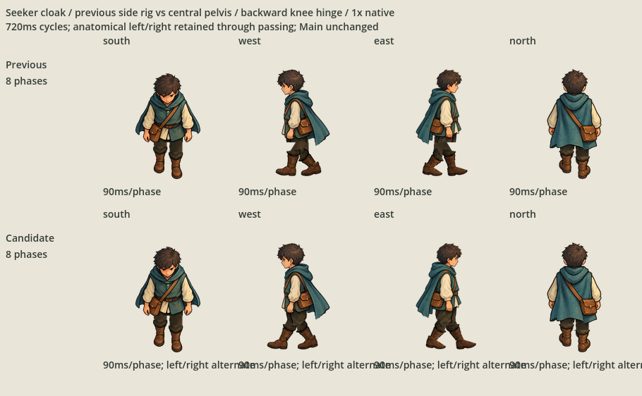
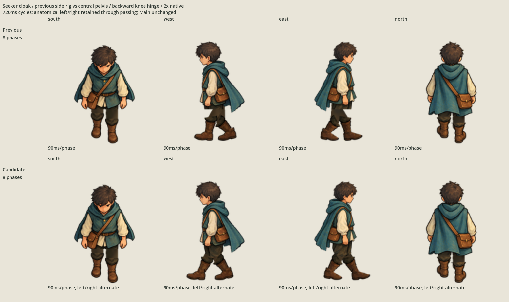
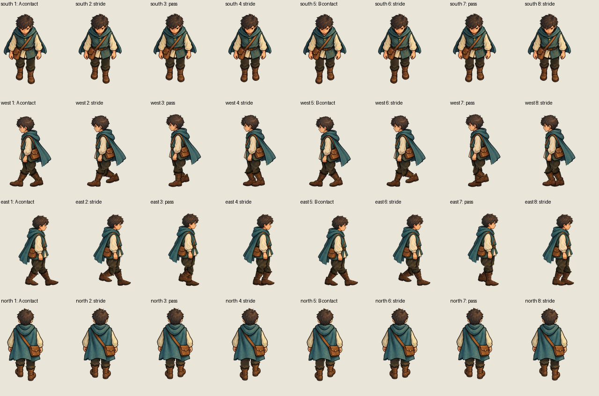
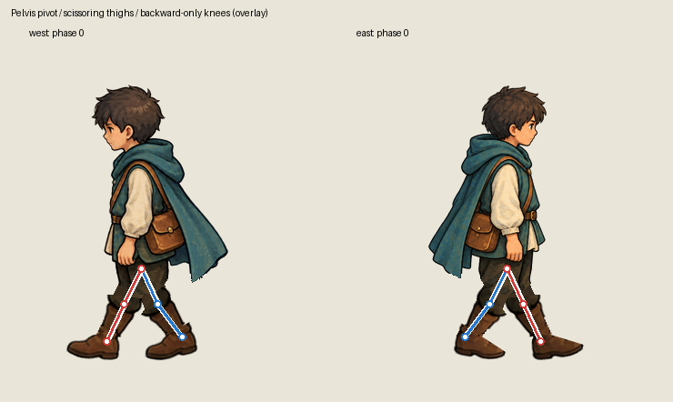

# Seeker cloak pelvis and knee hinge revision

The owner's [further side correction](owner-request.json) identifies the thigh
roots behind the pelvis and a missing sharp front edge. This separate successor
replaces the canvas-centre hip with the painted anatomical centre: west `(123,210)`
and east `(165,210)` in the original native 2× source coordinates.

Retained original pelvic paint fills the front contour and rounds the lower edge
over both thigh roots. Both thighs share that one pelvic pivot, rotating forward
and backward. Each shin has one knee pivot: it straightens along the thigh at the
forward contact, then folds backward during swing. Knee angles cannot become
negative or bend forward through the straight position. The source calf rotates
with the shin; the foot rotates separately at the ankle.

The rig uses explicit hip and knee angles with fixed bone lengths. It no longer
derives thigh orientation from ankle targets. A supporting sole determines a small
whole-body rise/fall; the anatomical hip remains fixed within the pelvic paint.
Side canvases have twelve native pixels of transparent top padding for that motion,
with the foot pivot shifted by the same amount. The displayed ground baseline is
unchanged. Front/back canvases, pivots, exports and native masters are unchanged.

## Complete series and visible hinges

Previous side candidate above; pelvis/hinge revision below. Both eight-phase cycles
last 720 ms. The comparison previews preserve actual imported Godot capture pixels.





The overlay shows the shared pelvic pivot, each knee pivot and each ankle. Red is
anatomical left A; blue is anatomical right B. Lines and dots are diagnostic only.



```sh
godot --path game res://SeekerCloakPelvisHingeProof.tscn
/opt/homebrew/bin/python3 art-direction/seeker-cloak-pelvis-hinge-revision/check_gait.py
python3 scripts/check-continuation.py --self-test
git diff --check
```

The separate full-cohort display is `game/CharacterAnimationImportProofPelvisCloak.tscn`.
Both displays use measured texture pivots and preserve the other nine families.

## Evidence and remaining decision

`rig.json` retains exact joint coordinates, hip angles, knee angles, source-paint
hashes, exported files and editable masters. `check_gait.py` independently checks
the signed angle between thigh and shin: straight or backward flexion only, with
no hyperextension. It verifies both scissoring thigh exchanges, actual straight
contact poses, constant bone lengths, supporting sole depth, front pelvic paint
continuity, exact 32-pose replay and original source/predecessor preservation.

All sixteen previously accepted front/back exports and masters remain byte-identical.
Their existing [terminal partial acceptance](../seeker-cloak-gait-side-revision/accepted-views.json)
remains authoritative. Both side predecessors and the original accepted character
import proof are retained. `candidate.json` binds this complete successor and its
comparisons; scoped import/playback/capture evidence is in `evidence/`.

This is cutout animation with largely rigid arms and torso. Visual selection of
the new sides remains open. Main integration, terrain contact, speed matching,
footsteps, ordinary gameplay and Git publication remain outside this correction.
