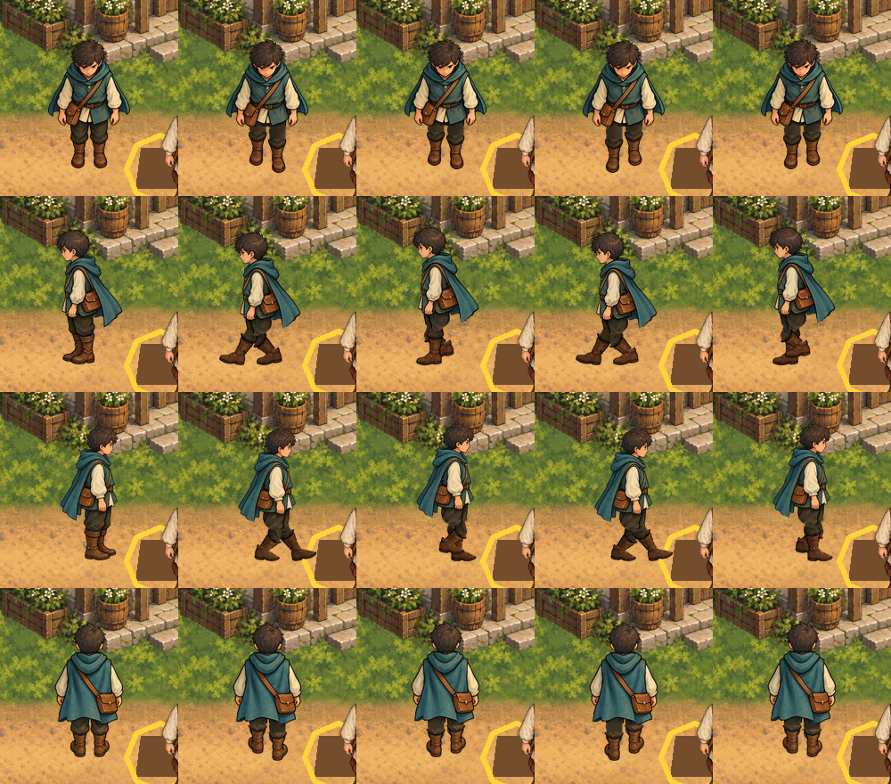

# Seeker reference gait in Main

On 6 November 2026 (Australia/Sydney) the owner chose #462 as the next slice
([authority.json](authority.json)): Main's Seeker walk still played the older 6-frame cycle, in
which one leg always seems to lead. This slice installs the owner-accepted
[reference gait](../reference-gait-model.md) (2026-10-07) in ordinary Main. No new art was made
and no accepted frame was edited.

Each row is one direction (south, west, east, north): the idle pose, then the walk at 0, ¼, ½
and ¾ of its cycle, rendered by ordinary Main on the village square
([capture script](../../scripts/capture-seeker-reference-gait-runtime.gd),
[hashes](capture-evidence.json)).

## Which frames

`game/art/runtime/characters/seeker/<direction>/walk-NN.png` are byte copies of the accepted
frames in `game/art/seeker-cloak-reference-gait-revision/frames/` (the frames that
[reference-gait-model.json](../reference-gait-model.json) binds): eight poses each for south and
north, sixteen each for west and east. They replace the old `walk-01..06`; idle and interaction
frames are unchanged. Import settings match the other runtime Seeker frames.

## Wiring

- `walk-animations.tres` plays them in the accepted phase order: 90 ms per pose front/back,
  45 ms per pose on the sides, so every direction loops in the model's 720 ms.
- The side poses are 144×180, 12 px taller than every other Seeker frame (extra head-room above;
  the feet are still 12 px above the bottom edge, as in idle). `AnimatedSprite2D` has one offset,
  so with Main's (0, −72) the side walks would have drawn 6 px low.
  `SeekerWalkAnimationPresenter` now keeps each animation's bottom edge where the scene's offset
  puts the starting animation's, which raises the side walks to (0, −78). The Healer and Sage
  frames all share one height, so their offsets do not change.
- Movement, facing selection, collision and depth order are unchanged.

## Checks

`ALLRPCS_RUNTIME_SEEKER_WALK_CHECK` (`RuntimeSeekerWalkSmokeCheck`) now requires the 48 runtime
walk frames to match the accepted frames' SHA-256, the 8/16-pose 720 ms loops, the side frames'
size, and the walk/idle offsets that keep the feet on one ground line. Before the art change it
failed (`walk_south is not the reference gait's 8-pose 720 ms loop`); after it, it passes.

`scripts/validate-runtime-seeker-walk.py` is the frozen validator of the superseded 6-frame
promotion (`e5762031`). It now reports `lost manifest/source parity` at HEAD by design; nothing
runs it at HEAD, and it stays unchanged as historical evidence.

Out of scope: Healer/Sage walks (#480), the Healer inspect gesture (#481), new artwork.
