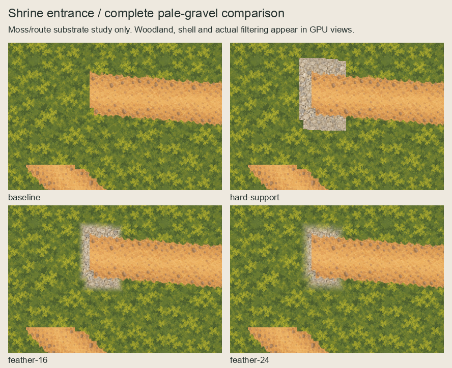
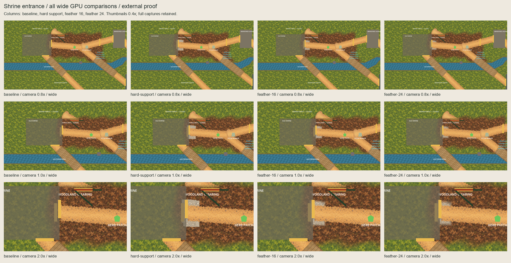
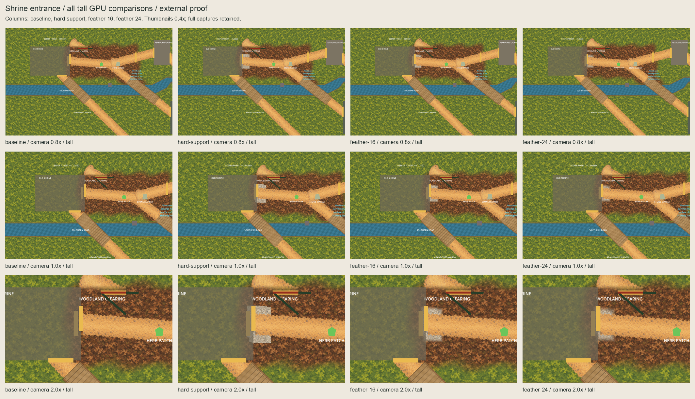
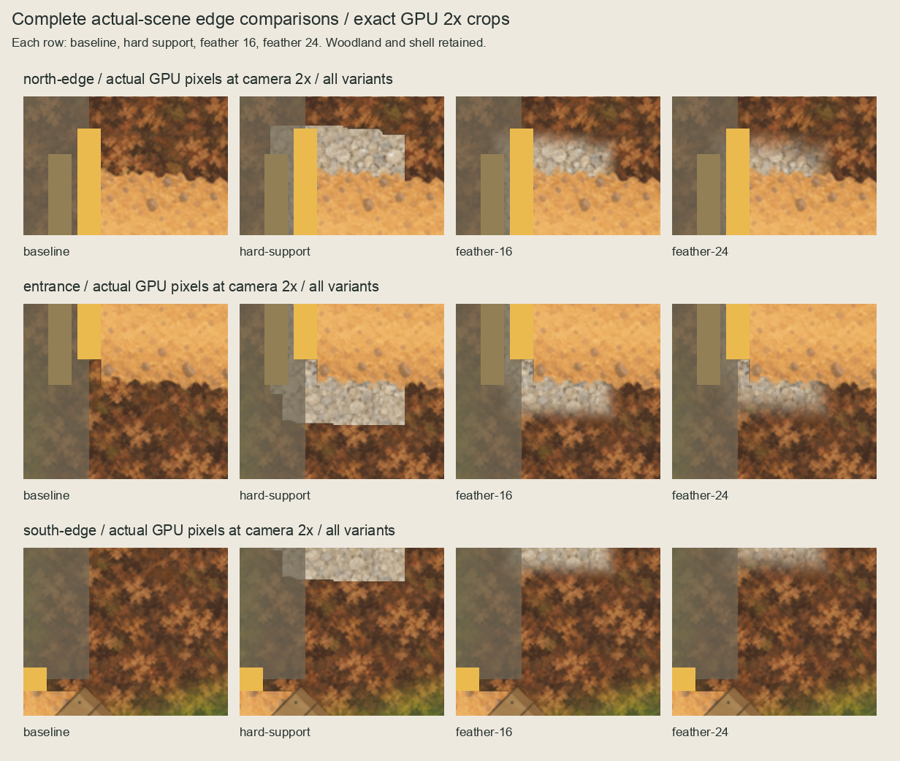

# Shrine east-entrance pale-gravel external proposal

Prepared from live main `90dd8ccf` on 2026-10-05 (Australia/Sydney), under the
continuing slice request. The owner selected **feather-16** ("feather-16 seems best here").
[Owner selection](owner-selection.json) binds the exact displayed and selected files. No runtime asset,
import, production master or scene changed. [Selection recipe](selection.json)
records agent choice of location/material; it does not invent owner approval.

## Complete revised series






Columns retain baseline, hard-support diagnostic, 16px inward feather and 24px
inward feather. All 24 full-size GPU views remain in `captures/`. Overview boards
use 0.4x thumbnails; detail boards crop the actual wide 2x captures without
resampling. Three editable **184x286 OpenRaster masters** retain masked paint,
empty Corrections, hidden coverage and hidden unmasked world-paint layers.

The CPU board is only a quiet-moss/route substrate study. It omits woodland
litter/transitions, the Shrine shell, labels and physical boundaries. It must not
be used as evidence of the actual scene interface. GPU views retain all these
owners, every accepted ground owner, channel, Shrine triangle and forest gate.
Only root CanvasLayers and CharacterBody2Ds are hidden in the disposable instance.

Hard support leaves flat gravel terminations. Feather-16 keeps more visible
stones; feather-24 gives a softer perimeter against the retained woodland litter.
The existing translucent Shrine shell, overlapping opening markers and greybox
labels remain visible. No accessibility, pacing or terrain-completeness acceptance
is claimed. The owner preferred feather-16; the 24px feather remains a retained alternative.

## Exact proposal

Sample approved unchanged 128x128 pale gravel at absolute world phase `(0,0)`.
The retained 704x208 Woodland–Shrine route is centred at `(704,328)`, top-left
`(352,224)`, z=-74. Use alpha `>0` only in world columns `[620,664)`, just east
of the authored Shrine boundary x=620. Its segment bounds are `(620,274)` to
`(664,369)`, exclusive right/bottom. Square dilation radius 24 yields a **92x143**
window `(596,250)` to `(688,393)`; this is a local entrance apron.

Zero-padded Chebyshev pixel-centre distances yield inward smoothstep masks of
16px and 24px. Covered RGB equals approved source texels exactly; transparent
pixels have zero RGB. Proposed sprites use **z=-78**, centred=false, unit scale,
zero offset, linear filtering and repeat disabled: above retained woodland
transitions (-80/-79), below the Woodland–Shrine route (-74). No accepted paint,
mask, transform, depth, sibling order or physical owner is modified.

The initial z=-90 recipe was substantially hidden by the woodland perimeter.
Its complete masters, native boards, 24 GPU images, tools and metadata remain in
[evidence/initial-depth-minus90](evidence/initial-depth-minus90/). The revised
packet changes proposed depth and labels only; source paint and masks are identical.
The final edge boards now use actual GPU pixels, rather than a substrate study.

Camera target `(650,340)` retains ordinary north/west limits. At 0.8x both frames
clamp x to 800 and y to half-height/zoom. At 1x x remains 650 and y clamps to
360/413.5; both 2x views stay at `(650,340)`. Six baselines pair with 18 candidates.
World transforms and exact input/capture hashes are in [capture evidence](capture-evidence.json).
Godot sandbox startup exited 134; identical host retries produced both full series.

## Evidence and next boundary

[Baseline](baseline.json) freezes all 7,555 tracked predecessor files; only the
three continuation documents may change. [Inventory](inventory.json) binds the
material/recipe, accepted owners, output paint/masks/masters and substrate boards.
[Board manifest](review-board-manifest.json) binds all 24 captures and final boards.
[Session review](session-review.json) records review fixes and current limitations.

Lightweight authoring checks verified input bindings, dimensions, source approval,
Python syntax, complete captures, board construction and predecessor byte equality.
[Consolidated validation](evidence/validation.json) passes: 12 master layers,
10 protected ground/channel alpha planes and all 18 paired GPU comparisons.
[Five rejection probes](evidence/rejection-checks.json) first pass a valid disposable
fixture, then reject phase, coverage, RGB, camera and selected-depth mutations.
[Predecessor checks](evidence/predecessor-check.log) prove all protected live bytes
and pass unchanged Wagon asset/rejection/capture checks.
Product code/runtime/CI inputs are byte-identical to the accepted Wagon checkpoint;
retain its [passing quality evidence](../wagon-ground-runtime-promotion/verification.json)
(5,033 tests, smokes and Compatibility startup), rather than repeat full code CI
for this external-only comparison. This is inherited product evidence, not fresh
validation of the new package.

The following consolidated package commands passed after owner selection.
Do not change frozen predecessor inventories or weaken inherited validators.
`check_predecessor.py` first proves live predecessor bytes, then delegates only
historical tree membership and invokes unchanged Wagon asset/rejection/capture checks.

```sh
/opt/homebrew/bin/python3 art-direction/shrine-ground-feasibility/build.py --check
/opt/homebrew/bin/python3 art-direction/shrine-ground-feasibility/boards.py --check
/opt/homebrew/bin/python3 art-direction/shrine-ground-feasibility/inspect_package.py
/opt/homebrew/bin/python3 art-direction/shrine-ground-feasibility/rejection_probes.py
/opt/homebrew/bin/python3 art-direction/shrine-ground-feasibility/check_predecessor.py
```

The owner selection binds exact selected paint/mask/master, six GPU views and
baselines, inventory, capture metadata and displayed series. The [separate named
one-asset runtime scope](../shrine-ground-runtime-scope/README.md) is prepared and
checked. Installing assets needs explicit named scope approval; ordinary-scene
publication needs separate actual-view confirmation.
No physics/navigation/layout/scenario/gameplay/dialogue/clue/discovery/treatment/
save/provider/functional-UI/audio/release/signing changes. Exclude `.DS_Store`.

Initial pending recipe/inventory metadata is historical and superseded by the
owner selection. Accepted artwork bytes remain unchanged.
