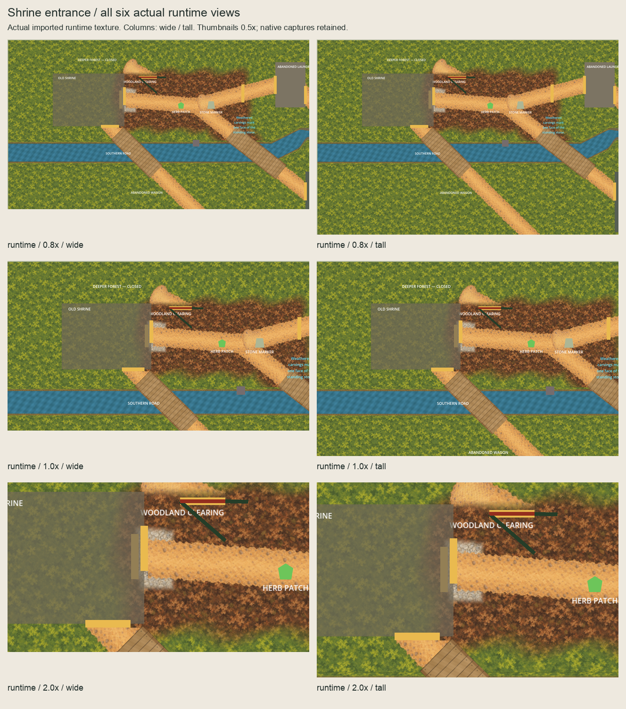
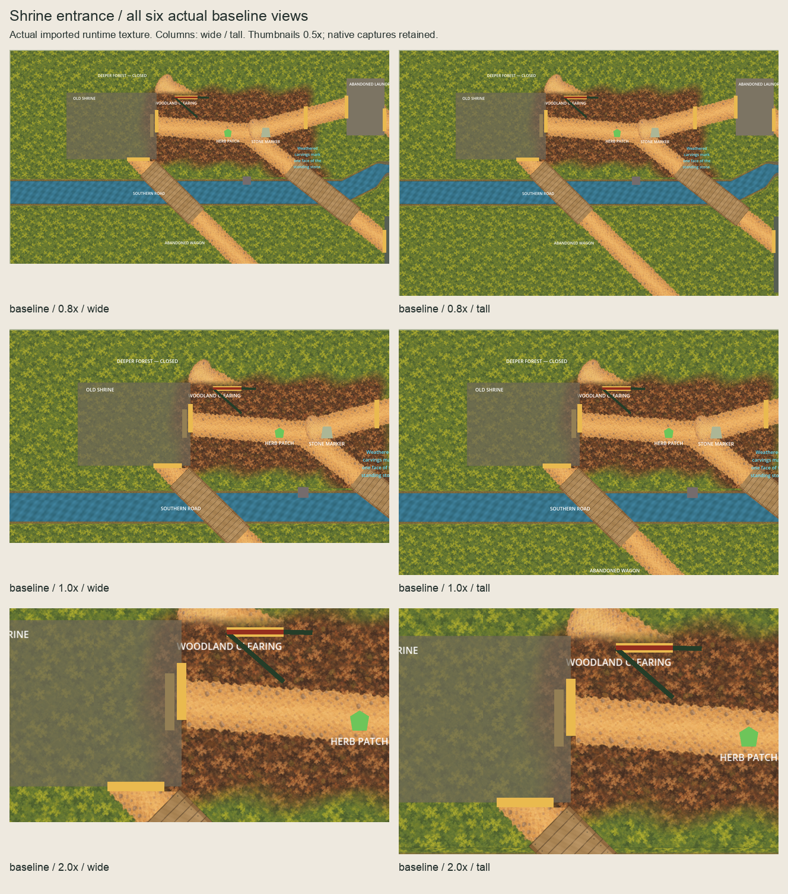

# Shrine east-entrance ordinary-scene checkpoint

The owner approved the [exact named scope](../shrine-ground-runtime-scope/README.md)
on 2026-10-05 ("approved"). [Authorization](authorization.json) binds the unchanged
approved README, source bindings, owner record and full implementation predecessor
at `e7a2f812`. The owner confirmed the six exact actual runtime views on 2026-10-05;
[acceptance](owner-runtime-acceptance.json) closes this slice.

## Installed presentation

`ShrineGroundPresentation` is an independent script-free root at `(596,250)`, z=0.
Its single 92x143 `PaleGravel` child has effective z=-78, centred=false, unit scale,
zero offset, linear filtering and repeat disabled. World paint phase is `(0,0)`.
This places it above retained woodland transitions (-80/-79) and below the retained
Woodland–Shrine route (-74), preserving the actual selected external draw order.
Source/production/proof/runtime PNG SHA-256 is
`bfa4d01952b4b2b35da8172c5f30ca5f9566aeac5a2de507fb245c7ef6834e4b`.

The selected **184x286 OpenRaster master is copied unchanged**, retaining masked
nearest2x paint, empty Corrections and hidden coverage/raw-paint references.
Production is append-only: **95 assets / 46 masters**, preserving all old 94/45
entries and bytes. Both new imports have independent native UIDs/cache paths,
lossless RGBA and no mipmaps, alpha-border correction, premultiplication, channel
remapping or size limit. Both new script UIDs are independently native-generated.

Removing only the new texture/script resources, owner/child and inactive smoke
node restores byte-exact predecessor scenes and sibling order. The channel remains
the final root child. Woodland litter/transitions, Shrine shell/openings/inscription/
discovery/physical owners, all routes, existing Garden/Square/Sickhouse/Wagon ground,
native channel owners and accepted paint/masks/masters remain intact.

## Six actual imported-runtime views

These captures instantiate ordinary `Main.tscn` and use the actual imported runtime
texture. Paired baselines hide only the new ground owner. Root CanvasLayers and
CharacterBody2Ds are hidden in the disposable instance; camera changes exist only
there. Target `(650,340)` retains north/west limits: 0.8x clamps x to 800 and y to
half-height/zoom; 1x retains x=650 and clamps y to 360/413.5; both 2x views stay at
the target. Metadata records actual canvas transforms.

**All six runtime images and six baselines equal the selected external GPU RGBA
pixels exactly.** [Pairwise results](capture-comparison.json) confine changes to
selected support plus a two-native-pixel filtering/index guard.

| Zoom | Wide 1280x720 | Tall 1280x827 |
| --- | --- | --- |
| 0.8x | [Runtime](captures/runtime-0.8x-wide.png) / [Baseline](captures/baseline-0.8x-wide.png) | [Runtime](captures/runtime-0.8x-tall.png) / [Baseline](captures/baseline-0.8x-tall.png) |
| 1x | [Runtime](captures/runtime-1.0x-wide.png) / [Baseline](captures/baseline-1.0x-wide.png) | [Runtime](captures/runtime-1.0x-tall.png) / [Baseline](captures/baseline-1.0x-tall.png) |
| 2x | [Runtime](captures/runtime-2.0x-wide.png) / [Baseline](captures/baseline-2.0x-wide.png) | [Runtime](captures/runtime-2.0x-tall.png) / [Baseline](captures/baseline-2.0x-tall.png) |




The inherited translucent Shrine shell, physical boundaries, opening markers,
forest gate and greybox labels are preserved. Inspect the gravel perimeter against
woodland litter and the translucent shell. Accessibility, pacing and terrain
completeness remain open.

## Verification and review

Full host quality passed **5,033 tests**, zero build warnings/errors, all inherited
Godot smokes, the new Shrine smoke and Compatibility startup.
[Verification](verification.json) records checks and all sandbox/host attempts.
The initial host healer-command native mutex abort is retained; its exact retry
exited successfully, a fixed-60-FPS diagnostic reached the explicit completion
marker, and the final identical full-suite retry passed.
[Session review](session-review.json) records cumulative review and corrections.
[Runtime review bindings](runtime-review-request.json) identify the exact views
accepted by the owner before reviewed direct-main publication. Pending statuses
in the original request and verification are historical; the acceptance supersedes them.

Ten disposable probes reject phase, depth, duplicate/dropped owner, transform,
extent, physical scope, paint, coverage/source and import processing after a valid
fixture passes. Cold imports begin from an empty disposable cache, regenerate the
proof UID independently, retain the runtime sidecar and prove native RGBA equality.
Native checks prove all four new UIDs canonical, distinct and absent from predecessors.
The successor preserves the full live implementation baseline and dispatches
unchanged historical artwork/Garden/Square/Sickhouse/Wagon checks at frozen heads.

```sh
PATH="/opt/homebrew/bin:$PATH" ./scripts/quality.sh
/opt/homebrew/bin/python3 scripts/validate-shrine-ground-runtime.py --check-captures --check-rejections
/opt/homebrew/bin/python3 art-direction/shrine-ground-runtime-promotion/review_boards.py --check
```

## Completed slice and next work

Owner acceptance closes the Shrine-ground slice. Preserve its accepted pixels,
rejected evidence and frozen inventories; do not reopen its approval steps.
The next bounded slice is an external-only Laundry entrance packed-earth study,
using the existing approved material and unchanged route/structure geometry.
Prepare the complete comparison series before consolidated validation and review.
No Laundry runtime placement is authorized by Shrine acceptance.
No physics/navigation/layout/scenario/gameplay/dialogue/clue/discovery/treatment/
save/provider/functional-UI/audio/release/signing changes.
