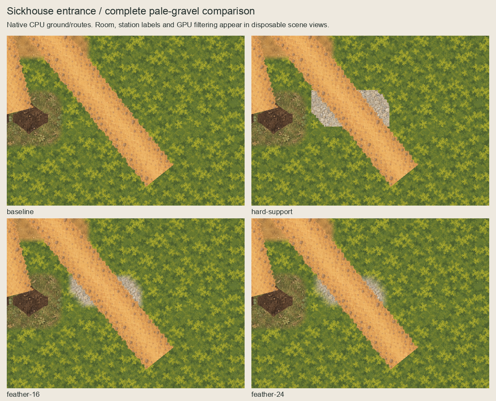
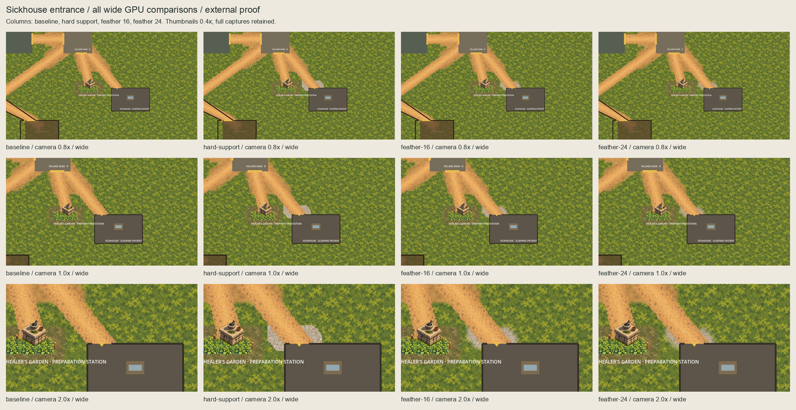
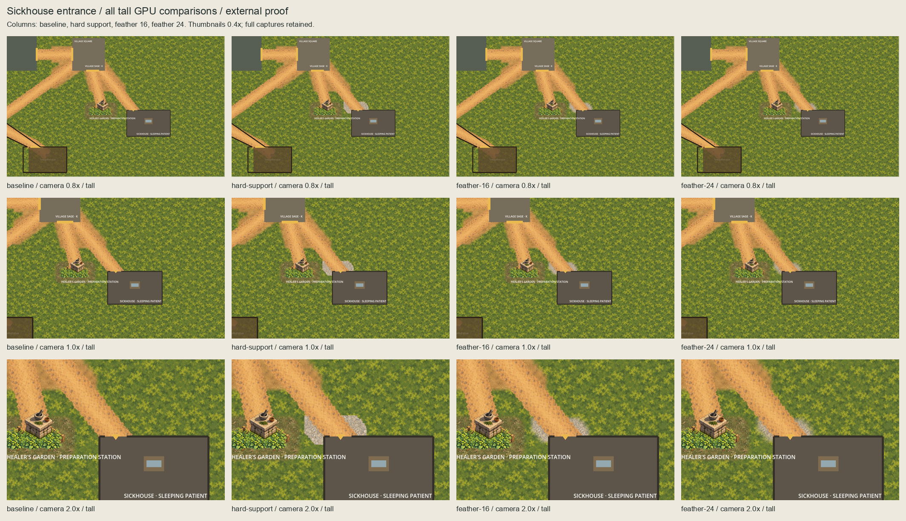
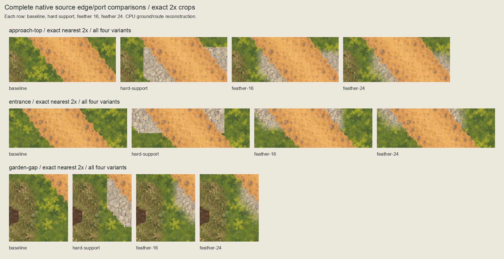

# Sickhouse entrance pale-gravel external checkpoint

The owner authorized choosing the next placement on 2026-10-05 and then selected
the displayed **16px inward feather**. [Exact acceptance](owner-acceptance.json)
binds the unchanged approved pale-gravel source, mask, native composition, editable
master and six injected GPU views with paired baselines. This is external
composition acceptance; named runtime promotion and actual runtime confirmation
remain separate.

## Complete comparison series






The series retains baseline, hard-support diagnostic, 16px feather and 24px feather.
All 24 full-size views remain in `captures/`. GPU boards use labelled 0.4x
thumbnails; CPU comparisons are native scale and edge crops exact nearest 2x.
The CPU reconstruction includes retained ground/routes but omits room geometry,
stations and labels; disposable GPU views instantiate the actual scene and retain
those owners. Root HUD layers and character bodies alone are hidden.

The hard support has conspicuous flat terminations. The selected 16px feather
softens them while retaining more visible gravel than the 24px alternative. The
room floor occludes the southern part of the apron; its yellow entrance marker
and the Garden's large label remain inherited. No route repainting or floor/wall
correction hides these conditions. Use-specific human accessibility, pacing and
terrain completeness remain unverified.

## Bound source and geometry

`selection.json` records the agent's choice under the owner's authorization, not
an invented owner recipe selection. The retained route is 380x360 at world origin
`(2320,1140)`, centred at `(2510,1320)`, z=-71. The segment uses its exact alpha `>0`
only in world rows `[1272,1310)`, just north of the existing room floor at y=1310.
Square-neighbourhood dilation radius 24 yields the hard-support diagnostic within
`(2408,1248)`–`(2616,1334)`, right/bottom exclusive, a 208x86 window.

Feathers use zero-padded Chebyshev pixel-centre distances and inward smoothstep
widths 16/24px. All nonzero paint stays within the hard support; alpha-zero texels
have zero RGB. Covered RGB equals the unchanged 128px pale-gravel source at world
phase `(0,0)`. Full unmasked world paint remains separate. No new general connector
family or texture replacement is established.

Three deterministic **416x172 OpenRaster masters** preserve each transparent
underlay enlarged at exact nearest 2x, empty Corrections, hidden unmasked world
paint and a separate hidden coverage reference. These are editable underlay
masters, not masters of the opaque context reconstruction.

Actual injected sprites are centred=false, unit scale, z=-90, linear filtering,
repeat disabled, and placed at `(2408,1248)`. Camera target is `(2528,1290)`;
0.8x views clamp at the east world limit, and the tall 0.8x view also clamps at the
south limit. Recorded actual centres and transforms, including those clamps, are
checked separately for every baseline/candidate pair.

## Validation and review

[Inventory](inventory.json) binds exact sources, output bytes and measurements.
[Capture evidence](capture-evidence.json) binds the actual capture script, inputs,
24 views and transforms. [Validation](validation.json) checks all 7,219 protected
predecessor files (three continuation documents excepted), independent masks,
source RGB/phase, all 12 master layers and 18 paired GPU comparisons.
All eight accepted Garden/Square/channel alpha planes have zero overlap with
support plus a two-native-pixel guard. Four [disposable probes](evidence/rejection-checks.json)
reject changed phase, coverage, paint and camera metadata after a valid fixture passes.

Review fixed the initial validator's omitted south-edge camera clamp; actual
captured pixels and transforms were unchanged. Sandbox startup exited 134 without
output; the identical host retry completed. Both outcomes are retained under
`evidence/`. Capture code refuses existing capture metadata, accepted packets and
individual output overwrites. Builders verify frozen inputs and refuse writing
accepted artwork. [Session review](session-review.json) records final checks.

Product/runtime/import/CI inputs are unchanged. Retain the prior 5,033-test full
host-quality evidence in the accepted Square checkpoint rather than replaying
full quality for an external composition. No physics/navigation/layout/scenario/
gameplay/dialogue/clue/discovery/treatment/save/provider/functional-UI/audio/
release/signing changes are included.

## Next boundary

The [named runtime scope](../sickhouse-ground-runtime-scope/README.md) proposes
exactly one unchanged selected underlay. Approval of this external comparison does
not install it or authorize that separate scope. Preserve all diagnostics and
accepted predecessors; any different paint, mask, phase, depth or extent needs a
separate revision.

```sh
/opt/homebrew/bin/python3 art-direction/sickhouse-ground-feasibility/build.py --check
/opt/homebrew/bin/python3 art-direction/sickhouse-ground-feasibility/boards.py --check
/opt/homebrew/bin/python3 art-direction/sickhouse-ground-feasibility/inspect_package.py
/opt/homebrew/bin/python3 art-direction/sickhouse-ground-feasibility/rejection_probes.py
```

The original disposable capture was explicit authoring only. Do not rerun it into
this accepted packet; prepare a separate revision when a new capture is needed.
