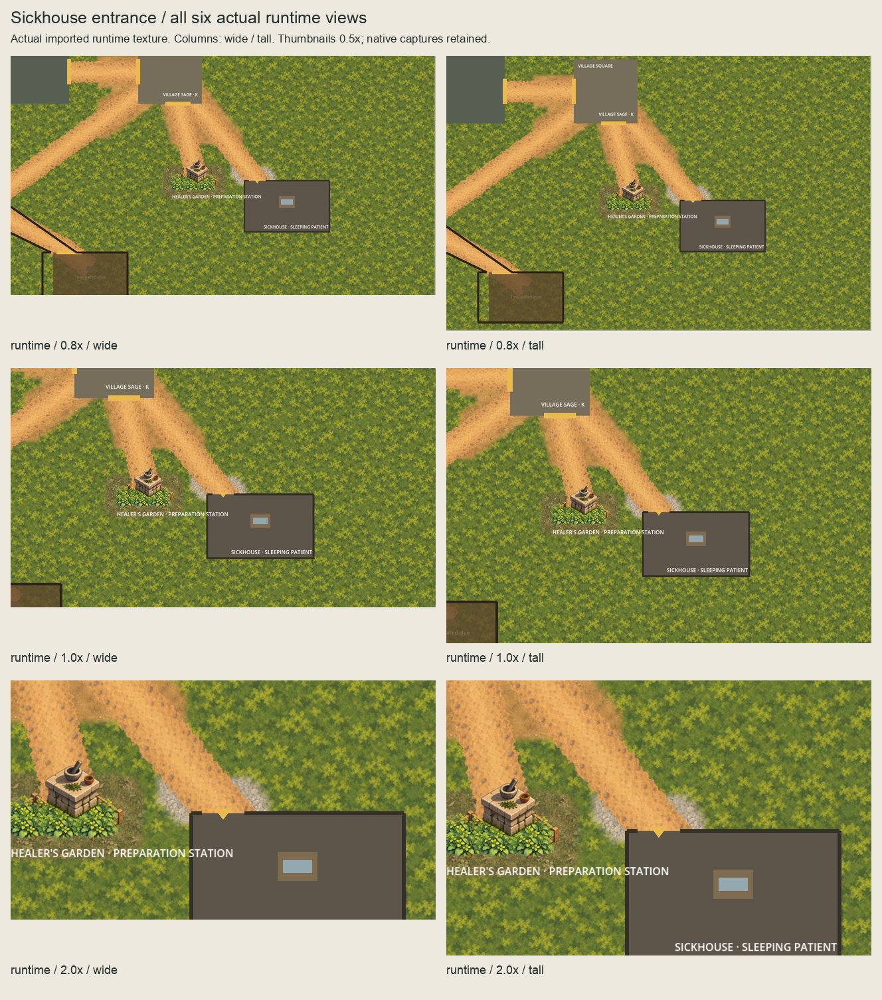
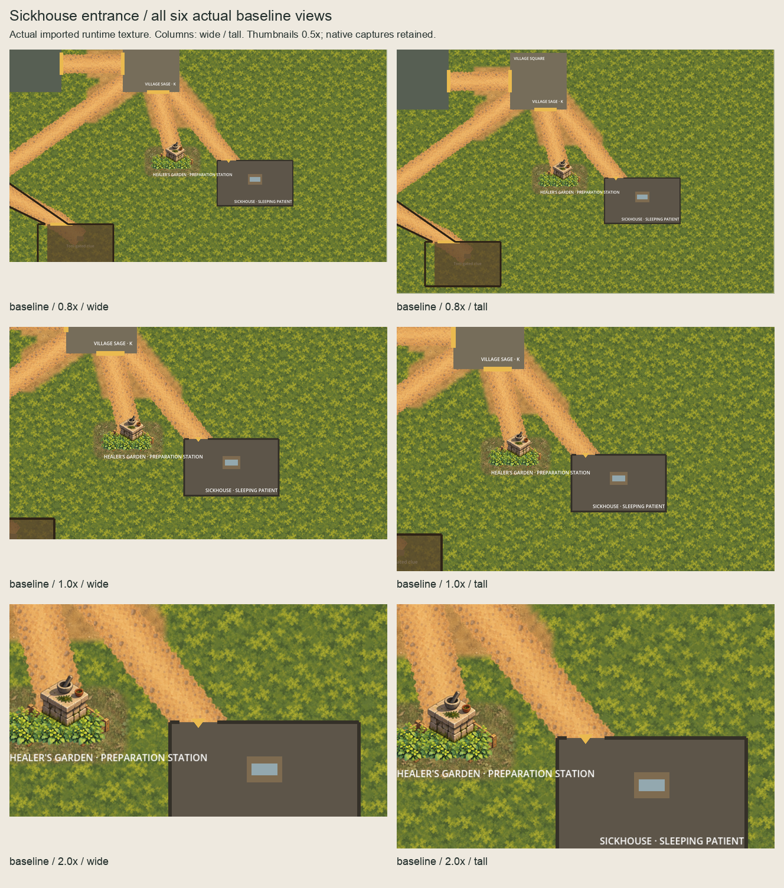

# Sickhouse entrance ordinary-scene checkpoint

The owner approved the [named one-asset scope](../sickhouse-ground-runtime-scope/README.md)
on 2026-10-05 ("approved"). [Authorization](authorization.json) binds the exact scope,
owner record and complete 7,290-file implementation predecessor at `4d1bcf0b`.
The selected 16px-feather gravel underlay is installed. The owner confirmed all six
actual runtime views on 2026-10-05 ("I confirm");
[acceptance](owner-runtime-acceptance.json) clears reviewed direct-main publication.

## Installed presentation

`SickhouseGroundPresentation` is an independent script-free root at `(2408,1248)`,
z=0. Its single native 208x86 `PaleGravel` child has effective z=-90, linear
filtering, repeat disabled, centred=false, unit scale and zero offset. It lies
above broad quiet moss and below the retained route and room floor. Source,
production, isolated-proof and runtime PNGs share SHA-256
`216c49fbc5c3d640345b89db458414e7daec79f6204d0c7a7b63827ab2051a86`.

The exact selected **416x172 master is copied unchanged**. It retains nearest2x
masked paint, empty Corrections, hidden source field and coverage references.
Production is append-only: 93 assets / 44 masters, preserving every previous
92/43 entry and byte. New proof/runtime imports have separate native UIDs/cache
paths, lossless unchanged alpha, no mipmaps/premultiplication or remapping.
Smoke/capture script UIDs are also independent.

All old resource/node blocks and their order remain byte-exact after removing
only the named additions. `WholeChannelPresentation` remains the final root child.
The existing Sickhouse floor, walls, entrance marker, patient/station ownership,
all routes, Garden soil/meadow, Square packed earth and channel/forest presentation
remain intact. No physics/navigation/layout/scenario/gameplay/dialogue/clue/
discovery/treatment/save/provider/functional-UI/audio/release/signing changes.

## All six actual runtime views

These views instantiate ordinary `Main.tscn` and use the actual imported runtime
texture, with **no injected external proof**. Paired baselines hide only the new
ground owner. Root HUD layers and character bodies are hidden and camera settings
changed only in the disposable instance. Target `(2528,1290)` retains native
east/south camera clamps at 0.8x. Every actual transform equals its selected
external counterpart. **All six runtime and all six baseline images equal approved
external GPU RGBA pixels exactly.**

| Zoom | Wide 1280x720 | Tall 1280x827 |
| --- | --- | --- |
| 0.8x | [Runtime](captures/runtime-0.8x-wide.png) / [Baseline](captures/baseline-0.8x-wide.png) | [Runtime](captures/runtime-0.8x-tall.png) / [Baseline](captures/baseline-0.8x-tall.png) |
| 1x | [Runtime](captures/runtime-1.0x-wide.png) / [Baseline](captures/baseline-1.0x-wide.png) | [Runtime](captures/runtime-1.0x-tall.png) / [Baseline](captures/baseline-1.0x-tall.png) |
| 2x | [Runtime](captures/runtime-2.0x-wide.png) / [Baseline](captures/baseline-2.0x-wide.png) | [Runtime](captures/runtime-2.0x-tall.png) / [Baseline](captures/baseline-2.0x-tall.png) |




The inherited floor occludes the southern apron. Its yellow entrance marker and
the Garden label remain unchanged. No accessibility, pacing or terrain-completeness
acceptance follows from these captures.

## Checks and review

[Verification](verification.json) records full quality, scoped checks, captures,
cold imports and their sandbox/host distinction. [Session review](session-review.json)
records cumulative review and fixes. [Runtime review bindings](runtime-review-request.json)
identify the exact confirmed packet. [Publication review](publication-review.json)
binds the unchanged implementation and final documentation. Historical pending
records remain intact and are superseded by the owner acceptance.
Full host quality passed: 5,033 tests, zero build warnings/errors, all inherited
Godot smokes, Garden/Square/Sickhouse checks and Compatibility startup.

The successor requires append-only manifest/master parity, normalized old scenes,
complete protected predecessor bytes and distinct new texture/script UIDs.
Ten disposable probes reject wrong phase/depth/transform/extent, duplicate/dropped
owner, physical scope, paint, coverage/source and import processing after a valid
fixture passes. GPU differences stay within accepted coverage plus a two-native-
pixel filtering/index guard. The twelve images independently match their accepted
external counterparts. Cold-import decoding starts with an empty disposable cache,
regenerates the proof UID, preserves runtime sidecar bytes and proves exact native RGBA.

Frozen validators run unchanged: 35 artwork checks at `2fcc849`, Garden checks at
`7942e7d` and Square checks at `06f0dab4`. This successor proves their preserved
live inputs plus the exact addition. Historical inventories stay unchanged.

Review corrected an initial manifest export filename before scene installation;
the initial manifest remains under `evidence/`. It also corrected rectangular-mask
handling, strengthened exact master/manifest/tooling checks and added transform/
extent probes. Source pixels, mask, selected master and all captures are unchanged.
Native UID review corrected the new capture-script UID using Godot generation;
all four final new UIDs are canonical and mutually distinct from the predecessor.
The UID helper's type annotation was repaired and cold decoding now requires an
explicit success marker as well as zero exit; failed audit evidence is retained.
Sandbox editor import exited zero with blocked editor-settings writes; full sandbox
quality passed .NET tests before failing at `user://logs`. Actual capture and cold
decode also needed identical host retries. Detailed logs remain under `evidence/`.
Accepted output builders and capture/review tools refuse overwrites.

```sh
PATH="/opt/homebrew/bin:$PATH" ./scripts/quality.sh
/opt/homebrew/bin/python3 scripts/validate-sickhouse-ground-runtime.py --check-captures --check-rejections
/opt/homebrew/bin/python3 art-direction/sickhouse-ground-runtime-promotion/review_boards.py --check
```

## Next bounded slice

Continue from live main with one bounded next placement proposal as specified in
[HANDOVER.md](../../HANDOVER.md). Preserve all accepted evidence; changes to paint,
mask, phase, depth or extent require a separate revision. No further runtime
placement is approved.
