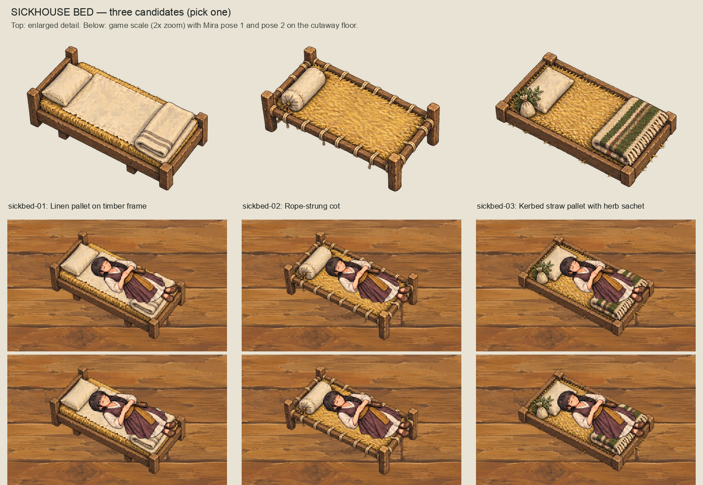
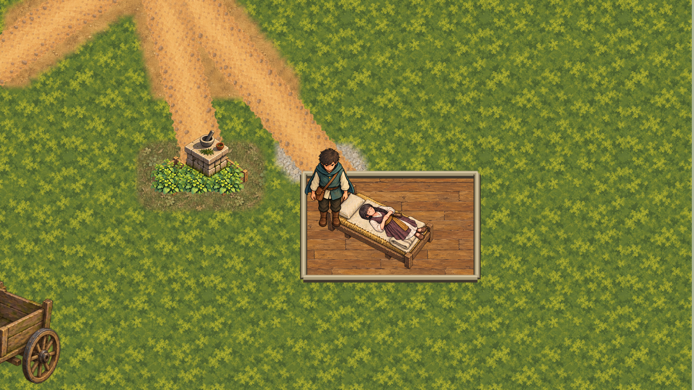

# Sickhouse bed and sleeping patient

27 October 2026 (Australia/Sydney). After accepting the building group, the owner asked for
the sickhouse bed/patient placeholder to be replaced. They chose a new generated bed and Mira's
approved dormant poses 1↔2 as a breathing loop. The four replies are in
[authority.json](authority.json).

## New bed artwork

[prompt.txt](prompt.txt) was run once through the Codex CLI (0.162.0-alpha.17.2) built-in
`image_gen`, with a transparent background and three references: the approved Direction A
scene, the woodland tree board and Mira's dormant pose 1. The sheet is kept unchanged in
`sources/`. [build_review.py](build_review.py) reuses the structures-batch helpers to separate
the three candidates, write editable 2x OpenRaster masters and 200 px wide exports, and build
the review board. The board's lower rows are the game scale enlarged 1.5x (its caption says 2x).
The owner picked **sickbed-01 (linen pallet)**. That pick is bound by hash in
[owner-acceptance.json](owner-acceptance.json); sickbed-02 and sickbed-03 stay as alternatives.

## Runtime

In `game/Main.tscn`, the `Bed` and `Patient` Polygon2D placeholders under
`OpeningRegionFirstPatientSceneSource` are now Sprite2D nodes. `Bed` shows sickbed-01, positioned
at (−20, 18) so that Mira's head rests on the pillow. `Patient` stays centred on the unchanged
interaction point (2640, 1390). Its `Breathing` AnimationPlayer alternates
`dormant-01`/`dormant-02` every 1.6 s. Pose 2 is drawn at offset (4, −3) because it is painted
slightly apart from pose 1. That offset gives the smallest alpha difference over a ±20 px search,
so the breathing does not jitter. The runtime PNGs are byte copies of the approved exports.

The existing cutaway owner still shows the bed and patient only while the sickhouse is cut away.
Interaction ranges, collision, navigation, clue/disease state and saves are unchanged.

## Checks

- `scripts/validate-sickhouse-patient-bed.py` checks the acceptance bindings, that the
  runtime art is byte-identical to the approved exports, and their lossless import settings. It checks only those bytes, never the
  whole tree (#471).
- `scripts/check-sickhouse-patient-bed.gd` checks the textures and the interaction point, that
  the loop advances by itself, plays it forward through both poses and the wrap, and checks
  visibility for cutaway on/off. A watchdog fails it instead of hanging on a script error.
- `scripts/capture-sickhouse-patient-bed.gd` writes the three `captures/` and
  [capture-evidence.json](capture-evidence.json).

Issue #471: the whole-tree fence `validate-gameplay-view-repairs.py` of the accepted building
and repair slices no longer runs in live smoke. `quality.py` replays it unchanged at its accepted
revision `5c99c7c4` (stage `boundary-view-repairs`). Live smoke instead requires those two
packages' accepted files to be unchanged from `5c99c7c4`. Results are in
[verification.json](verification.json): the full gate passed on the review-fix head `06fa1f30`.
PR #473 (head `08f036bf`) merged as `fcf538b4` before its gate was recorded; the review fixes land
separately. Closed 2026-10-28. The PR #475 review fixes (rename-proof smoke fence, checked
capture write, `size_limit` import check) passed the full gate again on `3ee69352`; see
[review-fixes-verification.json](review-fixes-verification.json), which also corrects the merge
note in the unchanged closure record.
