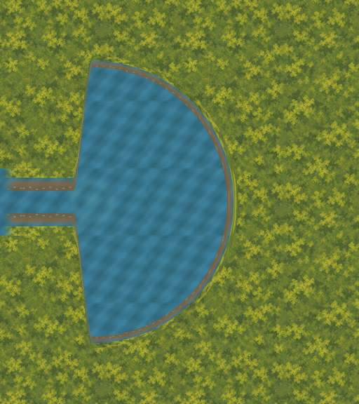

# External spring: three-times-diameter variant

The owner requested “looks good - perhaps make it three times as large, would look even better”
for the [original spring](../spring-bank-join-proof/README.md). This separate variant interprets
that as three times the linear basin diameter: 128px → 384px, radius 64px → 192px.
The centre remains `(2032,500)`. The original candidate and all earlier evidence are frozen.
The request and shown-source digest are recorded in [enlargement-request.json](enlargement-request.json).
Visual assessment of this enlarged candidate remains pending. No runtime/layout/physical promotion is authorized.



## Retained join and geometry

The accepted Stream still ends at x=2000, with water visible at y=484..516 and banks at
y=452..484 and y=516..548. Every x<2000 review pixel is preserved. All 32 central water
connector pixels and both 32-row bank connectors continue the exact retained texture phase.
The first 4px of the new connector hold the existing widths; a smooth cubic neck then
flares into the eastern half of the larger circular basin. The retained edge requires
this shaped western neck: the candidate is not a complete circle over the accepted banks.

The bank depth remains 32px at the inlet and 16px at the basin centre and circular rim.
The outer radius is 208px. Existing bank RGBA is composited over the continuing water UV
phase, preserving its transparent-row appearance. The static emergence highlight scales
threefold with the basin; it adds no interaction, clue or scenario fact.

| Check | Result |
| --- | ---: |
| Protected predecessor files | 3,978 |
| Retained comparison pixels changed | 0 |
| Visible inlet width | 32px |
| Basin diameter envelope | 384px |
| Bank radius envelope | 208px |
| Continuous clearance lower bound from retained 96px route corridors | 143.79px |
| Retained 8px route-cell centres inside the new profile | 0 |
| Rejected full circle's retained bank pixels covered in this crop | 5,994 |
| Rejected full circle's retained composite pixels changed in this crop | 30,590 |

Clearance checks all twelve finite route segments against every occupied 1x halo pixel,
subtracting the pixel square's half-diagonal and the 48px route half-width. This bounds
clearance for the actual raster shape, including the steep neck. The full untrimmed
208px circle would give a -24px conservative corridor bound; that envelope includes
western territory omitted by this candidate. It is not used to claim clearance.
The full-circle failed overlay is retained separately. Existing collision/navigation
owners remain untouched; these measurements grant no traversal authority.

## Artifacts, reproduction and review

The editable [2x OpenRaster master](masters/spring-join.ora) is 1024×1152, with six
independent layers. Seven 512×576 exports and review PNGs are bound by [manifest.json](manifest.json).
The crop origin is `(1900,212)`. Review at [0.8x](review/joined-0.8x.png),
[1x](review/joined-1.0x.png), [2x](review/joined-2.0x.png), and compare the
[original on the same world scale and canvas](review/original-common-scale.png).
These are source-derived external compositions, not Godot captures. Production assets
remain at 83 exports and 34 masters.

```sh
/opt/homebrew/bin/python3 art-direction/spring-bank-join-3x-proof/tools/proof.py --build
/opt/homebrew/bin/python3 art-direction/spring-bank-join-3x-proof/tools/proof.py
/opt/homebrew/bin/python3 art-direction/spring-bank-join-3x-proof/tools/check_rejections.py
/opt/homebrew/bin/python3 art-direction/production-proof/corrected/tools/validate_stream_laundry_path.py --check-captures --check-promotion-scope
PATH=/opt/homebrew/bin:$PATH ./scripts/quality.sh
```

The baseline freezes main at `2cfce8af460da05a95da4a1e69bfa81ccb4ea9c5`, excluding only
this proof folder, HANDOVER.md and Finder metadata. Source hashes, deterministic master/PNG
reproduction, retained territory, exact connectors, mask interiors, draw order, route
clearance and cell exposure are verified. Eight in-memory mutations exercise rejection
boundaries. The mask-interior check evaluates all four 2x samples of each 1x pixel,
so steep neck edges are handled without assuming a small vertical slope.

Session review checked the enlargement ratio, fixed centre, connector backing/phase,
clipped geometry, conservative raster clearance, editable master order and comparison
framing. Both candidate and engineering view were inspected. The original spring verifier
passed before this successor was tracked; use this broader baseline afterward. Never
rewrite frozen predecessor inventories or evidence.

Full host quality passed: zero-warning build, all 5,033 tests, asset/scenario validation,
all credential-free Godot smokes and Compatibility launch. Accepted Stream–Laundry
capture and promotion-scope checks passed. The host run used the established sandbox
log-directory workaround. Final staged proof reproduction and protected scope passed.

## Exact next slice

Assess the enlarged external view for scale, steep neck, closed bank and emergence detail.
If a correction is requested, retain both candidates and make only that external correction.
Defer western-outlet/whole-channel art and Clearing–Closed Deeper Forest Path until this
join is assessed. Obtain separate named authorization for runtime/layout/physical promotion.
