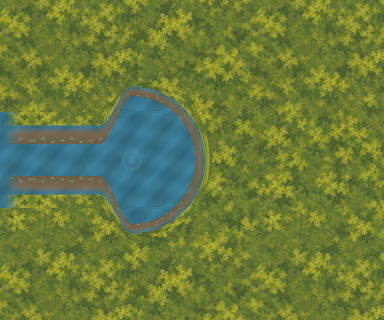

# External spring and Stream bank-join proof

One bounded external source candidate at `(2032,500)` against the accepted
[western-watercourse overview](../western-watercourse-proposal/README.md), based on
`514500d700cddd8c5648c670e6daac1c2efcefec`. Spring visual assessment is pending. No
runtime, layout, physical, scenario, production-manifest or Godot import change is made.



The owner accepted B2's shown external 1x composition with “Approved” on 2026-10-03.
[b2-visual-acceptance.json](b2-visual-acceptance.json) binds that response to the exact
shown PNG digest. It grants no layout/runtime/physical promotion authority. B1, B2 and
the watercourse proposal remain immutable; their historical status records are preserved.

## Existing banks and retained failed circle

The live Stream water polygon spans y=452..548, but its northern/southern bank sprites
occupy y=452..484 and y=516..548 **inside that band**. Its eastern edge at x=2000 has a
32px visible central inlet, rather than 96px of uncovered water. The eastern caps are at
x=1900..1932 and the bank regions at x=1932..2000. These dimensions and source textures
are read against the current scene and retained geometry, not inferred from the overview.

A plain 64px-radius circular water overlay at the proposed source centre would cover
1,390 retained bank pixels and change 1,518 pixels of the local retained composite.
[The rejected circular overlay](review/rejected-circle-overlay.png) is retained as evidence.
The raw circle also changes nearby ground in the retained comparison. This measured
conflict supersedes the earlier overview's water-only overlap description. Neither the
original overview/evidence nor any accepted bank asset is rewritten.

The candidate instead starts a 32px-wide inlet at x=2000, y=484..516. Across x=2000..2032,
a smooth cubic profile widens into the source basin within the original 64px water
radius envelope. The eastern half is circular. All new water, banks and spring detail
stay east of the retained x=2000 edge. The western portion is shaped for the retained
banks; this is a bounded join correction, not the complete untrimmed proposal circle.

## Exact connectors, sources and editable artifacts

All x<2000 pixels in the local comparison remain byte-identical, including the accepted
water, cap and bank composites. The new central water starts at the next texel in the
retained Polygon2D UV phase, origin `(1600,452)`. Both new bank connectors use source
column 68, continuing the existing bank region's columns 0..67. Every connector pixel
is checked against its exact source continuation, including both flipped southern rows.

The accepted bank texture contains partial alpha and one fully transparent row. Its
existing appearance relies on water beneath it. New bank pixels are therefore composited
against the continuing water phase before export, keeping that appearance at the join
and avoiding a ground-coloured stripe through the new bank. The old RGBA textures and
retained reference layers stay untouched. Bank depth tapers from 32px at the join to
16px at the basin centre, then uses radial depth through a closed 80px-radius outer halo.
A small static emergence highlight is proposed at the source centre; it adds no scenario
fact, clue, interaction, animation or hydrological authority.

[manifest.json](manifest.json) binds all source/artifact digests and the B2 acceptance
record. [masters/spring-join.ora](masters/spring-join.ora) is an editable 768×640 2x master
with six independent layers: ground, retained water, retained banks, new water, new banks
and spring detail, in that back-to-front order. Seven 1x RGBA exports include the joined
composition. Fully transparent RGB is zeroed. Existing immutable proof/image/OpenRaster
helpers are reused without changing their files. Production remains at 83 exports and
34 masters; this proof's seven exports and one master are separate external artifacts.

## Measurements and limits

| Check | Result |
| --- | ---: |
| Retained comparison pixels changed by candidate | 0 |
| Plain circle's retained bank pixels covered | 1,390 |
| Plain circle's retained comparison pixels changed | 1,518 |
| Visible inlet width at x=2000 | 32px |
| Proposed water radius envelope | 64px |
| Outer bank halo radius envelope | 80px |
| Minimum source-centre distance to any retained route segment | 232px |
| Conservative halo clearance from any retained 96px route corridor | 104px |
| Retained 8px route-cell centres inside new halo | 0 |

The 104px clearance subtracts the entire 80px halo and 48px corridor half-width from the
nearest finite route distance; all twelve routes are checked. The candidate lies inside
world bounds and does not touch the Clearing, a retained route or a bridge opening.
This is presentation feasibility only. Existing Stream collision remains intact; the
new basin and banks establish no collision, navigation, actor opening or traversal authority.
The spring remains a proposed source explanation, not an established scenario fact.

These are local source-derived compositions, not Godot scene captures. Review views are
provided at [0.8x](review/joined-0.8x.png), [1.0x](review/joined-1.0x.png) and
[2.0x](review/joined-2.0x.png); 2x uses nearest scaling to expose the 1x raster edges.
[The engineering overlay](review/engineering.png) shows the retained edge and original
64px envelope. [The retained Stream comparison](review/retained-stream.png) omits all new
layers. This proof grants no production-art, gameplay, pacing or human accessibility acceptance.

## Reproduction, scope and session review

```sh
/opt/homebrew/bin/python3 art-direction/spring-bank-join-proof/tools/proof.py --build
/opt/homebrew/bin/python3 art-direction/spring-bank-join-proof/tools/proof.py
/opt/homebrew/bin/python3 art-direction/spring-bank-join-proof/tools/check_rejections.py
/opt/homebrew/bin/python3 art-direction/production-proof/corrected/tools/validate_stream_laundry_path.py --check-captures --check-promotion-scope
PATH=/opt/homebrew/bin:$PATH ./scripts/quality.sh
```

[baseline.json](baseline.json) freezes all 3,957 pre-existing tracked authored files.
Only this new proof, the requested handover edit and Finder `.DS_Store` metadata are
excluded. The verifier checks inventory/hashes, source acceptance, PNG/master byte
reproduction, complete inlet/bank masks, exact connector texels, draw order, retained
comparison territory, circle conflict measurements, route clearance and cell exposure.

Eight in-memory mutation checks reject retained-pixel changes, inlet gaps, bank gaps,
bank intrusion, water/bank connector phase errors, escaped water masks and wrong draw
order. Review corrected the bank's source-alpha backing and used radial interior
clearance checks around the curved rim, rather than vertical margins at steep tangents.
The candidate, failed circle and engineering view were visually inspected. No further
implementation issue was found; owner visual assessment remains the next checkpoint.

B2's original verifier passed before this folder was tracked. Its frozen inventory now
rejects this additional tracked proof, as earlier inventories already reject successor
folders. Use the spring proof's broader 3,957-file preservation verifier; never rewrite
predecessor evidence. Accepted Stream–Laundry capture and promotion-scope checks pass.
Full host quality passed: asset validators, formatting, zero-warning build, all 5,033 tests,
scenario validation, complete credential-free Godot smokes and Compatibility launch.
The host run used the established workaround for Godot's sandbox-restricted log directory.

## Exact next slice

Assess the spring's shown external candidate: retained-bank fit, narrowed inlet, curved
bank closure, basin envelope and static emergence detail. If the owner requests a
correction, make only that external spring correction and retain this candidate and the
failed circle as evidence. Defer western-outlet/whole-channel art and Clearing–Closed
Deeper Forest Path proof until this join is assessed. Obtain separate named layout,
runtime and physical approval plus visual checkpoints before any promotion.
