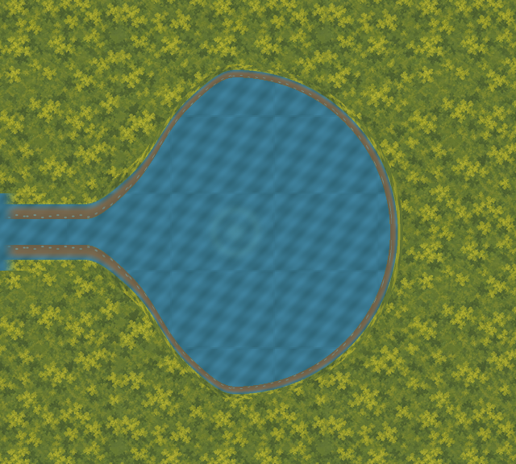

# External spring: curved western bank

The owner requested removal of the enlarged spring's unnatural straight western edges,
or a deliberately man-made rock structure. This variant takes the natural shoreline
option. [shoreline-request.json](shoreline-request.json) records the exact feedback and
previous shown-view digest. The small spring, steep enlarged candidate and earlier failed
circle evidence remain frozen. The owner approved the shown 1x curved candidate on
2026-10-03; [visual-acceptance.json](visual-acceptance.json) binds the exact view digest.
Generated manifest/evidence status strings retain their historical build-time assessment
status. This acceptance grants no runtime/layout/physical promotion authority.



## Shape and retained Stream

The earlier candidate widened a 32px inlet into a 384px basin over only 32px of horizontal
space. That produced steep, wall-like western edges. This correction retains the 384px
basin diameter envelope and moves its external centre 160px east, from `(2032,500)` to
`(2192,500)`. The proposed emergence highlight follows that centre. The accepted overview
and runtime layout are unchanged; this is a separate external placement correction.

All pixels west of x=2000 remain identical to the retained reference. The exact visible
inlet at y=484..516 and both 32-row bank connectors retain their accepted UV continuation.
A 4px straight connector then flows into a 188px curved western flare with a small bounded
undulation. Its end slopes are zero, meeting the circular eastern basin smoothly. The
new shoreline eliminates the steep western sides without introducing a dam or scenario fact.

Western bank depth tapers from 32px at the inlet to 16px at the centre. The circular
rim uses a 16px radial depth, outer radius 208px. Existing bank RGBA remains composited
over continuing water UVs, preserving the source's translucent and transparent rows.
The static emergence detail remains scaled threefold relative to the original small spring.

| Check | Result |
| --- | ---: |
| Protected predecessor files | 4,000 |
| Retained review pixels changed | 0 |
| Visible inlet width | 32px |
| Basin diameter envelope | 384px |
| External centre displacement | 160px east |
| Raster halo clearance lower bound from retained route corridors | 143.79px |
| Retained 8px route-cell centres covered | 0 |

Clearance checks every occupied exported halo pixel against all twelve finite route
segments, subtracting the pixel half-diagonal and 48px corridor half-width. No collision,
navigation, actor opening or traversal authority is established. Production assets and
runtime geometry remain untouched.

The [unjoined circle reference](review/unjoined-circle-reference.png) is a water-only
comparison at the new centre. It leaves retained territory unchanged but does not reproduce
the exact inlet texels. It is distinct from the historical failed circles, which remain
in their original folders with their measured retained-bank conflicts.

## Artifacts and verification

The independent [2x OpenRaster master](masters/spring-join.ora) is 1280×1152 with six
layers. Seven 640×576 exports use world origin `(1900,212)`. Source and artifact hashes
are bound in [manifest.json](manifest.json); [baseline.json](baseline.json) freezes all
4,000 authored predecessor files at `c90c11a2b4fdd23eec3b2522a570bf248c94c9ce`.
Only this new folder, HANDOVER.md and Finder metadata are excluded. Historical inventories
are immutable and intentionally reject tracked successors; use this broader verifier.

Views are provided at [0.8x](review/joined-0.8x.png), [1x](review/joined-1.0x.png),
[2x](review/joined-2.0x.png), and with an [engineering overlay](review/engineering.png).
The [previous enlarged candidate](review/original-common-scale.png) uses the same canvas
and world scale. These are external source-derived compositions, not Godot captures.
Production remains at 83 exports and 34 masters.

```sh
/opt/homebrew/bin/python3 art-direction/spring-curved-bank-proof/tools/proof.py --build
/opt/homebrew/bin/python3 art-direction/spring-curved-bank-proof/tools/proof.py
/opt/homebrew/bin/python3 art-direction/spring-curved-bank-proof/tools/check_rejections.py
/opt/homebrew/bin/python3 art-direction/production-proof/corrected/tools/validate_stream_laundry_path.py --check-captures --check-promotion-scope
PATH=/opt/homebrew/bin:$PATH ./scripts/quality.sh
```

The verifier checks full protected scope, deterministic PNG/master reproduction, source
bindings, draw order, retained pixels, exact inlet UVs, sampled mask interiors, bank closure,
route exposure and bounded western slope. Nine in-memory mutations reject retained-pixel
changes, inlet/bank gaps, bank intrusion, UV errors, escaped masks, wrong order and a steep
western wall. Review fixed the slope check to include the first connector pixels, so an
abrupt early jump cannot escape it. Candidate and comparison framing are visually checked.

Full host quality passed: zero-warning build, all 5,033 tests, asset/scenario validation,
all credential-free Godot smokes and Compatibility launch. Stream–Laundry capture and
promotion-scope checks passed. The host run used the established sandbox log workaround.
Final proof reproduction and all 4,000 predecessor hashes passed after review.

## Exact next slice

Prepare one external western outlet proof at `(0,600)`, limited to world x=0..320,
water y=552..648 and the proposed 16px bank allowance. Show water and both banks
continuing off the west edge, preserving channel alignment and tiling phase. Include
an editable 2x master, source-bound exports, review composition and preservation checks.
Keep the accepted spring, B1/B2, all runtime assets/layout and collision/navigation owners
unchanged. Defer whole-channel art, Clearing–Closed Deeper Forest Path and promotions.
