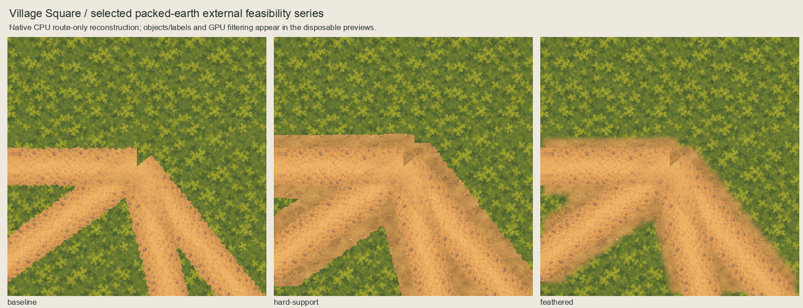
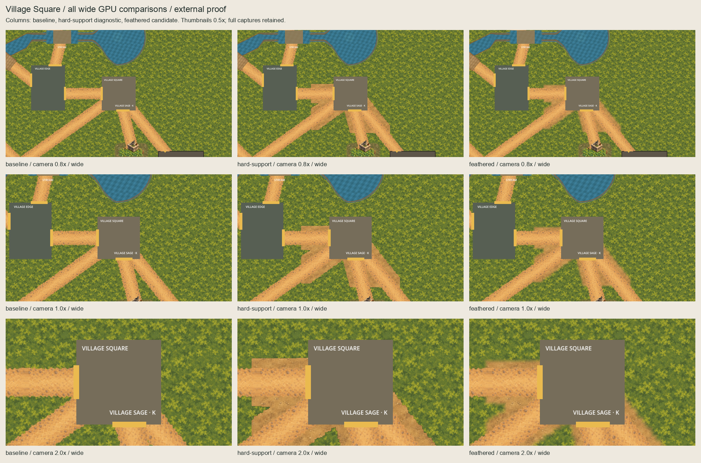
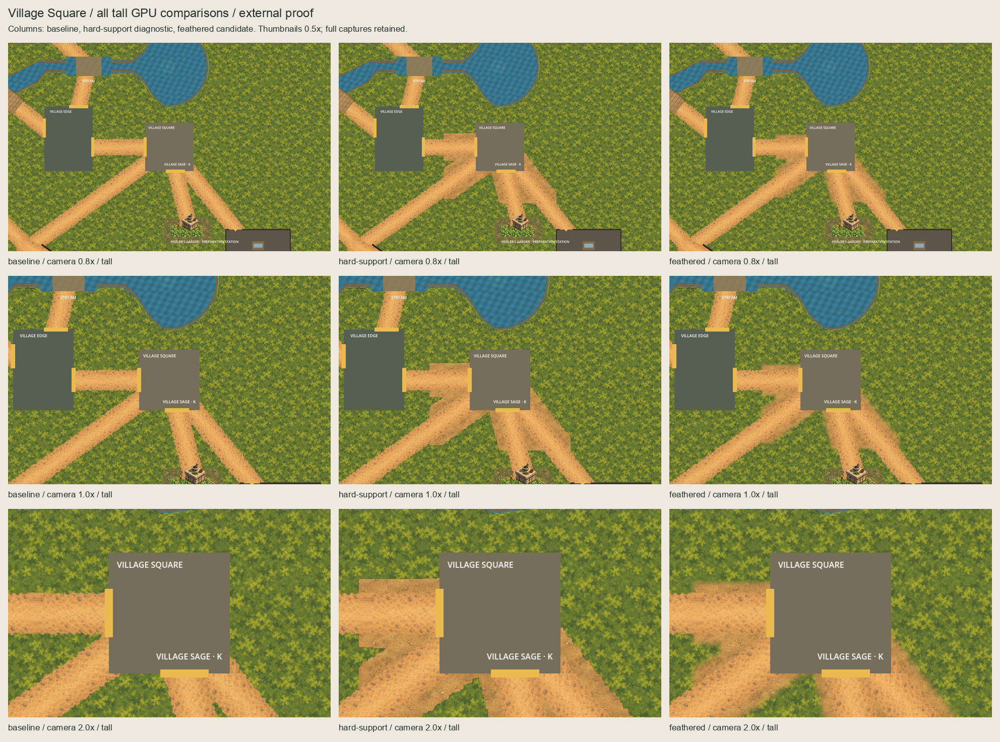
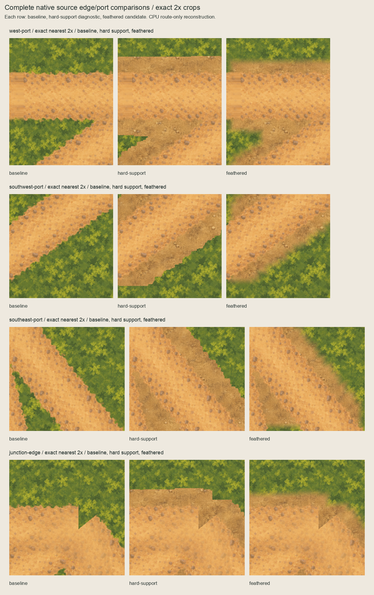

# Village Square packed-earth external feasibility

The owner selected the [placement proposal](../ground-placement-proposal/README.md)
on 2026-10-05: “OK - I select this proposal. Please continue”.
[Selection](owner-selection.json) binds the exact proposal and boards;
[baseline](baseline.json) freezes all 7,109 tracked predecessor files at `9f3949b`.
This package implements only the selected external composition. The owner said
“feathered composition approved”. [Acceptance](owner-acceptance.json) binds exact
selected bytes; [validation](validation.json) records passing consolidated checks.
**Runtime promotion is not selected.** Historical pending inventory/authoring
fields remain unchanged and are superseded by these separate records.

## Complete series

Columns are baseline, hard-support diagnostic, feathered candidate. GPU rows are
0.8x/1x/2x camera zoom. GPU series boards use labelled half-size thumbnails;
all eighteen original 1280x720/1280x827 captures remain under `captures/`.
Native CPU boards omit objects/labels and reconstruct only the five retained
route textures over phase-zero quiet moss. GPU views instantiate the actual
`Main.tscn` with its unchanged route, square, cask, Garden and channel owners.






The hard-support diagnostic has conspicuous steps and straight apron terminations.
The feathered candidate softens that support boundary but still exposes the
packed-earth/path colour difference and finite local apron. The existing square
placeholder occludes much of the central junction; its cropped text and yellow
openings are unchanged. Inherited route discontinuities and cropped endpoint
geometry remain visible in the CPU reconstruction. No accepted route paint has
been corrected to hide them. These observations do not establish accessibility,
terrain completeness or use-specific owner acceptance.

## Exact source and editable composition

The proof window is `(1920,620)`–`(2480,1180)`, exclusive right/bottom, 560x560.
Junction alpha `>0` is expanded by a square-neighbourhood radius of 24px. The
hard-support diagnostic preserves this binary support. The candidate computes
inward Chebyshev pixel-centre distance using zero-padded one-pixel square erosions,
then applies `smoothstep(clamp(distance/16,0,1))`. The first boundary row is at
distance 0.5px; pixels at least 16px inward are opaque. Every nonzero candidate
pixel stays within the hard support; finite proof-window edges are feathered
inward as required, not clamped into an opaque continuation.

Packed-earth source RGB is retained exactly at world phase `(0,0)` with period 128;
quiet moss remains period 256. Canonical zero RGB is used only at alpha-zero texels;
the full unmasked world paint is retained separately. The five CPU route layers
follow the live source transforms and equal-depth order. Actual GPU views inject
only the external underlay at `(1920,620)`, z=-90, unit scale, linear filtering,
repeat disabled and `centered=false` in a disposable scene instance. The baseline
hides both proof sprites, the diagnostic shows only hard support, and the
candidate shows only feathered coverage. The capture script never saves a scene.

Two deterministic **1120x1120 OpenRaster masters** preserve visible route/ground
layers at exact nearest 2x, an empty Corrections layer, hidden editable unmasked
world paint and a separate hidden coverage reference. Merges correspond to native
CPU compositions enlarged at exact nearest 2x. These masters and proof layers
remain external; no production manifest, import, runtime texture or owner changes.

[Inventory](inventory.json) binds sources, measurements, masks, native outputs,
detail boards and master bytes. [Capture evidence](capture-evidence.json) binds the
capture script, scene, inventory, predecessor, proof sprites, all eighteen PNGs,
actual camera centres and world-to-canvas transforms. HUD/actors are hidden
only as recorded in the disposable capture: root HUD layers and character bodies
are hidden; station labels and square/cask presentation remain inherited.

## Review and next boundary

The owner approved the displayed feathered series. Consolidated scoped validation
passes exact byte reproduction, independent coverage/phase/RGB/master checks,
protected predecessor preservation, channel/Garden separation and all eighteen
paired GPU views. Four disposable phase/coverage/paint/camera mutations are
rejected. Product/runtime/CI inputs
remain unchanged; retain the prior 5,033-test full-quality evidence in
`garden-ground-runtime-promotion/verification.json` rather than replaying it for
individual candidates. Sandbox capture exited 134 at startup; the identical host
retry completed successfully. Both logs are retained under `evidence/`.
The final capture script also refuses to overwrite an accepted packet. Adding
that protection and recapturing left all eighteen PNG hashes unchanged; the initial
script, capture metadata and log are retained separately as authoring lineage.

The separate [named runtime scope proposal](../square-ground-runtime-scope/README.md)
is now prepared for the selected exact underlay and awaits approval. Do not install
it from external acceptance. Any different mask, paint,
phase, depth or extent needs a separate revision; retain this candidate and all
diagnostic views as evidence. No new general connector family is established.

Keep Garden soil/meadow, channel atlases, three-native-node shader scope, crossing,
UVs, caps, Shrine triangle, Clearing near side and forest/gate/Forester ownership.
No physics/navigation/layout/scenario/gameplay/dialogue/clue/discovery/treatment/
save/provider/functional-UI/audio/release/signing change.

## Reproduction

```sh
/opt/homebrew/bin/python3 art-direction/square-ground-feasibility/build.py --check
/opt/homebrew/bin/python3 art-direction/square-ground-feasibility/boards.py --check
/opt/homebrew/bin/python3 art-direction/square-ground-feasibility/inspect_package.py
# Explicit disposable capture; authoring only, never ordinary startup:
PATH="/opt/homebrew/bin:$PATH" godot --path game --script "$PWD/art-direction/square-ground-feasibility/capture.gd"
```

Builders reject source drift; accepted packets cannot be overwritten. GPU captures
are evidence rather than deterministic PNG re-exports; compare their actual paired
transforms and scoped differences separately. Do not regenerate selected evidence
to accommodate a later product change.
