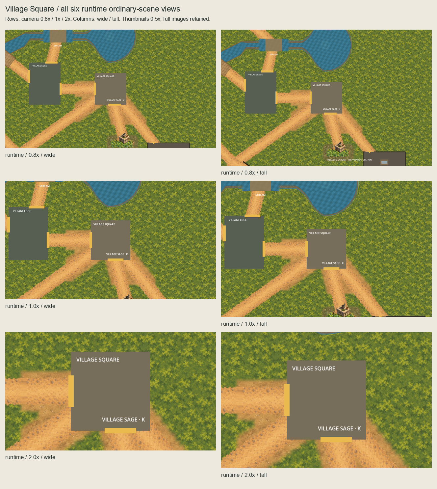
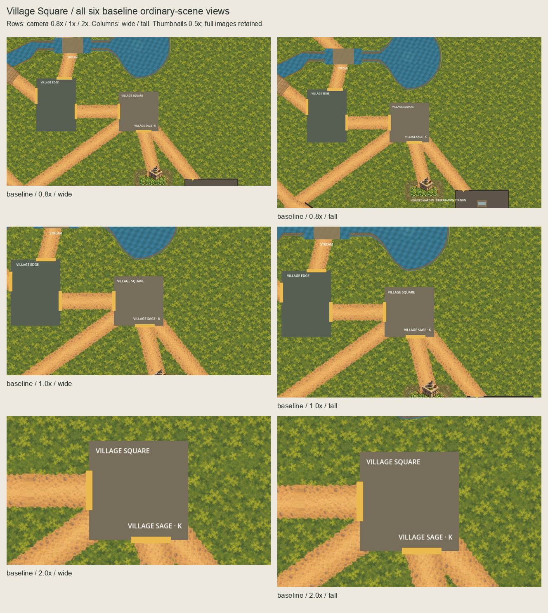

# Village Square ground ordinary-scene checkpoint

The owner approved the exact one-asset
[runtime scope](../square-ground-runtime-scope/README.md).
[Authorization](authorization.json) binds that scope, owner approval and the
complete 7,172-file implementation predecessor at `fc5d38a0`.
The exact selected feathered PNG is installed. The owner **confirmed all six actual
runtime views** on 2026-10-05 ("confirmed").
[Runtime acceptance](owner-runtime-acceptance.json) binds the exact views, paired
baselines, verification and review request for reviewed direct-main publication.

## Installed presentation

`SquareGroundPresentation` is an independent script-free root owner at
`(1920,620)`, z=0, with one native 560x560 `PackedEarth` child at effective z=-90,
linear filtering, repeat disabled, `centered=false`, unit scale and zero offset.
The accepted world phase `(0,0)`, 24px support and inward 16px feather are unchanged.
Source/proof/runtime PNGs have identical SHA-256
`af2818f9a30da7f4696a42851020bd06e054633d51903649e32a4c3666db1e37`.

One isolated 1120x1120 master preserves exact nearest2x masked paint, hidden
editable world paint/coverage and an empty Corrections layer. Production totals
are 92 assets / 43 masters; the previous 91/42 entries and bytes remain preserved.
The isolated import sample is separate from ordinary play. Proof/runtime imports
use distinct UIDs and lossless unchanged alpha; script UIDs are also independent.
Cold-import evidence verifies actual decoded runtime RGBA and independently
regenerated proof UIDs with an empty disposable cache.

The owner is inserted before `WholeChannelPresentation`, which remains the final
root child. Every prior resource/node block and sibling order remains byte-exact
after removing only the named additions. Broad quiet moss, route textures,
square/cask polygons and labels, Garden soil/meadow/station, channel/Stream/forest,
collision, navigation, layout and gameplay ownership remain unchanged.

## All six actual runtime views

These captures instantiate ordinary `Main.tscn` and use the actual imported
runtime texture. No external proof sprite is injected. Root HUD/actors are hidden
and camera settings changed only in the disposable instance. Paired baselines hide
only `SquareGroundPresentation` under identical transforms. **All six runtime
views and all six baselines equal their approved external GPU views in every RGBA
pixel.** Differences from the paired baselines remain inside the selected support
with a documented filtering/index-rounding guard.

| Zoom | Wide 1280x720 | Tall 1280x827 |
| --- | --- | --- |
| 0.8x | [Runtime](captures/runtime-0.8x-wide.png) / [Baseline](captures/baseline-0.8x-wide.png) | [Runtime](captures/runtime-0.8x-tall.png) / [Baseline](captures/baseline-0.8x-tall.png) |
| 1x | [Runtime](captures/runtime-1.0x-wide.png) / [Baseline](captures/baseline-1.0x-wide.png) | [Runtime](captures/runtime-1.0x-tall.png) / [Baseline](captures/baseline-1.0x-tall.png) |
| 2x | [Runtime](captures/runtime-2.0x-wide.png) / [Baseline](captures/baseline-2.0x-wide.png) | [Runtime](captures/runtime-2.0x-tall.png) / [Baseline](captures/baseline-2.0x-tall.png) |




The existing square placeholder hides part of the junction; cropped text and
yellow openings remain inherited. Local apron terminations and material contrast
are retained exactly as selected. No terrain-completeness, accessibility or
pacing acceptance is inferred from these views.

## Checks and historical evidence

Full host quality passed with 5,033 tests, zero build warnings/errors, all inherited
Godot smokes, Garden/Square runtime checks and Compatibility startup.
[Exact runtime review request](runtime-review-request.json) binds these views and
the completed verification/review records. Runtime acceptance supersedes their
historical pending visual status without rewriting those records.

The successor validator checks append-only manifest/master/import parity, exact
normalized scenes, all protected predecessor bytes, independent UIDs and source
approval. Eight disposable mutations reject phase, depth, duplicate/dropped owner,
physical scope, paint, mask/source and import processing; a valid disposable fixture
must pass before mutations are applied. Capture checks require exact six-view
external pixel parity and bounded paired differences.

Frozen artwork checks run unchanged at `2fcc849`; frozen Garden checks run
unchanged at approved `7942e7d`. The Square successor proves their preserved live
subset and the exact additions. Their inventories and validators are not rewritten.
The approved scope registry inadvertently included one ignored Finder `.DS_Store`;
authorization records its exclusion from implementation checks as required by the
existing handover. Historical scope files stay immutable; all authored inputs remain
strictly hash-bound. Finder metadata is neither packaged nor tracked.

Sandbox Godot startup failed at the user log directory. Identical authorized host
retries are recorded separately. The initial capture-directory error was corrected
in the explicit capture script and retained as failed authoring evidence. The
capture script creates its output directory and refuses to overwrite accepted
runtime views. See [verification](verification.json) and
[session review](session-review.json) for final results and limitations.

```sh
PATH="/opt/homebrew/bin:$PATH" ./scripts/quality.sh
/opt/homebrew/bin/python3 scripts/validate-square-ground-runtime.py --check-captures --check-rejections
godot --path game --script "$PWD/scripts/capture-square-ground-runtime.gd"
```

## Acceptance and next boundary

External composition selection, named runtime scope approval and separate actual
runtime visual confirmation are all recorded. [Publication review](publication-review.json)
binds the final documentation updates and the unchanged reviewed implementation.
No further field/material/interface is selected; the next session needs a named
placement or placement-proposal request before extending material geography.
