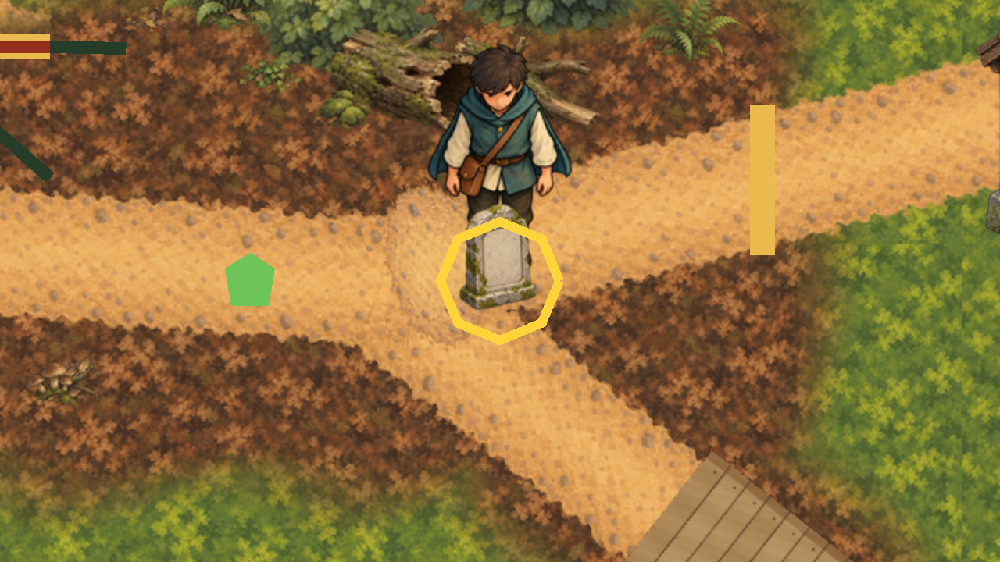
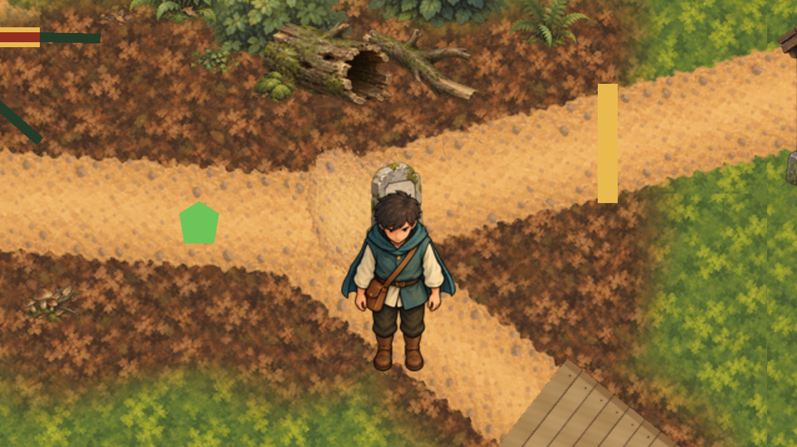

# Stone marker standing tablet

30 October 2026 (Australia/Sydney). After closing the depth-order slice (PR #482), the owner asked
for the greybox markers to be replaced, starting with the stone marker. They also asked for the
stone marker to join the depth order. The three replies are in [authority.json](authority.json).

## Runtime

In `game/Main.tscn`, the `Marker` Polygon2D under `InteractionCandidates/StoneMarker` is now a
Sprite2D. It shows `game/art/runtime/objects/inscriptions-01.png`, a byte copy of the approved
[objects-batch](../objects-batch/README.md) export "Standing tablet" (bound by hash in its
`owner-acceptance.json`). No new artwork was made. The sprite sits at (0, −17), so the export's proposed
foot pivot (41, 75) stands on the old polygon's base line (y +18), just above the unchanged
`STONE MARKER` label. The node position (1080, 350), which the interaction ranges and perception
measure from, is unchanged.

The 80 px tablet is twice the height of the old polygon, so a Seeker standing just behind it was
drawn over it and looked as if it stood on the stone. `CharacterDepthOrderPresentation` now gives
the marker z `1 + DepthDrawOrder.CountNorthOf(...)`, the number of ranked figures whose feet are
north of the tablet's foot. The Sage, water cask, Healer and Seeker keep their accepted ranks
z 1..4, so the accepted depth-order check passes unchanged. When the marker ties with the first
figure south of it, Godot draws in tree order. That figure is always the cask, Healer or Seeker
(the cask at y 900 always lies between the marker and the Sage), and all three come after the
marker in `Main.tscn`, so they draw in front.

## Checks

- `scripts/validate-stone-marker-art.py` checks the objects-batch acceptance binding, that the
  runtime PNG is byte-identical to the approved export and that its import is lossless. It checks only
  those bytes, never the whole tree (#471).
- `scripts/check-stone-marker-art.gd` checks the texture, the foot placement and the unchanged
  interaction point. It also checks that a Seeker south of the tablet draws in front of it and one
  north of it draws behind it.
- `DepthDrawOrderTests` unit-tests `CountNorthOf`.
- `scripts/capture-stone-marker-art.gd` writes the two `captures/` and
  [capture-evidence.json](capture-evidence.json).

Results are in [verification.json](verification.json).
