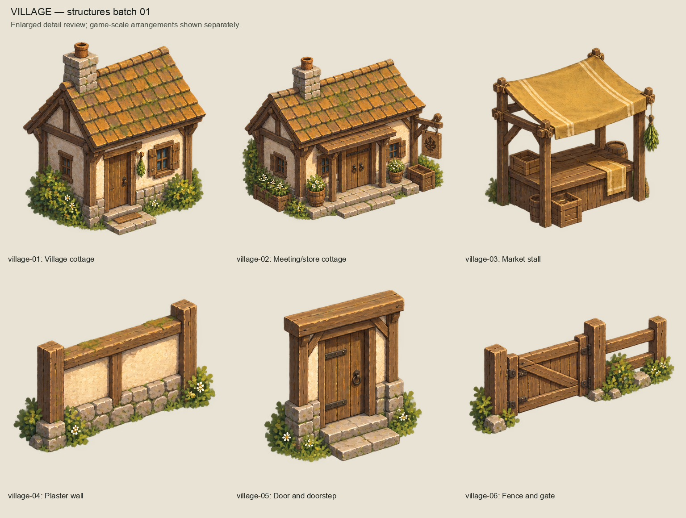
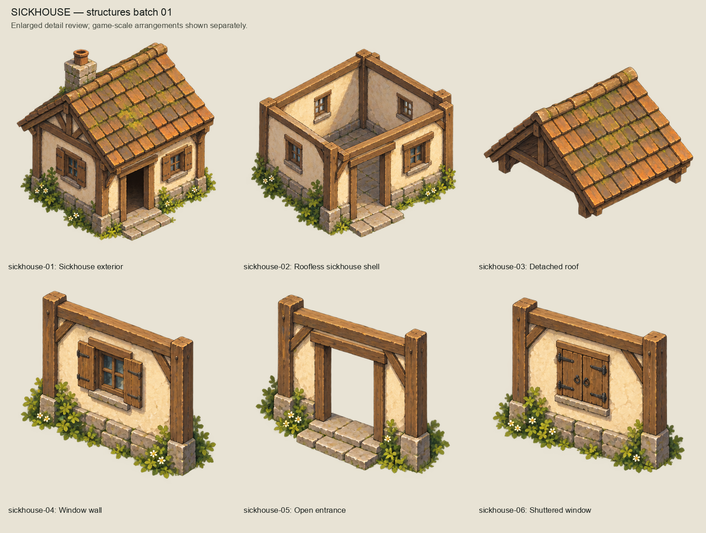
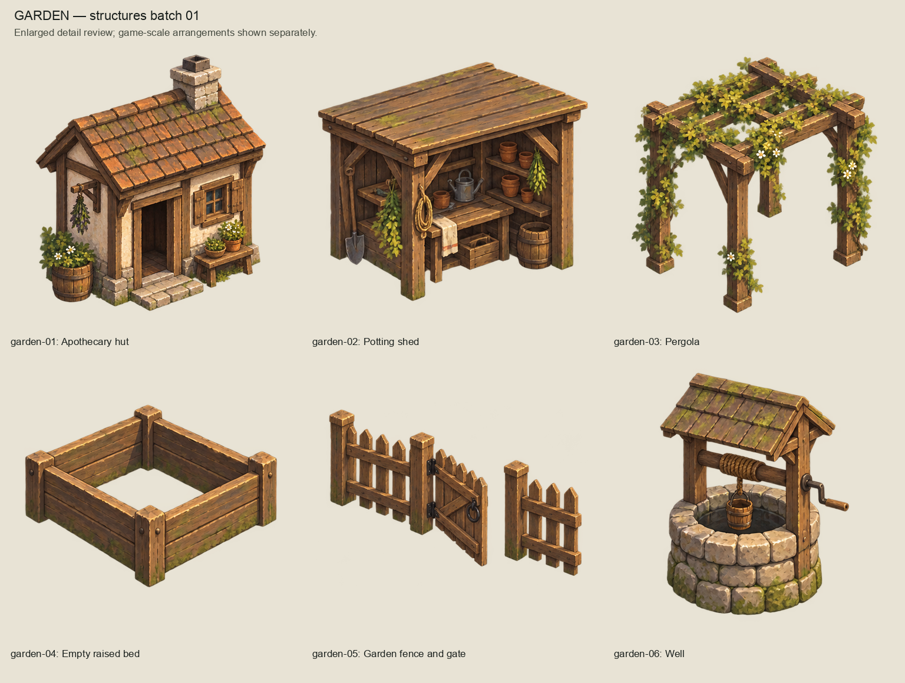
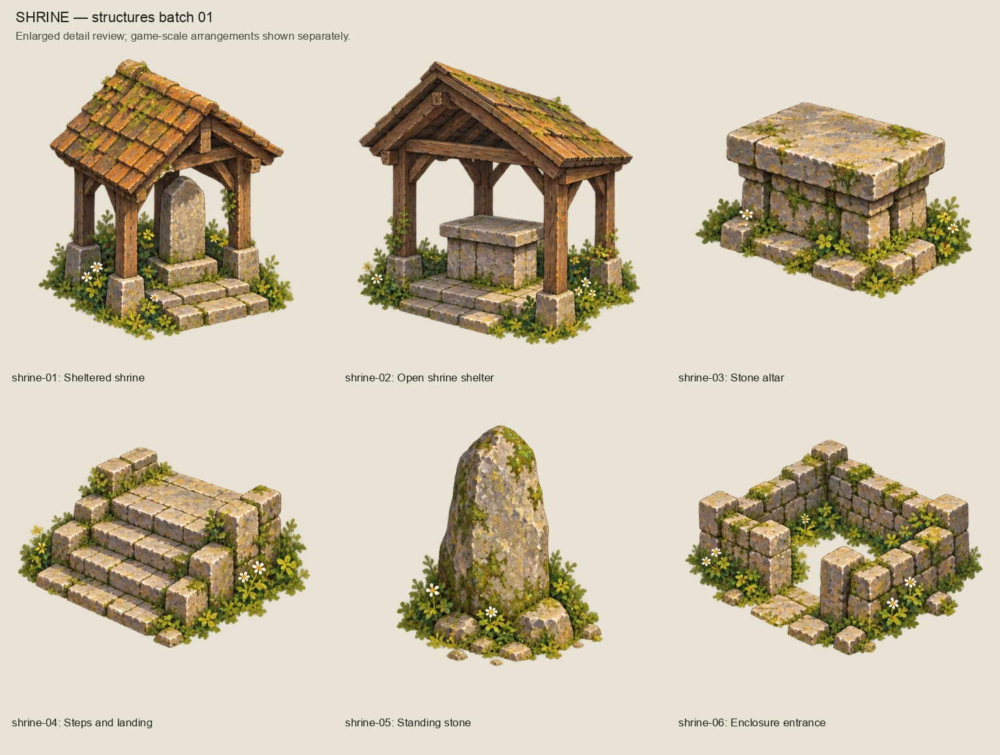
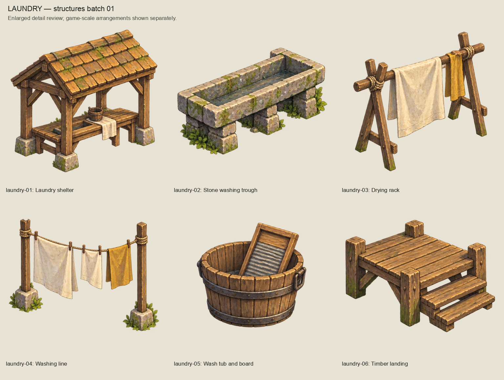
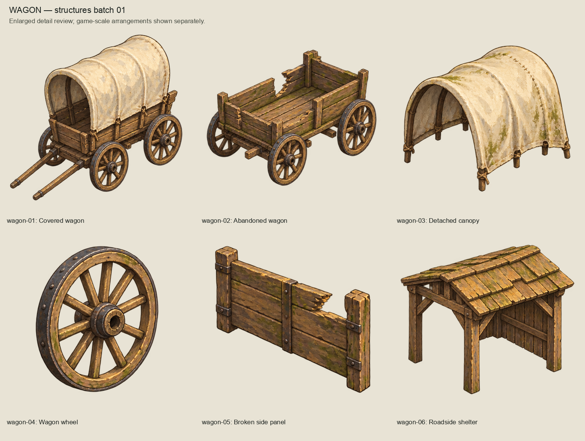
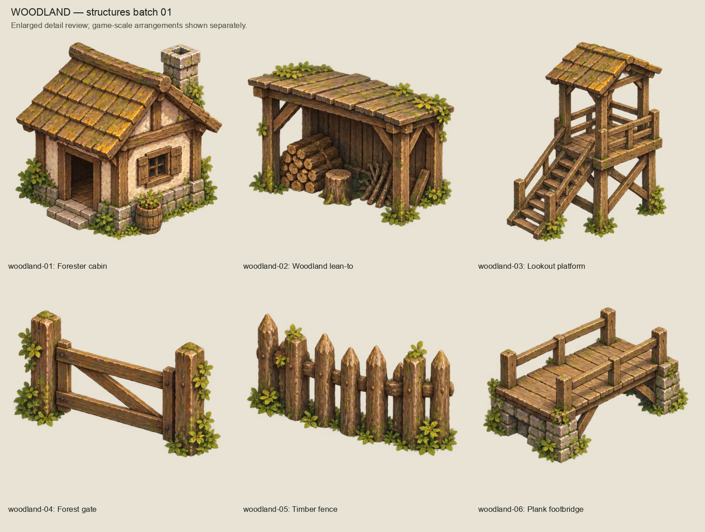
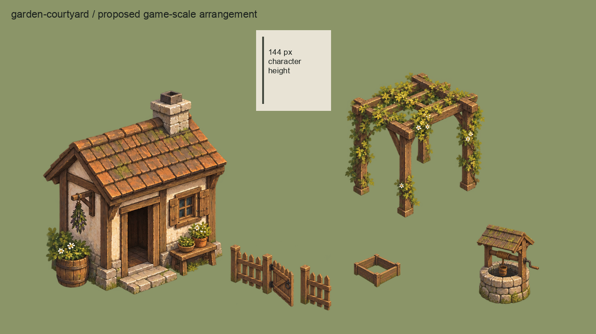
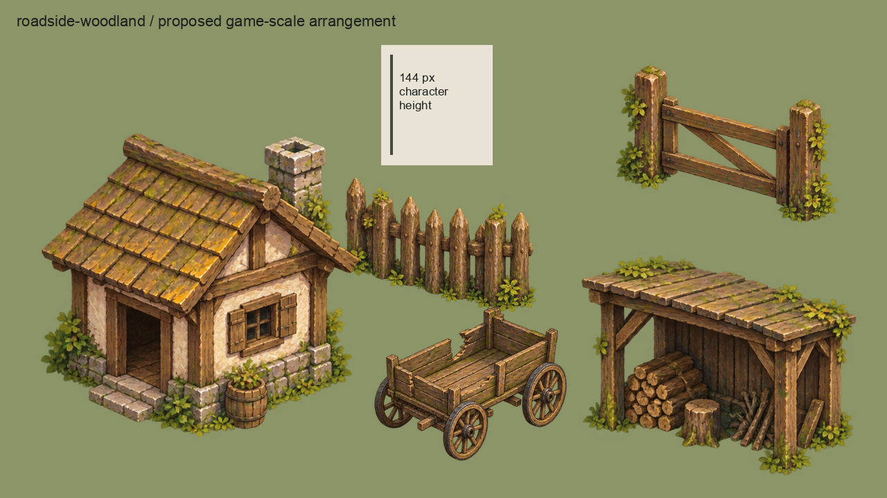

# Structures artwork batch 01

Initial complete Phase 9.2 structures category, produced on 2026-10-04 (Australia/Brisbane)
with the built-in image_gen tool. The owner approved the complete series:
"They look fantastic! ALl approved". `owner-acceptance.json` binds approval to the exact
source, master, export and review image hashes.

42 modules: six each for village, sickhouse, garden, shrine, laundry, wagon and woodland.
The approved Direction A scene and woodland tree board were used as style references.
Keep the previously approved pleasing gouache detail and readable rustic materials.

## Complete review series

## Proposed game scale

The two external arrangements use the actual transparent exports at 1280x720,
with a 144-pixel character-height ruler. These are artwork review compositions,
not runtime screenshots or authorized opening-region layout changes.

## Editable package and provenance

- `sources/`: seven unchanged generated RGBA sheets.
- `prompts.json`: exact prompts; transparency enabled; references are the approved
  `representative-scene/previews/selected-direction-a-refinement.png` and
  `woodland-environment-batch/review/trees.png`.
- `masters/`: 42 OpenRaster files at exact 2x proposed export dimensions, with source
  paint and a separate blank correction layer. These are editable raster layers,
  not reconstructed semantic building/roof/wall layers. Higher-resolution original
  sheets remain available.
- `exports/`: 42 approved transparent artwork modules.
- `inventory.json`: identities, crop bounds, dimensions, provisional pivots and hashes.
- `build_review.py`: mechanical separation, sizing, ORA packaging and review assembly.

Reproduce with `/opt/homebrew/bin/python3 art-direction/structures-batch/build_review.py`.
Per-module crop regions accommodate uneven source spacing. Separation retains the largest
connected alpha component to remove neighbor intrusions, except the garden gate/fence set
which retains its two intended disconnected pieces; source pixels are not repainted.
Review scale, pivots, roof/wall fit, module seams,
occlusion, alpha edges, collision silhouette and accessibility remain provisional.
Detached architectural modules are candidate artwork, not proven snap-fit construction kits.

After approval, `validate.py` checks the accepted hashes, RGBA/alpha integrity, dimensions,
proposed pivot bounds and exact 2x OpenRaster-to-export parity. `validation.json` records
these results and reuse of the preceding consolidated regression evidence: product code,
runtime assets and CI configuration are unchanged. No runtime manifest, imports, scenes,
collision, navigation, dialogue, clues or gameplay are changed.
