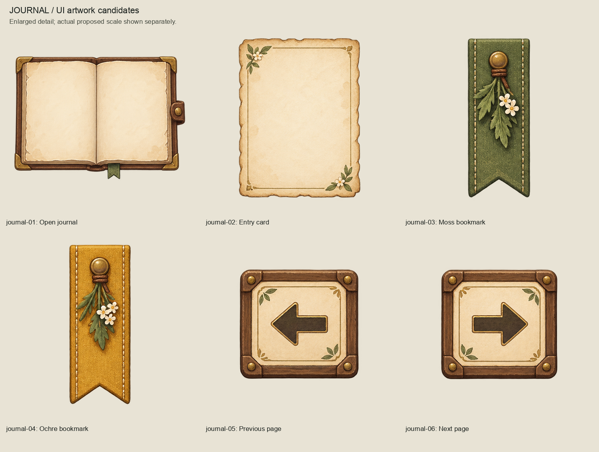
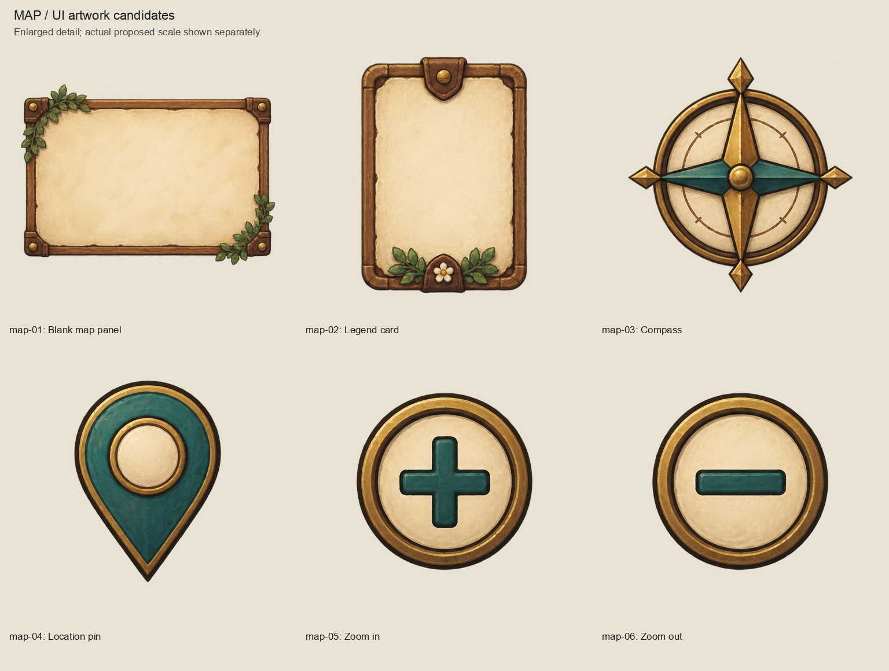
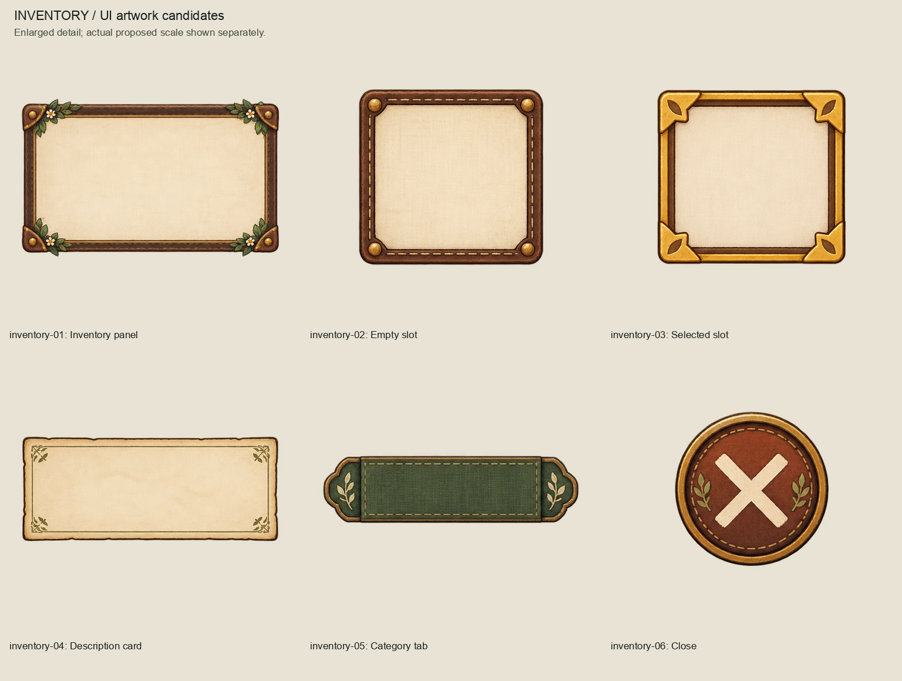
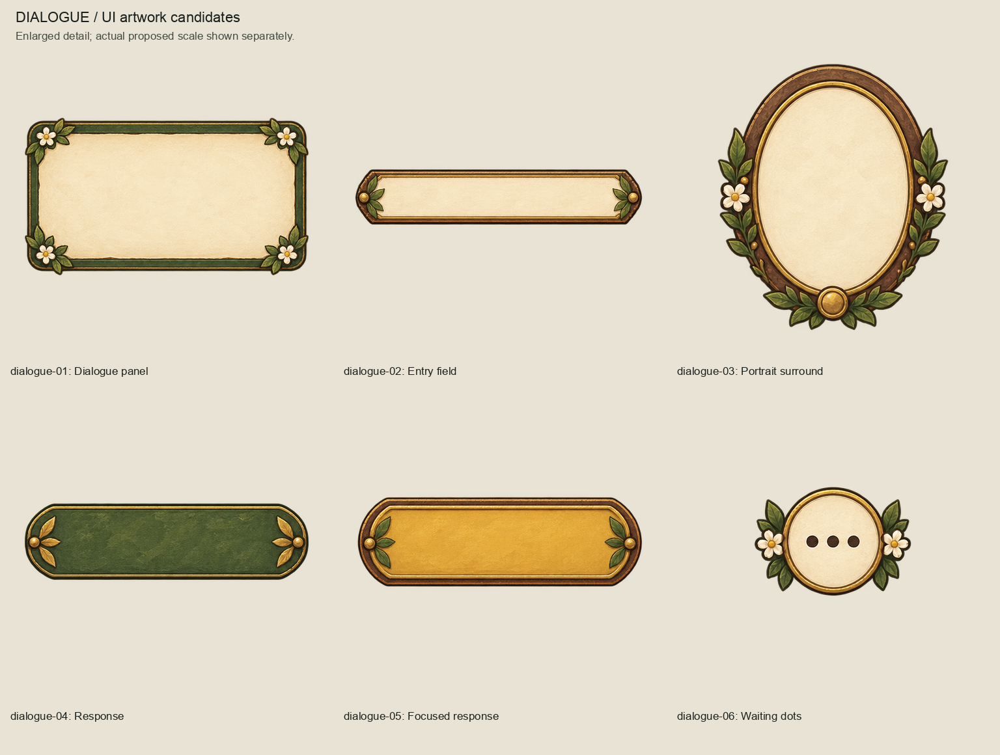
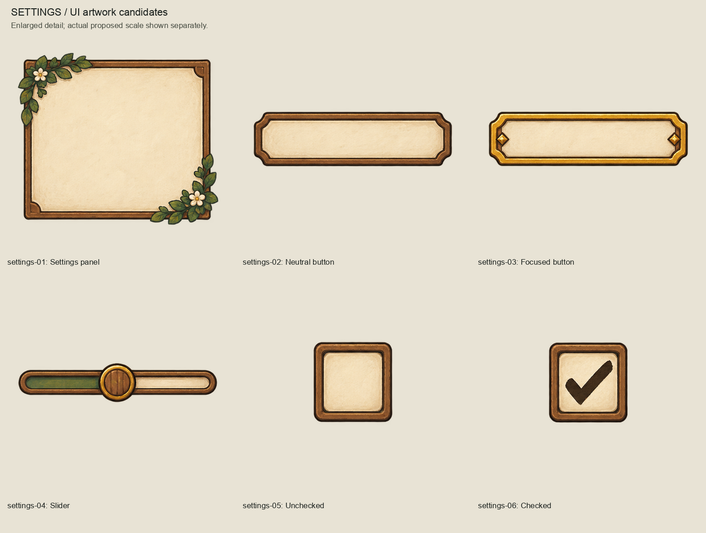
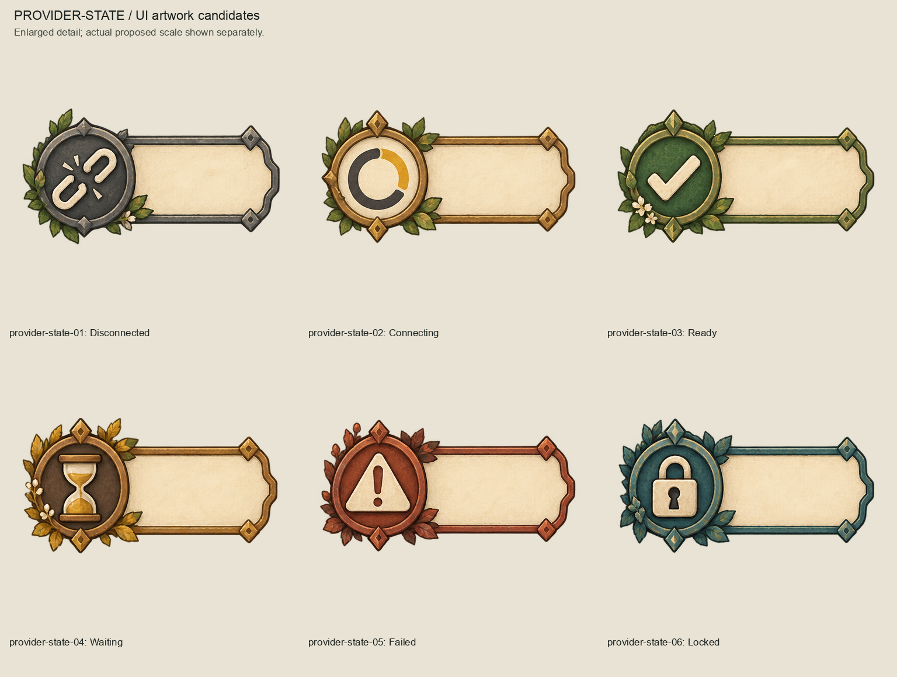
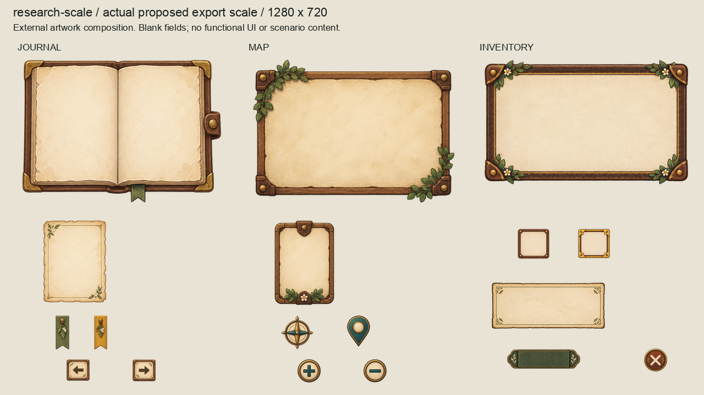
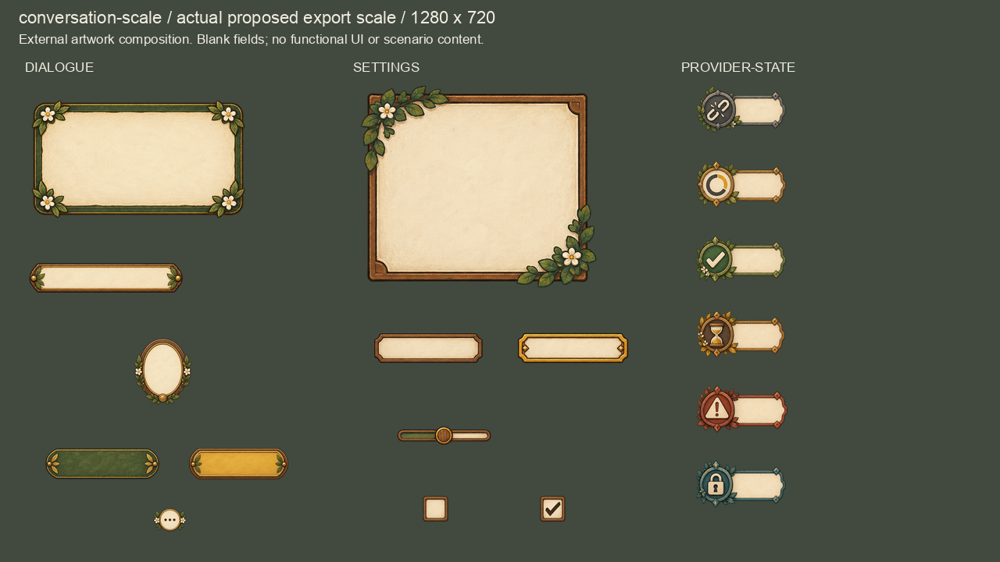

# UI artwork batch 01

Complete initial external Phase 9.2 UI artwork series, authored 2026-10-04
(Australia/Brisbane) with built-in image_gen. **Awaiting collective owner review.**
36 reusable painted candidates, six each for journal, map, inventory, dialogue,
settings and provider-state presentation. No functional UI or runtime promotion.

## Family review

## Proposed screen scale

Every export appears once at exactly its exported dimensions in these 1280x720
light/dark arrangements. These are component arrangements, not working screens,
runtime captures or approved layouts. Labels on review boards identify candidates;
the painted content fields stay blank. The map contains no geography or routes.

## Sources and reproduction

- `sources/`: unchanged transparent generated sheets and tool provenance.
- `prompts.json`: exact prompts, transparency and approved style reference hash.
- `masters/`: 36 OpenRaster files, exactly twice their export dimensions, with
  source paint and a separate empty Corrections layer. These editable raster
  masters do not reconstruct semantic layers or add detail absent from the source.
  Some large panels require resampling above their original source crop size.
- `exports/`: padded transparent PNGs. Dimensions and top-left anchors are provisional.
- `inventory.json`: exact source cells/crops, excluded faint-pixel accounting, dimensions, master/export hashes.
- `review-manifest.json`: hashes of the candidate sources, assets, boards and authoring inputs.
- `session-review.json`: session code/visual review and reproduction evidence.

Rebuild with `/opt/homebrew/bin/python3 art-direction/ui-batch/build_review.py`;
inspect with `/opt/homebrew/bin/python3 art-direction/ui-batch/inspect_package.py`.
Generation uses the approved Direction A scene only as a paint/material reference;
interface artwork is front-on. Preserve the unchanged source sheets. Crops retain all pixels with alpha >= 8
and an eight-source-pixel margin, including detached paint in that footprint.
Only distant pixels below alpha 8 can fall outside a crop; their count and maximum
alpha are recorded per component. Initial undersized scale boards are retained
in `evidence/`. No retained pixel is repainted or thresholded.
Do not rebuild a package after owner acceptance; create a separate revision instead.

Pale fields leave space for later live text. Buttons, selected slots, checkboxes,
slider and status icons illustrate candidate visual states only; they define no
interaction contract. Provider chips depict disconnected, connecting, ready, waiting,
failed and locked; they contain no credentials, provider identities or diagnostics.
Icon shapes and border accents offer alternatives to colour, without establishing
contrast compliance, keyboard focus, localization, text fitting, hit targets,
nine-slice suitability or usability. The painted slider is one fixed illustrative
position, not a runtime control. All remain subject to owner and later UI review.

Product/runtime/CI inputs remain unchanged. Retain the existing full-suite evidence
referenced by HANDOVER.md. Run scoped approval checks after collective owner review.
