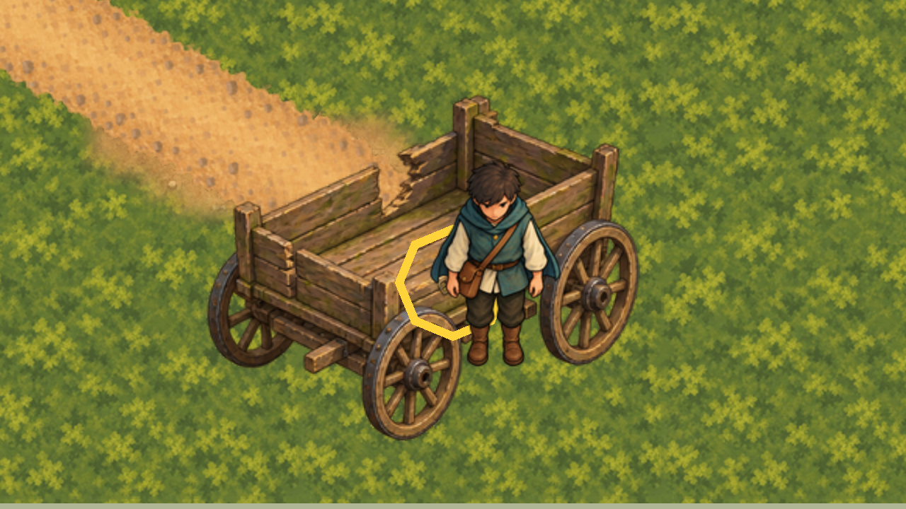
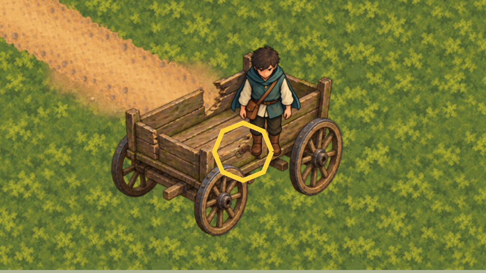

# Wagon clue broken strap

30 October 2026 (Australia/Sydney). After merging PR #484, the owner closed the herb patch slice
([acceptance](../herb-patch-art/owner-acceptance.json)), chose the wagon clue as the next greybox
marker to replace, and chose the broken strap as its object. The owner's replies are in
[authority.json](authority.json).

## Runtime

In `game/Main.tscn`, the `Marker` Polygon2D under `InteractionCandidates/WagonClue` is now a
Sprite2D showing a byte copy, `game/art/runtime/objects/clue-objects-05.png`, of the approved
[objects-batch](../objects-batch/README.md) "Broken strap" (bound by hash in its
`owner-acceptance.json`). The domain only calls the clue "a small clue on the abandoned wagon that
needs close inspection"; a torn harness strap fits a wagon. No new artwork was made.

The sprite is uncentred, with its `offset` set to minus the export's proposed foot pivot (16, 27), so
its `position` (0, 12) is its foot, the old polygon's lowest point. The strap spans about −16..17 by
−15..17 around the node, where the polygon was, and stays above the unchanged `TOOL-GATED CLUE`
label. The node position (1900, 1640), which the interaction ranges, perception and the focused
search measure from, is unchanged. In ordinary Main the strap lies across the front rail of the
installed wagon artwork.

`CharacterDepthOrderPresentation` adds the wagon clue to its fixed props (foot +12 below its node),
so it gets z `1 + DepthDrawOrder.CountNorthOf(...)` like the herb patch and stone marker. The Sage,
water cask, Healer and Seeker keep their accepted ranks z 1..4; the herb patch and stone marker are
unchanged. The clue is far south of the Sage, so it can reach z 5, level with the Sage's name label,
but the two are about 800 px apart. Its z is always at least 1, so it draws over the painted wagon
(`MapStructuresPresentation/Wagon`, z -2, later in the tree); the greybox wagon shell is hidden in
ordinary Main. The Healer and Seeker come after the clue in `Main.tscn`, so at equal z they draw in
front of it. The water cask comes before it, but the two are far apart.

## Checks

- `scripts/validate-wagon-clue-art.py` checks the objects-batch acceptance binding, that the runtime
  PNG is byte-identical to its approved export and that its import is lossless. It also checks the
  captures and their art and script inputs against [capture-evidence.json](capture-evidence.json).
  It checks only those bytes, never the whole tree (#471).
- `scripts/check-wagon-clue-art.gd` checks the texture, the foot, that the sprite is untransformed,
  the unchanged interaction point, that the clue draws over the visible painted wagon (at a relative
  z under a z-0 parent), and that the Healer and Seeker come after it in the tree. It also checks
  that a Seeker level with the strap's foot draws in front of it and one 1 px north draws behind,
  which ties the presentation's foot offset to the sprite's foot.
- `scripts/capture-wagon-clue-art.gd` writes the two `captures/` and
  [capture-evidence.json](capture-evidence.json). It hides every Control, so the captures show
  neither the UI nor the world labels such as `TOOL-GATED CLUE`. The yellow ring is the clue's own
  focus indicator, shown because the Seeker is in range.

Results are in [verification.json](verification.json).
