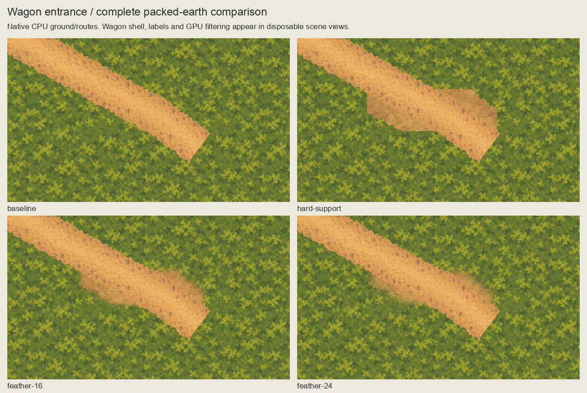
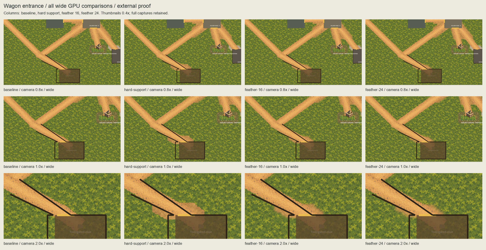
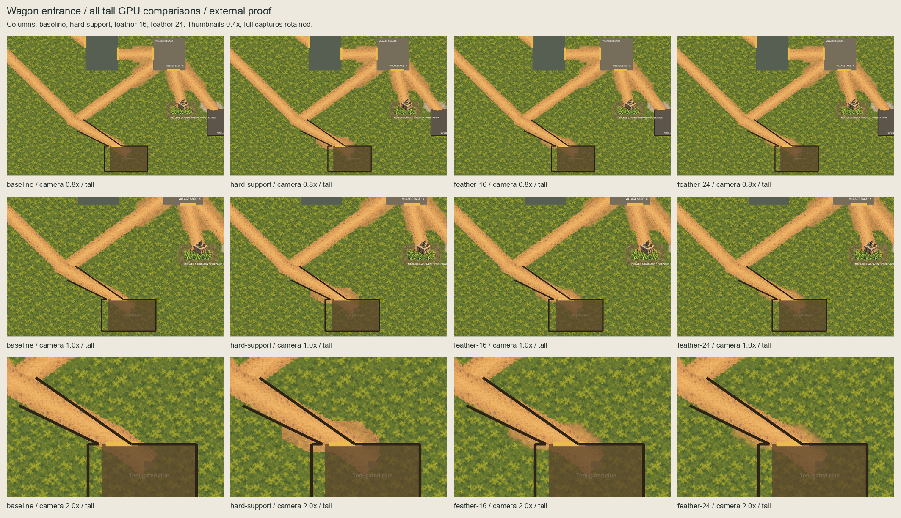
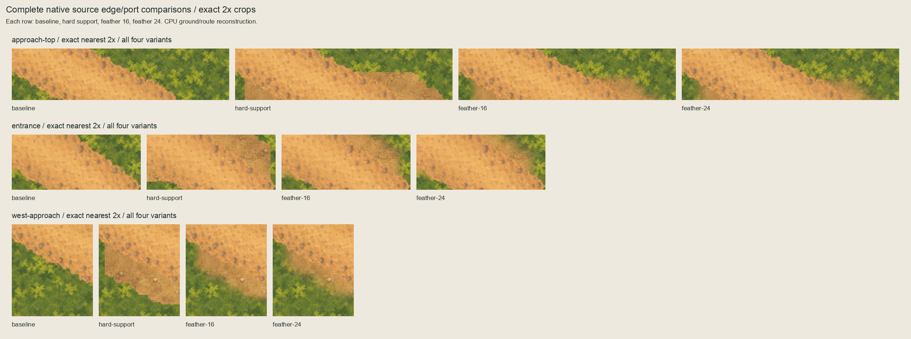

# Wagon entrance packed-earth external proposal

The continuing slice request and live handover authorize this one agent-chosen
external proposal from `bbcc14b1`. The owner selected **feather-24** on 2026-10-05 ("Here feather-24 looks best I think").
[Selection](owner-selection.json) binds that exact external preference; named runtime approval remains absent.
No ordinary-scene asset, import, production master or scene was changed.

## Complete series






Columns retain baseline, hard-support diagnostic, 16px inward feather and 24px
inward feather. All 24 full-size GPU views remain under `captures/`; the labelled
GPU boards use 0.4x thumbnails. CPU boards reconstruct quiet moss, accepted ground
and the retained routes. They omit the Wagon shell, labels and physical boundaries;
the disposable GPU views retain those actual owners. HUD CanvasLayers and character
bodies alone are hidden. All scene changes exist only in the disposable instance.

The hard-support patch has flat terminations. Both inward feathers soften them;
16px leaves more visible packed earth, while 24px blends more softly. The unchanged
black boundaries, yellow opening marker, translucent Wagon shell and clue label
remain conspicuous. The shell reveals some underlying paint. These conditions are
not corrected here. Accessibility, pacing and terrain completeness remain open.

## Exact proposal

The approved unchanged 128px packed-earth field is sampled at world phase `(0,0)`.
The existing 560x432 Road–Wagon route is centred at `(1680,1496)`, giving top-left
`(1400,1280)`, z=-70. Use its alpha `>0` only in world rows `[1536,1580)`, immediately
north of the authored Wagon top at y=1580. Square dilation radius 24 produces support
within `(1633,1512)`–`(1918,1604)`, right/bottom exclusive, a **285x92** window.
This is an entrance underlay proposal, not a repaint of the whole Wagon enclosure.

Zero-padded Chebyshev pixel-centre distances produce inward smoothstep masks at
16px and 24px. Every covered RGB texel equals the approved source paint; alpha-zero
texels have zero RGB. Proposed sprites use z=-90, centred=false, unit scale, zero
offset, linear filtering and repeat disabled. Three **570x184 OpenRaster masters**
retain exact nearest 2x masked paint, empty Corrections, hidden coverage reference
and hidden unmasked world paint. They are editable underlay masters.

Camera target `(1800,1530)` keeps the actual south clamp for 0.8x, 1x and 2x in both
1280x720 and 1280x827 viewports. Six baselines pair with eighteen candidates;
actual centres and world-to-canvas transforms are recorded and checked separately.

## Evidence and reproduction

`baseline.json` freezes the complete tracked predecessor. `selection.json` records
agent selection under the continuing instruction, without inventing owner recipe
approval. `inventory.json` binds approved paint, physical owner/code/scene inputs,
exact outputs and masks. `capture-evidence.json` binds the actual external script,
input bytes, captures and transforms. `review-board-manifest.json` binds all boards.

[evidence/validation.json](evidence/validation.json) checks 7,355 protected predecessor
files, all twelve master layers, nine accepted ground/channel alpha planes and all
18 paired GPU comparisons. Differences stay within support plus a two-native-pixel
filtering/index guard. [Four rejection probes](evidence/rejection-checks.json) first
pass a valid disposable fixture, then reject phase, coverage, RGB and camera drift.
Build/capture/board tools refuse existing final packets; checks never write them.

The initial CPU composition omitted the retained Wagon route; GPU views already
included it. The initial inventory, CPU/edge boards and 24 GPU views remain under
`evidence/initial-cpu-review/`. The corrected complete CPU composition includes the
route; fresh final captures bind the corrected inventory. No source paint or masks
changed. Capture sandbox startup exited 134; identical host retry succeeded.
Session review and quality outcomes are recorded in `session-review.json`.
The frozen Sickhouse validator rejects these external successor files in a live
whole-tree run. It is unchanged. `check_predecessor.py` first proves all protected
predecessor bytes and exact new-file scope, then runs the unchanged live asset,
rejection and paired-capture checks with only historical membership delegated.
Full `PATH="/opt/homebrew/bin:$PATH" ./scripts/quality.sh` runs in a clean isolated
checkout at `bbcc14b1`; its product inputs equal the protected live bytes. Logs
separate sandbox failure from the identical host retry. That quality evidence
covers the unchanged product, while the external package has its own scoped checks.
Initial pending metadata in `selection.json`/`inventory.json` is historical and
superseded by `owner-selection.json`; accepted image bytes remain unchanged.

```sh
/opt/homebrew/bin/python3 art-direction/wagon-ground-feasibility/build.py --check
/opt/homebrew/bin/python3 art-direction/wagon-ground-feasibility/boards.py --check
/opt/homebrew/bin/python3 art-direction/wagon-ground-feasibility/inspect_package.py
/opt/homebrew/bin/python3 art-direction/wagon-ground-feasibility/rejection_probes.py
/opt/homebrew/bin/python3 art-direction/wagon-ground-feasibility/check_predecessor.py
```

## Next boundary

The [separate named one-asset runtime scope](../wagon-ground-runtime-scope/README.md)
proposes the selected feather-24 unchanged. Obtain explicit named scope approval
before installing it. The owner selection binds artwork, master, source recipe,
all six selected GPU views and baselines, and the displayed series.
Do not infer runtime approval or ordinary-scene visual confirmation from this proposal.

Preserve Direction A and every accepted paint/mask/master, rejected evidence,
Garden/Square/Sickhouse owner, route sibling order, physical owner and final channel
child. No physics/navigation/layout/scenario/gameplay/dialogue/clue/discovery/
treatment/save/provider/functional-UI/audio/release/signing changes. Exclude `.DS_Store`.
