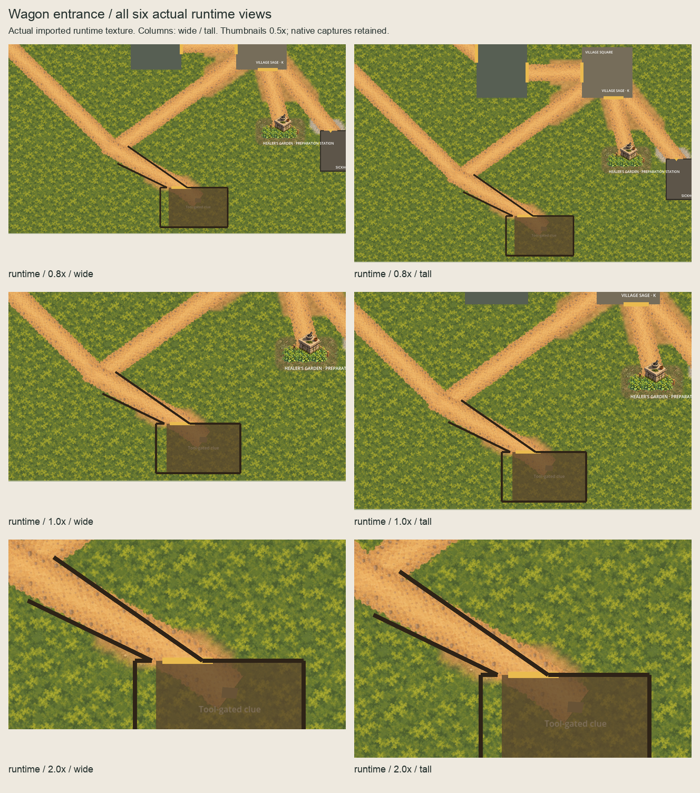
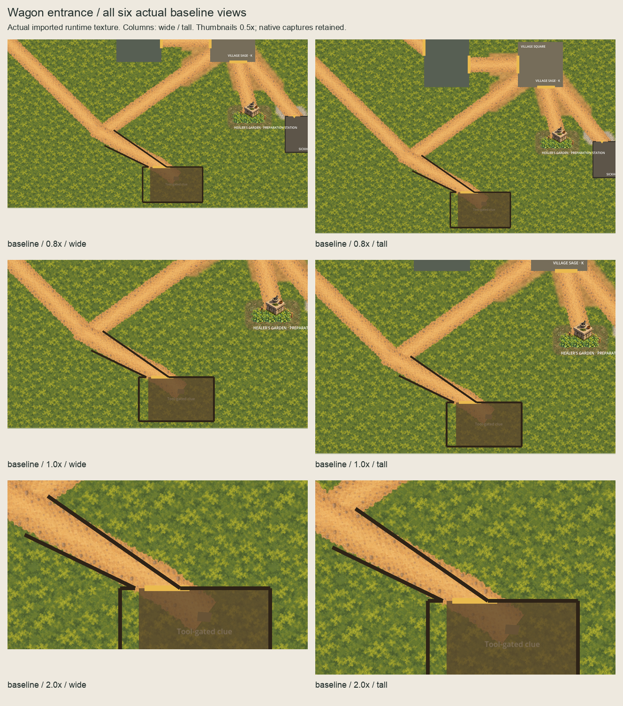

# Wagon entrance ordinary-scene checkpoint

The owner approved the [exact named scope](../wagon-ground-runtime-scope/README.md)
on 2026-10-05 ("scope approved"). [Authorization](authorization.json) binds the
unchanged approved README, source bindings, owner record and complete implementation
predecessor at `b7048d2e`. The selected feather-24 packed-earth underlay is installed.
The owner confirmed these exact six actual runtime views on 2026-10-05
("confirmed"); [acceptance](owner-runtime-acceptance.json) clears reviewed direct-main
publication.

## Installed presentation

`WagonGroundPresentation` is a script-free independent root at `(1633,1512)`, z=0.
Its single native 285x92 `PackedEarth` child has effective z=-90, centred=false,
unit scale, zero offset, linear filtering and repeat disabled. World paint phase
is `(0,0)`. Exact source/production/proof/runtime PNG SHA-256 is
`8f2738681d3eedebfdab946ec0f67a0b71caf0bc9e06b1e962d36ea19c0393ae`.
The selected **570x184 OpenRaster master is copied unchanged**, preserving masked
nearest2x paint, empty Corrections and hidden coverage/raw-paint references.

Production is append-only: **94 assets / 45 masters**, retaining every previous
93/44 entry and byte. Proof and runtime imports have independent native UIDs and
cache paths, lossless RGBA, no mipmaps, alpha-border processing, premultiplication,
channel remapping or size limit. Both new script UIDs are independently native-generated.

Removing only the named texture/script resources, owner/child and inactive smoke
node returns byte-exact predecessor scenes and node order. The channel remains the
final root child. Existing Wagon shell/opening/clue/physical owners and all routes,
Garden/Square/Sickhouse ground, native channel nodes and accepted terrain remain intact.

## All six actual runtime views

These captures instantiate ordinary `Main.tscn` and use the actual imported runtime
texture, with no injected external proof. Paired baselines hide only the new ground
owner. HUD CanvasLayers and character bodies are hidden only in the disposable
instance; camera settings are changed only there. Target `(1800,1530)` retains
south clamps at 0.8x and 1x; both 2x views stay at the unclamped target. Historical
external-package prose described clamps too broadly; its recorded transforms and
pixels are correct and remain frozen.

**All six runtime images and six baselines equal the selected external GPU RGBA
pixels exactly.** [Pairwise results](capture-comparison.json) also confine changes
to selected support plus a two-native-pixel filtering/index guard.

| Zoom | Wide 1280x720 | Tall 1280x827 |
| --- | --- | --- |
| 0.8x | [Runtime](captures/runtime-0.8x-wide.png) / [Baseline](captures/baseline-0.8x-wide.png) | [Runtime](captures/runtime-0.8x-tall.png) / [Baseline](captures/baseline-0.8x-tall.png) |
| 1x | [Runtime](captures/runtime-1.0x-wide.png) / [Baseline](captures/baseline-1.0x-wide.png) | [Runtime](captures/runtime-1.0x-tall.png) / [Baseline](captures/baseline-1.0x-tall.png) |
| 2x | [Runtime](captures/runtime-2.0x-wide.png) / [Baseline](captures/baseline-2.0x-wide.png) | [Runtime](captures/runtime-2.0x-tall.png) / [Baseline](captures/baseline-2.0x-tall.png) |




Inherited black boundaries, yellow opening marker, translucent Wagon shell and
clue label remain visible. The shell reveals some underlying paint. Accessibility,
pacing and terrain completeness remain open.

## Checks and review

[Verification](verification.json) records validation and sandbox/host outcomes.
[Session review](session-review.json) records cumulative review and fixes.
[Runtime review bindings](runtime-review-request.json) identify the exact views
confirmed by the owner before reviewed direct-main publication. Historical pending
records remain intact and are superseded by owner acceptance.
[Publication review](publication-review.json) binds unchanged implementation and
final documentation.

Ten disposable probes reject phase, depth, duplicate/dropped owner, transform,
extent, physical scope, paint, coverage/source and import processing after a valid
fixture passes. Cold decoding starts from an empty disposable cache, regenerates
the proof UID independently, retains the runtime sidecar exactly and proves native
RGBA equality. Four native new UIDs are canonical, distinct from each other and
absent from the predecessor. Frozen artwork, Garden, Square and Sickhouse checks
remain unchanged at `2fcc849`, `7942e7d`, `06f0dab4` and `bbcc14b1`; the new successor
proves every protected live input plus only the approved additions.

Capture review corrected portable script-input key normalization; initial metadata,
all twelve initial captures and boards remain in `evidence/initial-capture-input-key/`.
Fresh final captures bind the corrected script and retain exact external parity.
Review also corrected inherited absolute support origins in the new validator;
failed validation logs are retained. The correction uses the approved scope origin
without changing captured pixels or enlarging permitted support.
Sandbox Godot startup exited 134 for capture and UID checks; identical host retries
passed. Cold sandbox decode exited -6; its failed record is retained, and the
identical host retry passed. Sandbox editor import exited zero with blocked editor
settings writes. Full quality's sandbox attempt passed .NET checks before failing
at Godot user-log startup. The identical host retry passed restore, formatting,
a zero-warning/error build, all 5,033 tests, every inherited Godot smoke, the new
Wagon ground smoke and Compatibility startup.

```sh
PATH="/opt/homebrew/bin:$PATH" ./scripts/quality.sh
/opt/homebrew/bin/python3 scripts/validate-wagon-ground-runtime.py --check-captures --check-rejections
/opt/homebrew/bin/python3 art-direction/production-proof/corrected/tools/build_wagon_ground.py --check
/opt/homebrew/bin/python3 art-direction/wagon-ground-runtime-promotion/review_boards.py --check
```

Accepted evidence and all existing captures/boards must not be overwritten.
Cold-import and UID audit helpers operate only on disposable copies or new scripts.
No physics/navigation/layout/scenario/gameplay/dialogue/clue/discovery/treatment/
save/provider/functional-UI/audio/release/signing change is included.

## Next boundary

Continue from live main with one bounded next external placement proposal as
specified in [HANDOVER.md](../../HANDOVER.md). Preserve all accepted inputs and
evidence. No further location/material or runtime placement is selected.
