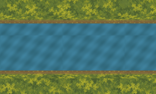

# External western outlet proof

This bounded proof shows the proposed water-only outlet at `(0,600)`. The exports
cover world x=0..320, water y=552..648, and 16px banks at y=536..552 and y=648..664.
The 320×192 canvas starts at `(0,504)` and includes ground margins for local review.
Water and both banks reach both horizontal export edges without end caps. The east
edge is a sampler boundary, not a new channel termination.



The [engineering view](review/engineering.png) marks the world boundary in gold.
Its leftmost 64px are an off-map reference, not part of the asset export or a world
extension. The [unannotated reference](review/off-map-reference.png) shows the same
uninterrupted water and banks. This is an external composition, not a Godot capture.
The world remains closed to actors. No runtime, collision, navigation or scenario
state changes. Owner visual assessment is pending; no promotion authority is granted.

## Source and phase

The water and bank pixels come from the frozen corrected production exports. Sampling
uses B2's accepted absolute-world UV phase: water `(floor(x) mod 128, floor(y) mod 96)`;
banks use `floor(x) mod 128` and compress the complete 32-row source into 16px with
BOX filtering. The south bank mirrors the north bank. Transparent source rows remain
transparent over the ground; no replacement bank pixels or invented dam are added.
This matches B2's external western reach, not the retained Stream's separate local UVs.

The verifier independently compares every water and bank texel to source sampling,
including the off-map strip. It also compares a complete water tile and both unobstructed
bank strips directly to B2's frozen exports. Ground remains world-aligned. Water and
bank repeat checks compare columns a full tile period apart, rather than incorrectly
requiring adjacent seam columns to be identical.

Five exports and a [640×384, four-layer editable 2x OpenRaster master](masters/outlet.ora)
are bound in [manifest.json](manifest.json), together with source paths, hashes and
draw order. Review views are provided at [0.8x](review/joined-0.8x.png),
[1x](review/joined-1.0x.png) and [2x](review/joined-2.0x.png).
Production remains at 83 exports and 34 masters; this proof is separate.

## Preservation and verification

[baseline.json](baseline.json) freezes all 4,023 predecessor files at
`f25c173c0a6c3868441e233964222508c6490099`. Only this new directory, HANDOVER.md and
Finder `.DS_Store` are excluded. Every accepted spring, bridge, route, production asset,
runtime owner, physical owner and historical failed candidate remains unchanged.
The conservative raster-halo clearance from all twelve retained 96px route corridors
is 162.416px. This measurement establishes no traversal or physical approval.

```sh
/opt/homebrew/bin/python3 art-direction/western-outlet-proof/tools/proof.py --build
/opt/homebrew/bin/python3 art-direction/western-outlet-proof/tools/proof.py
/opt/homebrew/bin/python3 art-direction/western-outlet-proof/tools/check_rejections.py
/opt/homebrew/bin/python3 art-direction/western-outlet-proof/tools/check_predecessor.py
/opt/homebrew/bin/python3 art-direction/spring-curved-bank-proof/tools/check_rejections.py
/opt/homebrew/bin/python3 art-direction/production-proof/corrected/tools/validate_stream_laundry_path.py --check-captures --check-promotion-scope
PATH=/opt/homebrew/bin:$PATH ./scripts/quality.sh
```

Eleven in-memory mutations reject capped west/east water edges, escaped water/bank
masks, changed UVs, missing north/south banks, hidden RGB, wrong draw order and an
off-map water gap. Session code review added independent off-map sampling validation
and exact B2 export comparisons. All generated PNG, master, manifest and evidence
bytes reproduce deterministically.

Historical scope inventories intentionally reject successors. `check_predecessor.py`
first verifies the complete new inventory and that it preserves every historical
baseline digest, then reruns the unchanged spring reproduction checks with only the
scope audit replaced by that verified superset. It retains the historical evidence's
4,000-file count and never rewrites historical sources or artifacts.

Full host quality passed: zero-warning build, all 5,033 tests, asset/scenario validation,
all credential-free Godot smokes and Compatibility launch. The initial sandbox run
passed build/tests but failed at Godot user-log rotation; the identical host retry passed.

## Exact next slice

Resolve owner visual assessment of the shown outlet; if correction is requested,
make one bounded successor proof within the same outlet envelope and preserve this
candidate. Do not infer acceptance of an unshown view. Whole-channel art and
Clearing–Closed Deeper Forest Path remain deferred. Named runtime/layout/physical
promotion requires separate authorization and visual checkpoints.
