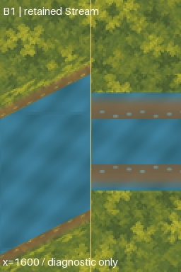

# External western-watercourse join audit

The owner replied “proceed” after the exact western outlet engineering view was shown
and its visual assessment requested on 2026-10-03. The
[acceptance record](outlet-visual-acceptance.json) binds that statement to the shown
image, digest and originating commit. Acceptance covers that external view only.
The frozen outlet README/manifest still describe the candidate's original pending
status; this successor record resolves that checkpoint without rewriting history.

This audit examines only the B1/retained Stream interface at world x=1600. It creates
no new terrain asset, editable art master, runtime texture, layout or physical state.
The [diagnostic](review/engineering.png) puts exact B1 joined pixels on the left and
the retained scene's water/bank recipe on the right. It is an external reconstruction,
not a Godot capture, proposed correction or visual acceptance of the seam.



Unannotated views are available at [1x](review/interface-1x.png) and
[2x](review/interface-2x.png). They cover `(1536,400)` through `(1664,592)`; no bridge,
bank cap or route enters the reconstructed retained portion.

## Findings

Both water envelopes meet at y=452..548. B1 samples water at absolute world coordinates;
the retained Stream samples from `(1600,452)`. Their phase difference modulo the
128×96 tile is `(64,68)`. Sampling both recipes over the same complete tile period
differs in 12,167 of 12,288 texels. This is a same-coordinate comparison, not a claim
that adjacent columns should be identical or that the authored exports overlap.

The western bank limits are y=436..452 and y=548..564, outside its water. The retained
west banks occupy y=452..484 and y=516..548, inside the retained water band. Separate
visual approvals therefore do not establish a continuous joined shoreline or water
phase. [Evidence](evidence.json) binds the exact sources, measurements and diagnostic
image digests. All 4,041 predecessor files remain byte-for-byte unchanged.

## Verification

```sh
/opt/homebrew/bin/python3 art-direction/western-watercourse-join-audit/tools/audit.py --build
/opt/homebrew/bin/python3 art-direction/western-watercourse-join-audit/tools/audit.py
/opt/homebrew/bin/python3 art-direction/western-watercourse-join-audit/tools/join.py
/opt/homebrew/bin/python3 art-direction/western-watercourse-join-audit/tools/fringe.py
```

Verification checks the exact shown outlet image, authored scene bounds/UVs/bank
regions, B1 boundary water and bank pixels, deterministic records and diagnostic
bytes, and the complete preservation inventory. It reproduces the frozen outlet
and curved spring with only their historical scope audits replaced by the verified
superset; historical file counts and artifacts remain unchanged.

Review corrected a boundary comparison to exclude BOX-filtered fractional edge rows;
those rows remain covered by frozen-artifact preservation. The diagnostic's retained
south bank uses the authored vertical mirror, and its B1 crop remains exact.

## Join candidates and owner correction

The [first join candidate](correction/review/joined-2x.png) uses a 64×256 patch at
`(1536,384)`, with a three-layer 128×512 master. It has a 56.061px horizontal gap from
the accepted B1 deck and contains no accepted deck/road pixels. Four-pixel endpoint
bands reproduce exact B1 and retained recipes. Full mask/bank checks and seven
in-memory mutations cover water gaps, bank intrusion, escaped halos, hidden RGB and
both endpoints. Review also added unchanged-pixel checks outside the old/new shoreline
halo. Alpha filtering required exact west master layers and opaque bank-over-water
endpoint texels; premultiplied interpolation uses the unrounded alpha weight.

The owner rejected the shown first candidate: “there is a small blue (water) line
between the brown bank and the green grass”. The [request](correction/review-request.json)
binds the exact shown image. Preserve it as failed evidence. The source bank has
translucent grass-to-brown rows, including a transparent row 14, exposing the water
underlay between grass and bank.

The separate [fringe successor](fringe-correction/review/joined-2x.png) replaces that
underlay with ground in source rows 11..14 and eases it back toward water in rows
15..21. All other pixels, including the water interior and first four western columns,
are unchanged. It changes 2,149 external pixels; the reconstructed retained portion
changes only within this owner-requested fringe. No runtime or accepted source file
changes. The two-layer 2x master contains the exact rejected reference and a separate
source-derived correction overlay; nearest enlargement adds no painted detail.
The [manifest](fringe-correction/manifest.json) records source/request/artifact digests
and the precise count of changed retained-reference pixels. Validation reproduces the
rejected candidate, confines changes to the fringe footprint, and independently
requires transparent retained bank rows to show exact ground pixels.

All proof checks passed. Full host quality passed: zero-warning build, 5,033 tests,
asset/scenario validators, all Godot smokes and Compatibility launch. The initial
sandbox run failed at Godot user-log rotation after passing build/tests; the identical
host retry passed. All 4,041 predecessor files remain unchanged.

## Exact next slice

The owner accepted the exact shown 2x fringe successor on 2026-10-03:
“Yes, visually acceptable as shown”. The [acceptance](fringe-correction/visual-acceptance.json)
binds that view and its digest. The first candidate stays rejected; candidate-generation
manifests retain their original pending status, resolved only by the separate acceptance.

The outlet and local interface assessment slices are complete. Resolve the owner's next
named scope before starting new art: whole-channel composition and Clearing–Closed
Deeper Forest Path remain deferred, and runtime/layout/physical promotion requires
separate authorization and checkpoints. Do not extrapolate this local acceptance to
the rest of the watercourse or change accepted source/runtime pixels.
