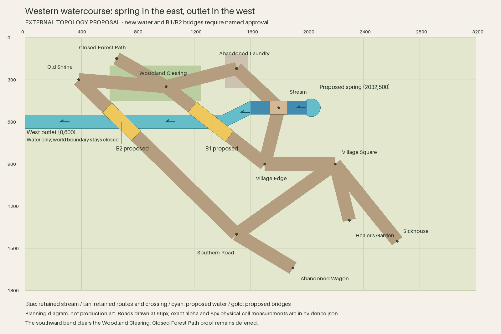

# Western watercourse topology proposal

External-only proposal based on `ebe5dcc` (accepted Stream–Laundry runtime promotion).
No layout, runtime, art, collision, navigation or scenario change is implemented or approved.
The diagram is a planning schematic, not a scene capture or production-art preview.



## Proposed direction

A spring basin centred at `(2032,500)`, radius 64, supplies the retained Stream band. Water flows
west through the existing `(1600,452)`–`(2000,548)` rectangle, bends southwest between x=1600 and
x=1400, then runs west at y=600 to an explicit off-map outlet `(0,600)`. The off-map continuation
is water only: the world boundary remains closed to actors, with no new location or scenario edge.
The spring is a proposed explanation for the eastern termination, not an established scenario fact.
The existing crossing `(1736,452)`–`(1864,548)`, its 200px collision opening and accepted water/bank
pixels remain baseline authority. The new channel joins their west edge without removing them.
The basin overlaps existing water only; it requires a new external art proof before promotion.

A constant y=500 western extension was rejected: its top edge at y=452 is just 2px below the
Clearing's y=450 boundary, inside that boundary's 8px wall thickness. Moving the western channel
to y=600 leaves 102px between water and Clearing, or 86px after a provisional 16px bank allowance.
The ramp retains a 96px vertical water height; its normal width is approximately 85.9px. This is
a topology envelope, not a promise of a finished constant-width texture or a hydrological model.

Both western path intersections require bridges. A decorative water overlay alone would place
water across retained walkable routes. Bridges retain the existing 96px corridor and route
endpoints. Fords would introduce wading semantics; culverts would hide the crossing water.
Neither alternative is part of this proposal. Bridges are proposed presentation/physical continuity,
not new interaction nodes, barriers or traversal dependencies.

| Proposed crossing | Retained road | Centre | Deck envelope | Visible road pixels under water | Current walkable 8px cells under water |
| --- | --- | --- | --- | ---: | ---: |
| B1 | Woodland–Village Edge | `(1318.182,600)` | 96px wide × 336px along route | 12,739 | 225 |
| B2 | Shrine–Southern Road | `(685.455,600)` | 96px wide × 288px along route | 11,572 | 204 |

Deck lengths cover the **entire accepted alpha footprint** inside the proposed water plus a
16px bank envelope, rather than just each path centreline. Measured visible half-widths are
46.533px and 47.158px. There is very little spare width: future railings must not narrow or obscure
the 96px traversable corridor. The decks' northernmost corners are south of y=454, clearing the
Clearing's bottom wall thickness. These dimensions are planning envelopes, not final approved art.

[Crossing close-ups with exact accepted road pixels](crossings.svg) show both proposed deck
outlines, retained 96px physical corridors and the Clearing boundary at 1:1 world scale. The SVG
embeds the original PNG file bytes unchanged, with no resampling or replacement asset export.
Its purple edges are continuous corridor guides; the measured cells retain the actual 8px grid.

## Compared alternative

A spring at `(1450,500)` feeding east through the retained band to a water-only east outlet
`(3200,500)` would avoid additional bridges. Its 64px source radius is clear of the existing route
strips (112.072px centre-to-strip clearance), and its two new centreline legs intersect no route.
It would replace the western continuation with an inside-loop headwater and require 1200px of
eastern extension. It also puts the source opposite the frozen layout's eastern “upstream-bank”
planning zone. That label is not hydrological authority, so this remains a viable alternative if
the owner prefers fewer physical changes. It has not received bank/art/physical feasibility
proofs. The pictured proposal favours westward continuity with an explicit off-map outlet; the
owner can accept it or request the alternative before any art or layout promotion.

## Physical owners and preserved assets

`GreyboxNavigation` derives route cells from the approved anchors, 96px corridors and 8px grid,
then authors `NavigationPolygon` and `RouteBoundaries`. Both proposed bridges lie on its current
walkable routes. `OpeningRegionStreamLaundrySceneSource` configures the original Stream/Laundry
presentation and the two `StreamCollision` polygons. Those polygons stop at x=1600/2000; they
provide no water collision at B1 or B2. `OpeningRegionWoodlandClearingSceneSource` owns the nearby
Clearing tree boundaries. Proposed banks, exclusions and bridge openings need separate named
physical/layout approval and explicit validation; this proposal does not add any of them.

Measurements use the runtime-owned accepted PNGs at their exact sprite origins:

- Woodland–Village Edge: `woodland-village-edge-path.png`, origin `(944,288)`, 816×688.
- Shrine–Southern Road: `shrine-southern-road-path.png`, origin `(432,400)`, 1152×1080.

The existing Shrine endpoint blend and accepted junction triangle are away from B2 and remain
untouched. Laundry–Clearing, Woodland–Shrine, Stream–Laundry, Village Edge–Stream and every other
accepted asset remain unchanged. All twelve route centrelines and their finite-width cell strips
are checked: only the two listed western routes contact the new water. The proposed spring is
clear of all 96px route strips. This does not establish a runoff tributary from the Laundry,
change contamination or dialogue facts, relocate the Hermit, or make a gameplay claim.

## Reproduction and approval boundary

`proposal.json` records the proposed source, outlet, water polygon and bridge envelopes.
`evidence.json` records derived intersections, alpha counts, deck coverage and route-cell exposure.
`baseline.json` pins all 3,912 pre-existing tracked files except the explicitly editable handover.
`tools/proposal.py` builds the vector schematic and PNG, reproduces them, checks every protected
hash/inventory and rejects new untracked runtime/source/test files. It reads accepted images to
measure their alpha; it never writes or composites those assets.

```sh
/opt/homebrew/bin/python3 art-direction/western-watercourse-proposal/tools/proposal.py --build
/opt/homebrew/bin/python3 art-direction/western-watercourse-proposal/tools/proposal.py
/opt/homebrew/bin/python3 art-direction/production-proof/corrected/tools/validate_stream_laundry_path.py --check-captures --check-promotion-scope
PATH=/opt/homebrew/bin:$PATH ./scripts/quality.sh
```

The owner said “Looks good” after the overview was shown on 2026-10-03. This is bounded visual
acceptance of that external overview, not approval of runtime/physical promotion or unshown
production bridge art. The next slice is one bounded external B1 bridge/water-bank join proof
at Woodland–Village Edge against its retained footprint and 96x336 planning deck, including
joined banks, draw order, abutments and physical-opening feasibility. Routine external proof/scope
approvals remain waived. Obtain separate named layout/runtime/physical scope approval and visual
checkpoints before promotion. Defer B2, source/outlet production art and Clearing–Closed Deeper
Forest Path proof until B1 is assessed.

## Session review and validation

Cumulative review corrected the first cell-count scan to cover the complete water polygon,
verified every affected physical route cell is inside its proposed deck, included full accepted
alpha through the bank envelope, and reduced deck width/length to avoid the Clearing wall.
The diagram uses Pillow's bundled font rather than a Mac-only system font. SVG parsing and
byte/pixel reproduction pass. The close-up SVG was also rasterized and visually inspected. All 3,912 protected files remain unchanged. The accepted
Stream–Laundry capture and promotion-scope validator passes. No further implementation issue
was found in the reviewed proposal; layout and art still need their stated owner checkpoints.

The sandbox quality run passed all asset validators, formatting, the zero-warning build,
5,033 tests and scenario validation. Godot then failed at sandbox-restricted `user://logs`;
the identical full-suite host retry passed, including all asset validators, formatting, the
zero-warning build, 5,033 tests, scenario validation, complete credential-free Godot smokes and
the Compatibility graphical launch. No product code was changed for that restriction.
