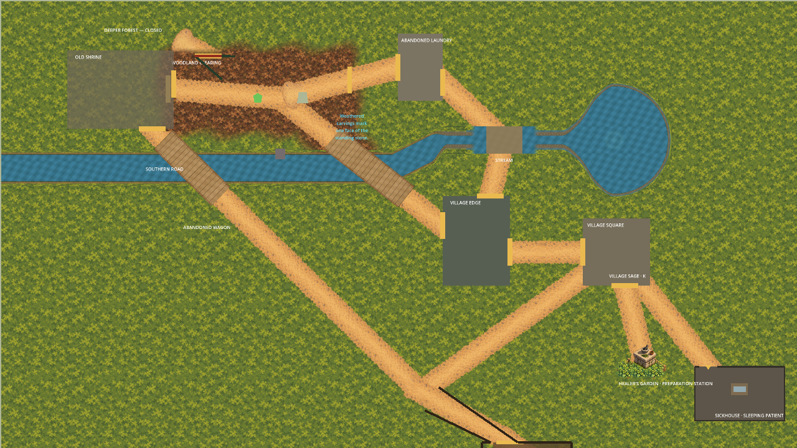

# Whole-channel disposable runtime preview

Stage 1 was approved on 2026-10-03 ("approved"); the [authorization](stage-1-authorization.json)
binds the exact [proposal](../whole-channel-runtime-scope/README.md). Production wiring remains
unapproved. All game/project/import mutations occurred in a disposable copy under `/private/tmp`.
The [baseline](baseline.json) freezes all 4,225 predecessor files at `0c0d833`; 4,222 files
remain protected byte-for-byte, with only the three continuation documents excluded from edits.



## Sources and rendering

Five independent transparent water/banks/decks/detail/fringe atlases reproduce the accepted
2604×620 channel CPU reference in every RGBA byte over its quiet-moss and reference roads/
crossing. [Manifest](manifest.json) binds source recipes, masking ownership and exact outputs;
[reconstruction](reference/accepted-reconstruction.png) is a comparison artifact only. Each
atlas has a nearest exact 5208×1240 editable master. All prior local sources remain unchanged.
No opaque ground canvas, duplicate road tails or baked CPU crossing enter the live preview.

The atlas origin is `(-64,212)`, sprite centre `(1238,522)`, identity transform and no repeat.
Water z=-68, banks -67, decks/detail -66, fringe -65 cover the bounded road crossing treatment;
actual Stream presentation remains at z=0. The existing route siblings, including final
ClosedForestPath, remain intact. Native water and the two western bank sprites use only an
in-memory [fragment mask](exports/channel-retained-overlap.gdshader) at x<1664. Their original
polygons, UVs, regions, transforms and other caps/crossing materials stay intact. The spring
atlas excludes x<2000; actual retained eastern banks/caps remain live. Imports are lossless,
without mipmaps, alpha-border processing or premultiplication; UIDs/cache paths are independent.
Their [decoded RGBA and sidecars](imports/) are preserved and checked against source exports.

## Actual GPU views and limits

There are 36 ordinary/candidate detail pairs (six targets, three zooms, wide/tall frames)
plus one whole-channel overview pair. [Context](capture-context.json) binds the exact scene,
recipe, imports, effective draw order, capture visibility and actual camera centres;
[evidence](capture-evidence.json) binds all 74 PNGs and pixel-change counts. Camera boundary
clamps remain active: some low-zoom outlet/B2 frames share the same actual centre. HUD/Seeker
hiding, frozen processing and overview framing are capture-only. No scene is packed or saved.

Review all frames via [the captures](captures/); focused 2x wide views:
[outlet](captures/candidate-outlet-2.0x-wide.png), [B2](captures/candidate-B2-2.0x-wide.png),
[B1](captures/candidate-B1-2.0x-wide.png), [interface](captures/candidate-interface-2.0x-wide.png),
[crossing](captures/candidate-crossing-2.0x-wide.png), [spring](captures/candidate-spring-2.0x-wide.png).
All ordinary/candidate GPU differences lie inside the declared source/suppression footprint,
with a conservative 2px source-space filtering allowance. The retained crossing interior
matches ordinary runtime pixels exactly. This is not equality between GPU output and the
CPU reconstruction: sampling transitions remain visibly assessable at x=1664 and x=2000.
The original bank/cap appearance after x=1664 was deliberately retained. No seam repaint is
included. Assess these exact runtime views before approving their production scope.

All collision polygons, shape storage properties and static-body transforms remained equal
through every capture toggle. New water/decks remain presentation-only; existing walkable
space beneath water stays walkable. B1/B2 fringe cell-corner and actor-clearance limits remain
unchanged. No gameplay, pacing, usability or accessibility acceptance is claimed.

## Validation and review

```sh
/opt/homebrew/bin/python3 art-direction/whole-channel-runtime-preview/tools/preview.py --check-captures --check-rejections
```

The [quality results](verification/results.json) and [full log](verification/quality.log) record
host execution of the unchanged `./scripts/quality.sh` on the pinned `e976ea0` runtime tree
with a disposable Git index: zero warnings/errors, 2,839 Domain + 925 Application + 1,261
Infrastructure + 8 Architecture tests (5,033 total), asset/scenario validators, all Godot smokes
and Compatibility launch. This is runtime regression evidence; new preview code is verified
by its separate focused checks and actual imported captures. Historical inventories were
not rewritten. Sandbox NuGet/GPU launch failures required identical host retries.

Five pixel mutations and [four additional mutations](verification/rejections.json) rejected
source drift, gaps, bank/UV drift, duplicate crossing, out-of-footprint pixels, stale capture
inputs and an inventory rewrite. Review fixed the capture-only Seeker audit and replaced
polygon trimming (which perturbed native GPU interpolation) with fragment masking. All
paired views were inspected on contact sheets and the focused joins/bridge ends at full size.
These fixes affect only the new proof package; every protected predecessor remains intact.

## Next checkpoint

Approve the [exact Stage 2 production scope](stage-2-scope.md) before implementing it.
Its [specification](stage-2-specification.json) freezes the five assets, masters, placement,
shader and evidence. Owner runtime visual confirmation remains required before publishing
the resulting promotion. Stage 1 approval does not grant Stage 2 or physical authority.
