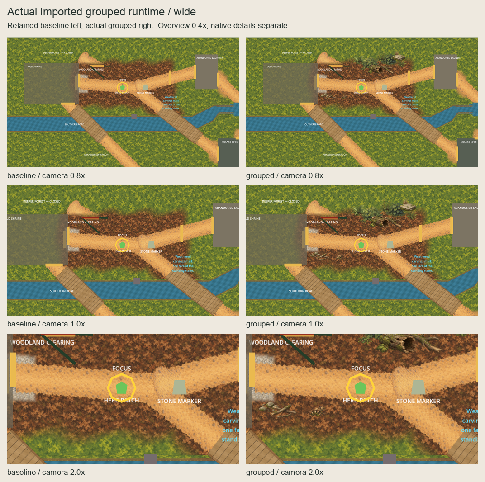
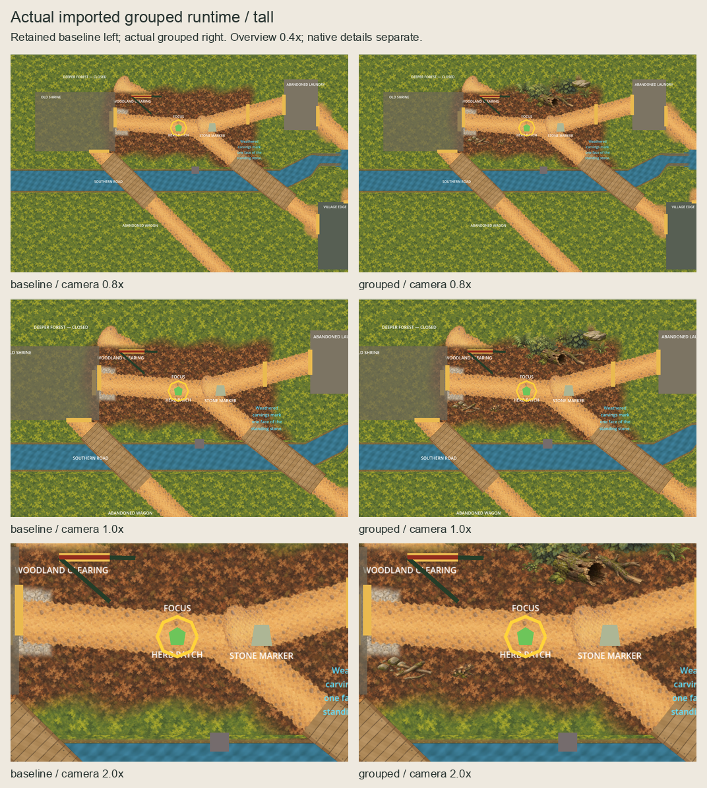
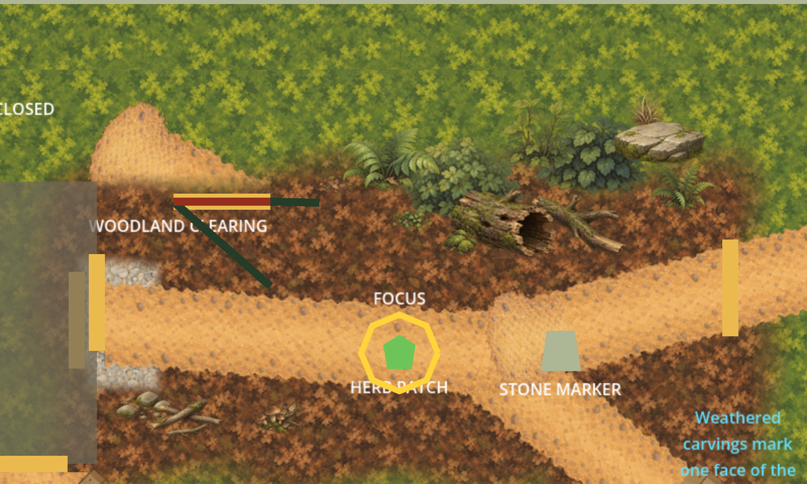
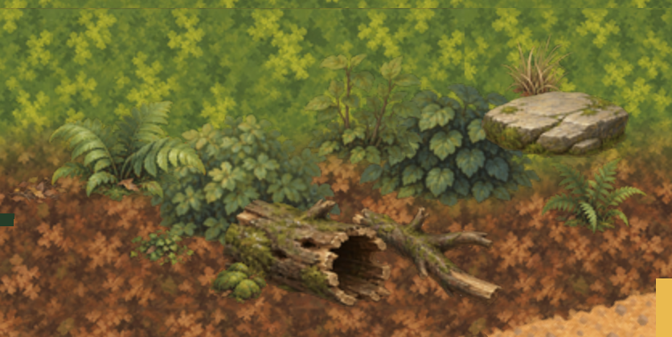
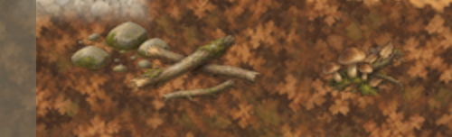

# Grouped Woodland Clearing dressing runtime promotion

The owner selected grouped and approved the exact sixteen-placement
[named scope](../woodland-clearing-dressing-runtime-scope/owner-approval.json) on
2026-10-06. Artwork, arrangement and installation approval are closed decisions.
[Authorization](authorization.json) freezes the actual starting published main
`6775f6730361596fcfb3e98a44be36cf355f2675` and its 8,323-file baseline.

Sixteen approved native PNGs and their editable 2x OpenRaster masters are copied
unchanged into production, isolated proof and independent runtime ownership.
Inventory is 113 assets / 64 masters. `WoodlandClearingDressingPresentation` owns
sixteen childless/script-free sprites at the scope's exact origins, native dimensions,
pivots, effective z=-60, filtering and draw order. It adds no collision, navigation,
interaction or discovery authority. All previous scene blocks and WholeChannel's
final-child position are preserved; every prior asset/master/import remains exact.
The new C# smoke activates only through its explicit check environment variable.

Source-specific validation preserves tightly cropped approved alpha edges and exact
hidden RGB counts. Thirty-two imports are independent, lossless, mipmap-free and
retain exact RGBA without alpha-border fixing, premultiplication or resizing. Empty-
cache verification decodes all 32 imports exactly and independently regenerates all
sixteen disposable proof UIDs. Original generic validators and closed inventories
remain unchanged and run in their terminally accepted historical checkouts;
`quality.sh` retains all inherited checks alongside the new closed runtime validator.

[Final verification](verification.json) records fresh product formatting/build,
5,033 tests, scenario, all inherited/new Godot smokes and graphical startup passing
with zero build warnings/errors. The exact host Godot remainder passes after recorded
sandbox user-log/editor-settings failures. Fourteen finite rejection probes pass.
[Code and visual review](session-review.json) is complete; initial tool/command attempts
are retained alongside the reviewed fixes and their fresh scoped verification.

All eight actual imported runtime views and eight paired baselines match the selected
external RGBA exactly. All 151 retained owners are identical. Full native rectangles
plus 2px filtering margin clear the retained raster masks; continuous route clearance
is 3.350px beyond the retained 48px half-corridor. GPU changes remain wholly inside
approved footprints. [Series bindings](series-bindings.json) freeze every capture and
review image. Root actors/HUD are hidden and controllers frozen only in the disposable
capture harness, using the selected external startup and camera recipe.

The owner [confirmed the complete exact actual-runtime series](owner-runtime-acceptance.json)
on 2026-10-06 and instructed us to finish and move to the next slice. This terminal
acceptance closes artwork, grouped selection, named scope and actual-runtime views;
historical pending verification/review metadata is superseded. Reviewed direct-main
publication is authorized under the standing instruction. Do not reopen unchanged
approvals. Retained baseline/sparse/grouped and failed-attempt evidence is immutable.
Human accessibility, pacing and terrain completeness remain open.








```sh
python3 scripts/validate-woodland-clearing-dressing-runtime.py --check-rejections
python3 art-direction/production-proof/corrected/tools/build_woodland_clearing_dressing.py --check
python3 art-direction/woodland-clearing-dressing-runtime-promotion/review.py --check
```
